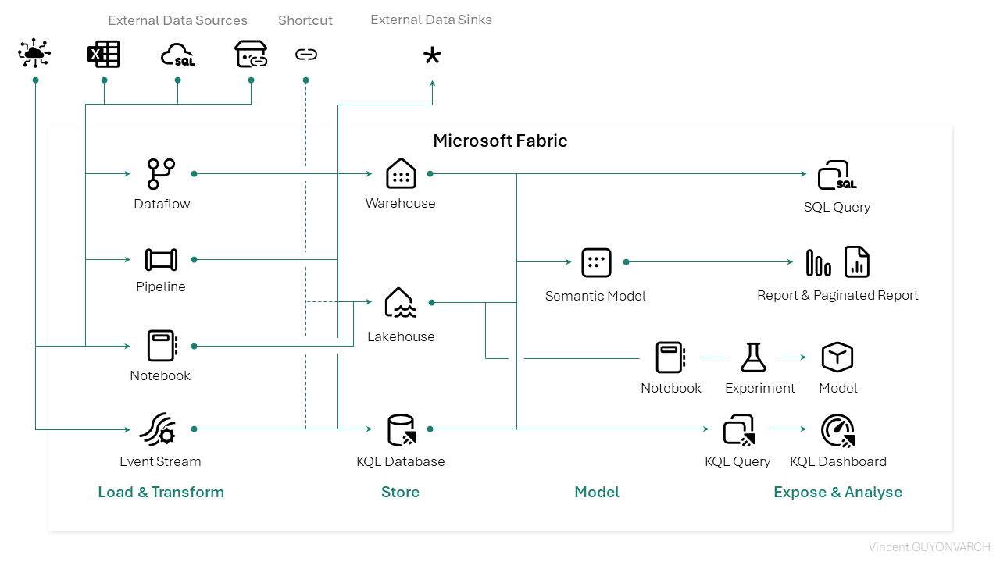
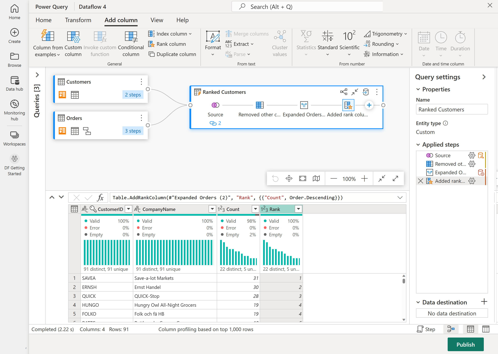
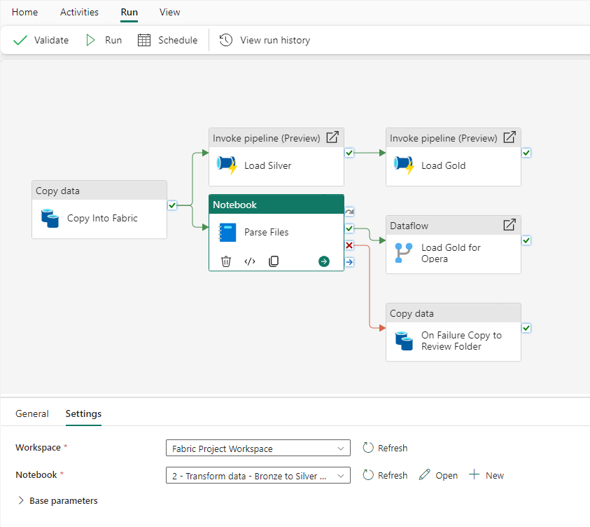

## Introduction

L'objectif de cette série d'articles est d'étudier les différentes possibilités que nous offre la nouvelle plateforme multi-service de Microsoft Fabric, et d'apporter des axes de réflexion pour définir nos architectures. Face à un objectif fonctionnel précis, le **défi** consiste à **choisir l'outil** le plus **adapté** : en apportant plusieurs outils pour y répondre, les décisions peuvent paraître difficile à prendre.

En présentant les différentes solutions, nous allons comparer leurs fonctionnalités, identifier leur points forts et permettre ainsi de nous guider dans nos choix. Pour y arriver, ces briques seront divisées en **plusieurs grandes familles**, en gardant à l'idée que notre but est de monter une plateforme de données sur laquelle appuyer nos analyses. Voici les étapes que nous allons parcourir :

-   **Première** partie : La **transformation** ou **l'acheminement** des données au sein du service, c'est l'objet de cet article ;
-   **Deuxième** partie : Le **stockage** et **l'historisation** de ces données ; à retrouver dans une deuxième partie,
-   **Troisième** partie : La **modélisation** et la **restitution** de ces informations ; enfin à retrouver dans une troisième et dernière partie.

Voici une vue alternative de l'organisation des services Microsoft Fabric : il représente les associations entre les services, et leur compatibilité. Pour ce premier article, nous nous focaliserons sur la partie **Load & Transform**.

*Vue alternative des compatibilités entre les services Microsoft Fabric. J'ai choisi de garder les noms anglais car je trouve qu'ils désignent une idée d'une meilleure manière que leurs traductions françaises.*

## L'extraction de données

C'est la première étape dans la chronologie de notre data platform. Dans le diagramme présenté plus haut, **4 éléments permettent** d'intégrer nos données. **3 solutions** d'intégrations sont **agnostiques** du cas d'usage, et dépendent de la **philosophie envisagée** : le dataflow, le pipeline et le notebook. Ces trois éléments permettent tous de se **connecter** à un service, un endpoint, une base de données, un ensemble de fichier, d'y appliquer des **transformations**, et **d'écrire** ces informations au sein d'une solution de stockage. Les pipelines ainsi que les dataflows permettent même d'écrire en dehors de Microsoft Fabric via des connecteurs intégrés au service.

### 1 - Les développements *Low-Code*

Lorsque l'on tente de traiter des problématiques métiers et d'aller rapidement à destination, c'est à dire à l'analyse de nos données, il est possible d'utiliser un **dataflow** : la nouvelle génération du module nous permet désormais d'intégrer des données autrement que dans un dataset : il est possible d'écrire dans un *Lakehouse* (stockage de données orienté fichiers) et dans un *Warehouse* (orienté tables et vues). C'est via l'interface Power Query, déjà disponible dans Power BI Desktop, que l'on peut définir un format de **données structurée** : le but est de définir les règles fonctionnelles qui vont générer une ou plusieurs tables.

##### Les avantages

L'atout principal, est que c'est l'alternative la plus **simple à prendre en main** lorsque l'on démarre avec la transformation de données : les dataflows nécessitent très peu de code pour **réaliser des actions simples**, et ils sont largement adaptés à une population de **développeurs métiers**, appelés *citizen developpers*. Cette méthode de développement permet de faire des traitements au détail de la ligne, comme des filtres ou des colonnes calculées. Attention : par expérience, la simplicité et la facilité de déploiement rime généralement avec **manque** de respect des **bonnes pratiques**, et **consommations** de **ressources** trop **importantes** : les dataflows, ouverts à trop grande échelle, peuvent apporte de la congestion sur les capacités Fabric.

##### Les inconvénients

Ils résident dans le manque de possibilités offertes : le low code **limite** forcément **le paramétrage**, il faudra définir une requête pour chaque structure (ou table) désirée et leur paramétrisation n'est pas large. Aussi, pour ce qui est des requêtes indirectes (comme les APIs avec token) n'est pas possible : toutes les sources de données doivent pouvoir être testées directement à la publication (au-delà du danger de stocker les informations d'authentification au sein d'un paramètre). Pour ce qui est du format, le **contrat d'interface** entrant et sortant est **garanti** par le **flux**, et il ne sera pas possible d'être hors d'un format structuré et défini.

Ce service peut toujours être orchestré à un temps donné, mais sa paramétrisation reste limitée. Un dernier inconvénient ici est celui de la scalabilité : très peu d'options sont disponibles par rapport aux autres services pour y apporter plus ou moins de ressources ou de parallélisme.

*Exemple de dataflow et sa visualisation par étapes horizontale, les différentes requêtes et le profilage des colonnes.*

##### Les cas d'usages

Les dataflows seront présents dans le cadre de développements métiers, destinés à des transformations de données et des volumétries **raisonnables**, à destination d'un **format** de données **structuré**. S'il on veut aller plus loin dans les développements, il faudra se tourner vers un autre module, autrement ils alourdiront les process et la charge de calcul nécessaire pour arriver à un même but.

### 2 - Une modularité et une réutilisation importante

Profitant d'une interface à boutons, les **pipelines** au sein de Microsoft Fabric héritent directement des fonctionnalités d'Azure Data Factory (ADF). Ce service **d'intégration** et **d'orchestration** permet d'organiser des activités pour copier et transformer des données d'un point A vers un point B avec une grande modularité, et c'est cette modularité qui fait sa force.

##### Les avantages

Deux types d'activités existent : les **activités internes** (facturées à la quantité de ressources par unité de temps utilisées), ou les données transitent via le pipeline (donc au sein de Fabric) pour être transformées et copiées, et les **activités externes** (facturées au nombre d'activités exécutées), ou Fabric ne joue ici que le rôle d'horloger, pour appeler par exemple une API, un notebook ou un jar Databricks, un script ou procédure SQL, voire même un autre pipeline. Chaque activité peut être paramétrée, être répétée ou arbitrée par des boucles et des tests. On peut donc imaginer un flux de travail qui pourra être réexécuté plusieurs fois et servir à plusieurs cas fonctionnels, et ainsi éviter la multiplication des flux.

Les pipelines profitent des wildcards (ex : "*Folder/**\***.csv*") pour éviter la multiplication des activités et ainsi réduire les coûts en traitant un ensemble de fichiers dans une même activité. Aussi, on pourra réutiliser le même flux pour traiter plusieurs contrats d'interface. Ils permettent de proposer une méthode simple pour transformer les formats de fichiers, par exemple du *.csv* vers *.parquet*.

##### Les inconvénients

Pour l'instant, le service ne propose pas de transformations à la ligne comme on pouvait le trouver dans les ETL/ELT classiques. Les transformations à la ligne se font nécessairement hors des pipelines (SQL, Notebook, Dataflow ...). Les *mappings dataflows* qui existaient dans ADF ne sont pas disponibles, et ne permettent donc pas d'enchaîner et d'exécuter des transformations à la ligne, de gérer des logiques d'insertion/mise à jour type Slow Changing Dimensions, comme on pouvait trouver dans ADF, ou encore dans les mappings Informatica ou Talend. Rien ne laisse à penser pour l'instant que ce service apparaîtra dans Microsoft Fabric, il faudra suivre la roadmap [ici](http://aka.ms/fabricroadmap).

On peut aussi noter une prise en main du langage de paramétrage quelque peu verbeuse et compliquée pour démarrer, vis-à-vis d'un code python.

##### Les cas d'usage

Les pipelines permettent **d'écrire** dans **tous les modules de stockage** de Microsoft Fabric. Dans la plupart des projets il servira à une **première** **phase** d'ingestion et de **copie** de données provenant de l'extérieur comme dans une architecture médaillon ou l'on souhaite copier la donnée telle qu'elle est extraite. Les pipelines serviront aussi par la suite d'**ordonnanceur** : même s'il n'est pas utilisé pour transformer des données, il restera l'outil de **référence** pour **orchestrer** les différents modules d'une chaîne d'intégration, et sera difficile à écarter.

*Exemple de flux d'orchestration au sein d'un pipeline dans Fabric*

### 3 - Des développements spécifiques et avancés

Microsoft Fabric propose une expérience ***Full Code*** avec les notebooks. S'appuyant sur un environnement **Apache Spark**, ces notebooks peuvent mêler Scala, Python et SparkSQL pour développer au sein d'une même interface la **transformation** de données. Ces notebooks pourront être retrouvés plus tard dans une logique d'expérimentation et de développement de Machine Learning.

##### Les avantages

Les cas d'usages ici sont **sans limite** : l'association du Spark avec l'ensemble des librairies disponibles, et même l'intégration de **Copilot** pour l'aide à la génération du code, ou encore d'une librairie **Open AI** pour enrichir les traitements et la catégorisation des données par exemple, permettra d'arriver à bout de toutes les règles de calculs et d'intégration nécessaire à la mise en place d'une plateforme de données exigeante. L'usage du Spark permet aussi d'utiliser des méthodes modernes de gestion de données, et vise à alimenter des structures à destination du Lakehouse avec le format delta.

Les notebooks seront exécutés au sein d'un environnement Spark **démarrés** **à la volée**, sans reposer sur un cluster ou un service à démarrer au préalable : c'est la capacité Fabric qui permettra de jouer le rôle de cluster. Au sein de ces sessions de travail, différentes librairies et packages pourront être installées pour enrichir les langages Python ou Scala et profiter d'un SDK pour simplifier le développement du code. Ces **environnements** peuvent être **préchargés** par ces différentes bibliothèques et être mutualisés et réutilisés.

Pour simplifier l'expérience de développement, il est possible de lier un espace de travail avec **Visual Studio Code** pour développer en dehors du service Web et éviter les problèmes de synchronisations qui existent aujourd'hui sur le portail.

##### Les inconvénients

Du fait de l'expérience full code, ce n'est pas une technologie qui pourra être prise en main sans faire l'effort de s'alimenter par des formations et de la documentation. Néanmoins et via les modèles AI d'assistance au développement, cette montée en compétences est accélérée.

Aussi, le réglage des environnements Spark & du compute sera nécessaire pour améliorer les performances des développements et l'exécution du code. C'est là que réside la complexité d'utiliser Apache Spark au sein d'une chaîne d'intégration : c'est une bonne idée d'avoir dans une équipe de développeur une personne avec de l'expérience pour développer de manière efficace en Spark et éviter les goulots d'étranglement dans la parallélisation des flux et des tâches.

##### Les cas d'usages

Les notebooks sont l'outil principal des équipes Data Engineering ou Data Science. Ils permettent de réaliser les traitements de données automatisés et aussi de développer plus tard des modèles d'analyse et de machine learning, grâce à l'ajout de librairies.

Les sorties sont elles aussi illimités, mais au sein de Fabric, la philosophie associée aux notebooks visent à faire atterrir les données au sein du lakehouse, dans une architecture médaillon, avec des formats et des structures de données qui pourront être évolutifs, puis à terme dans les tables **delta**.

### 4 - Le traitement de données en temps réel

Pour ce qui est du 4ème, **l'event stream**, il permet d'adresser les cas d'usage de traitement de données en temps réel. C'est grâce aux Event Stream qu'une plateforme de données sera capable d'ingérer des données en temps réel au sein du service Fabric.

L'interface de gestion du flux a pour rôle de simplifier l'intégration de données, en validant le contrat d'interface et les connexions entrantes (depuis une source capable d'émettre des données en streaming) vers une base de données d'analyse temporelle : une *KQL Database*.

### Les solutions écartées

Nous avons omis volontairement la partie Streaming Dataflow et Datamarts, car ils ne sont soit plus supportés par Microsoft Fabric, soit trop isolés dans la logique d'une plateforme de données globale. Aussi, pas de distinctions faites entre Dataflow et Dataflow Gen 2 : Les dataflows permettent uniquement de charger des données à destination d'un dataset, et aujourd'hui encore la philosophie est d'unifier les données en amont.

## Conclusion

Même si l'interface de Microsoft Fabric donne l'impression d'apporter plusieurs outils pour faire la même chose, les différentes briques proposées présentent bel et bien des différences qui peuvent justifier l'utilisation de l'une ou de l'autre selon le cas d'usage et la philosophie de l'équipe de développement. Du novice à l'expert en data engineering, la transformation des données peut être réalisée de différentes manières, et présente ses avantages et ses inconvénients.

-   Les **dataflows** adresseront les citizen developers pour démarrer un projet et transformer des données provenant de fichiers plats rapidement et via une interface à boutons,
-   Les **pipelines** permettront d'orchestrer les étapes du traitement de données et d'ingérer des données au sein de Microsoft Fabric. Ils sont grandement paramétrables, et permettent de traiter à grande échelle des ingestions de données,
-   Les **notebooks** peuvent adresser des cas d'usages sans limite, en développant les transformations et le raffinement des données au fur et à mesure des étapes de la plateforme data,
-   Les **event streams** s'adressent à un cas d'usage bien précis pour proposer une interface pour associer une source de données qui produit des informations en temps réel, et une base de données KQL, destinée à des analyses temporelles.

Pour faire son choix, ce sont les connaissances de l'équipe, les volumes, le format et la manière dont les données seront stockées qui vont définir les technologies utilisées. Ces choix dépendent grandement de la manière dont les données seront structurées et stockées, et donc du module choisi : c'est l'objet de [la seconde partie](/2024/03/20/architecture-fabric-part-2-storage/).

A première vue, le manque de confiance dans le monitoring et le fait que le produit soit récemment sorti nous limite pour nous orienter : il manque des premiers retours d'expérience pour dresser cette architecture. Le point positif, c'est qu'à l'inverse d'une architecture avec plusieurs solutions, Microsoft Fabric propose des alternatives : une refonte de l'architecture n'entraînera pas une requalification des technologies, ou de s'assurer qu'elles sont compatibles et performantes.
