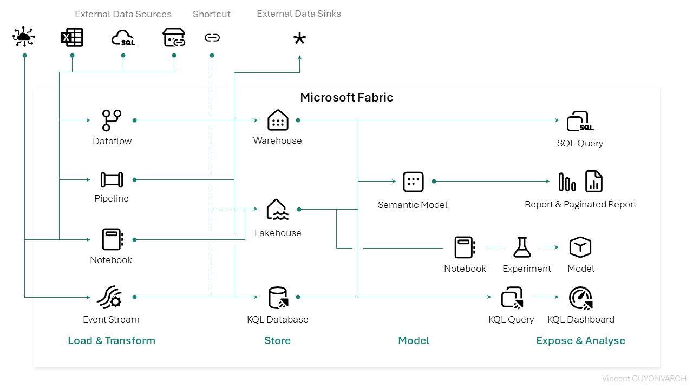
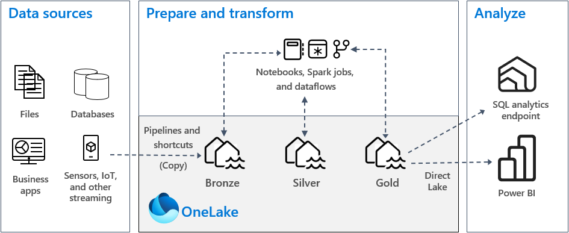

## Introduction

Cet article est la deuxième partie de cette série concernant les choix d'architecture au sein de Microsoft Fabric. Il a pour objectif de détailler les solutions de **stockage** et **d'hébergement** de données du service.

Voici à nouveau une vue alternative des services Microsoft Fabric : il représente les associations entre les services, et leur compatibilité. Pour ce second article, nous étudierons la partie **Store** :

*Vue alternative des compatibilités entre les services Microsoft Fabric. J'ai choisi de garder les noms anglais car je trouve qu'ils désignent une idée d'une meilleure manière que leurs traductions françaises.*

## L'hébergement et le stockage de données

C'est la seconde étape dans la chronologie de notre data platform, et c'est celle qui est plus importante : elle est au centre des problématiques de sécurité, de performances, et définie la structure et la philosophie de travail au sein de la plateforme de données. Dans le diagramme présenté plus haut, **3 éléments permettent** d'historiser et de stocker nos données. 2 solutions sont dédiées au stockage de données et à une analyse d'historiques que sont le Lakehouse et le Warehouse, et 1 solution est dédiée à l'analyse temporelles de données.

Avant de choisir une technologie ou une autre en fonction de ce que l'on va vouloir faire, il faut d'abord comprendre la base technique sur laquelle repose ces données : la couche **OneLake**.

### 1 - OneLake : Le datalake central de Microsoft Fabric

Comme son nom l'indique, c'est un **Data Lake**, construit sur la technologie Azure Data Lake Storage (ADLS Gen 2), qui a pour but d'être **transverse** à toute l'entreprise : **un seul point de stockage** pour tous les cas d'usage. Il est initié pour toute l'entreprise : chaque *tenant* ou environnement possède **1 et 1 seul OneLake**. Autrement dit, chaque entreprise ayant initié un environnement Fabric possède une seule instance OneLake, permettant à tous de collaborer, d'enrichir, ou d'utiliser la data platform, selon les accès définis.

La **séparation** des environnements et le cloisonnement de OneLake se fait alors par **workspaces** : chaque workspace associé à une capacité sera responsable des accès et du coût associé à l'hébergement des données. OneLake permet une ségrégation des informations avec des technologies homogènes, permettant ainsi de structurées les données comme des produits, et de responsabiliser les différentes entités fonctionnelles de l'entreprise, responsables de la qualité de leurs données, dans une logique **Data Mesh**.

Tout élément stocké au sein de Fabric est physiquement hébergé dans OneLake, peu importe la technologie choisie.

#### Tarification

Le prix du **stockage** des données est agnostique de la technologie, et est calculé **par mois et par Go**. Ce prix varie selon la région souhaitée, par exemple en *France Central* il est de 0.022 €/Go et par mois pour les données enregistrées à froid. Si le cas d'usage envisagé nécessite une analyse en temps réelle, et qu'on choisit de stocker les données au sein d'une KQL database (détaillé plus bas), un **cache** est nécessaire à la performance, et le stockage à chaud coûte 0.23 €/Go et par mois. Enfin, une méthode de **haute disponibilité** (appelée BCDR, *Business Continuity and Disaster Recovery*) est disponible en **option** sur le service et permet ainsi, dans le cas où une région Azure est indisponible, de faire une bascule sur une région appairée. Cette bascule opère une réplication des données, qui engendre un surcoût de 0.0399 €/Go et par mois.

Cette tarification est à prendre en compte en plus du prix du service Fabric : la capacité et son coût est calculé en CU(s) (Unité de Capacité par secondes), et toutes les opérations (rafraîchissements, flux de données, réseau (V-NET Gateway), Copilot), consomment des ressources au sein de cette capacité de calcul sans surcoût. Pour le stockage c'est à part, et il faut donc compter le stockage dans la tarification d'un projet. La documentation de la tarification laisse entendre que la partie Réseau sera facturée indépendamment des CU (s).

Voici un tableau permettant d'avoir un aperçu du prix à froid d'une plateforme selon les volumes :

| **Volume total des données** | **Prix Par Mois (France Central)** |
| --- | --- |
| 100 Go | 2.2 € |
| 1 To | 22.528 € |
| 10 To | 225.28 € |
| 100 To | 2 252.80 € |

Maintenant que le socle de stockage des données au sein de Microsoft Fabric est défini, il faut choisir une méthodologie de travail pour héberger ses données et les mettre à disposition des projets et des cas d'usages.

### 2 - Le Lakehouse : La plateforme de données moderne

##### La structure

Le Lakehouse est un service de stockage permettant d'historiser des données non structurées, semi-structurées ou structurées. La logique principale vise à faire atterrir les données dans le Lakehouse via un pipeline, puis d'y transformer les données via **Spark** : c'est la technologie **principale** de transformation des données au sein du service. Le Lakehouse se divise en deux parties :

-   La partie **Fichiers**, porte d'entrée du Lakehouse. Ces fichiers sont organisés par répertoires et selon une arborescence pour en faciliter la gestion. Au sein de cette partie, les données peuvent être stockés dans n'importe quel format. Il faut voir cette partie Fichiers comme une couche intermédiaire permettant de raffiner et préparer les données destinées à être déversées dans la partie Tables.
-   La partie **Tables**, stocke elle les données au format Delta. Cette surcouche open source permet aux fichiers Parquet d'être enrichis d'un journal de transaction, similaires à ceux d'une base de données, pour permettre à ces fichiers parquets de passer du mode "append only" à la mise à jour et à la suppression des données au sein de ces fichiers. Il profite alors du modèle open source des fichiers parquets, de la logique de compression des données, et propose une méthodologie d'optimisation et de suivi que l'on retrouve dans une base de données, et garanti le caractère ACID\* des transactions.

*(\*) ACID, pour rappel, c'est l'Atomicité (garantir qu'une transaction est réalisée entièrement ou est annulée, pas de validation partielle), la Cohérence (s'aligner avec les règles définies dans le modèle de données), l'Isolation (permettre aux activités concurrentes de consulter la base sans observer de transactions partielles), et enfin la Durabilité (faire persister les données dans une solution de stockage pérenne dans le temps, résiliente aux pannes et aux arrêts de services).*

##### L'architecture en médaillon

La couche Lakehouse vise à organiser les données selon la logique dite en Médaillon, organisées en plusieurs couches :

-   La couche **Bronze** sera implémentée dans la partie Fichiers du Lakehouse et permet d'historiser les données brutes sans porter atteinte au format ou aux données, et de mettre à disposition ces données aux couches suivantes.
-   La couche **Silver** elle peut être stockée dans la partie Tables, et ainsi bénéficier directement du format Delta présenté plus haut. C'est ici qu'on définit la structure des données la plus performante, et qui représente les règles techniques des données de l'entreprise, exposant une seule version de la vérité. C'est depuis cette couche que les projets vont être développés, exposant ainsi des valeurs cohérentes.
-   La couche **Gold**, spécifique à chaque projet, permet alors de n'exposer que les données nécessaires à chaque projet. Selon les cas d'usages, elle sera exposée au sein du Lakehouse ou en dehors. Chaque projet construit une vue fonctionnelle dédiée dans la couche Gold, et d'y implémenter ses règles métiers. On pourrait imaginer trois projets cohabiter au sein d'un Lakehouse :
    -   Un projet Analytics reposant sur des tables Delta qui auront été préparées et transformées via Spark, analysées via Power BI,
    -   Un projet de Machine Learning nécessitant une autre partie des données, analysées en Spark avec des librairies ML additionnelles,
    -   Un projet d'intégration de données, nécessitant des données structurées, hébergées dans un warehouse.

Le Lakehouse a pour but de séparer logiquement les données selon les cas d'usages envisagés dans des couches *golds*, permettant ainsi aux différents projets de venir créer leur propre valeur sur un socle technique commun, défini au sein de la couche silver.

##### Exposition des données via Langage SQL

Dans l'article précédent, nous avons pu voir que le Lakehouse faisait office de plateforme principale au sein de Fabric, puisqu'il peut être alimenté ou exposer ses informations via les dataflows, les pipelines, les notebooks, ou encore les rapports Power BI. Enfin, lors de sa création, il s'accompagne d'un **endpoint SQL**, accessible en **lecture seule** : les données stockées dans la partie Tables peuvent être lues via le langage SQL pour en faciliter l'analyse.

##### Accès direct sans rafraîchissement au sein d'un rapport Power BI : l'optimisation v-order ?

Enfin, Microsoft Fabric vient **surcharger** le format **Delta** d'une logique appelée **v-order** : Cette instruction Spark permet alors d'organiser les données pour les rendre compatibles avec le moteur Vertipaq de Power BI, et ainsi activer la possibilité d'utiliser le nouveau mode de stockage des modèles sémantiques Power BI, le **DirectLake**. A la frontière entre Direct Query et mode Import, une fois activée, les données stockées dans les tables du Lakehouse sont directement lisibles par un rapport, sans nécessiter un rafraîchissement de la couche sémantique en garantissant des performances élevées. C'est le but ultime de OneLake, proposer une copie unique des données disponibles directement après la transformation des données dans le Lakehouse.

### 3 - Le Warehouse :

Héritier direct de la technologie Azure Synapse Analytics, le Warehouse expose les données dans des tables structurées comme une base de données. Ce moteur hérite des capacités MPP (Massively Parallel Processing) de Synapse, en distribuant les requêtes sur plusieurs nœuds de calculs pour les réaliser en parallèle. La différence entre Synapse Analytics et le warehouse est que le premier est un service PaaS, ou il faudra définir la taille du service, la manière dont les données sont hébergées et optimisées selon les distributions, et le second est un service SaaS, hautement managé par Fabric : l'utilisateur ne doit se soucier que de la partie fonctionnelle de la base données, à savoir la structure et l'alimentation des informations. Après le constat de la trop grande complexité du moteur Synapse dédié, cette couche se rapproche plus du moteur Serverless :

-   Les données sont stockées dans des **tables** organisées en **schémas**, comme dans un environnement SQL Server. L'alimentation des tables peut être fait par un pipeline ou par des instructions SQL. Le warehouse bénéficie des méthodologies COPY INTO et CTAS (Create Table As Select) pour transformer les données depuis un fichier vers une table. Ces tables peuvent être **enrichies** de **clés** primaires et de **contraintes**, mais ces contraintes **ne sont pas garanties** et **forcées** : elles permettent d'améliorer la compréhension fonctionnelle du modèle, et d'aider le moteur à établir ses plans d'exécutions.
-   Le but du warehouse est de proposer une couche SQL simplifiée, en proposant des **vues** pour abstraire la **structure** du modèle et la **complexité** des requêtes à certains utilisateurs, et des **procédures stockées** pour sauvegarder les logiques de transformations de données.
-   Les données étant virtualisées dans des fichiers au format Delta, différents du monde SQL Server, les données sont montées en cache lors de leur première lecture. Cette mise en cache prend du temps, et les performances sont largement dépendantes des statistiques sur les métadonnées des tables, et doivent être créées de manière rigoureuse pour obtenir des temps de réponses acceptables. Pour l'instant, les performances du warehouse ne sont pas à la hauteur de celles du lakehouse.
-   Pour le moment, le moteur ne propose pas la création d'indexes : il n'est pas possible de profiter d'indexes row/column stores dans le warehouse, ou d'indexer une partie de la table pour répondre à une requête en particulier.

Le warehouse répond à un usage dédié à un stockage ayant la même philosophie qu'un moteur SQL. Il n'a de sens que si les personnes qui vont l'utiliser ne connaissent pas d'autres langage que le SQL pour en transformer les données. Aujourd'hui, son principal défaut réside dans ses performances à l'usage.

### 4 - Les databases KQL, ou Eventhouse : Analyser ses données en temps réel

Une base KQL (pour Kusto Query Language, langage utilisé pour requêter les données) est une base de données orientées "Time Series" : elle a pour but d'indexer les données selon une colonne horodatée, permettant de réaliser à haute performance des analyses de données temporelles. La technologie KQL Database hérite directement du service Azure Data Explorer, et la différence réside dans la manière de gérer les deux services : une base KQL est hautement managée par les services Fabric, et la scalabilité du service n'est pas à la main de l'utilisateur. Au sein d'Azure, un service Azure Data Explorer est largement configurable : il est plus précis mais plus complexe à administrer.

Au sein de Microsoft Fabric, elle propose une interface simplifiée pour traiter des données arrivant en temps réel, exposées via des services de streaming de données. Ce n'est pas une alternative à un stockage au sein d'une structure lakehouse ou warehouse si le cas d'usage ne rentre pas dans une analyse temporelle à haute performances, ou à un traitement de données reçues en temps réel.

### 5 - Les shortcuts : Unifier ses données multi-clouds au sein de Fabric

Il est possible de représenter une solution de stockage externe comme un objet Fabric appelé shortcut : de cette manière il est possible d'accéder aux données stockées dans un autre espace de travail Fabric, hébergée dans Azure au sein d'ADLS Gen 2, ou encore dans un bucket S3 depuis Amazon Web Services. A l'avenir, il sera possible de pointer vers d'autres solutions portées par d'autres fournisseurs de service Clouds. **Quel est l'intêret ?** C'est alors **d'éviter** une **copie de données** "as is" si les données sont déjà structurées au sein d'une autre plateforme, en amont d'une transformation. Cela permet alors de limiter les transferts de données, de toujours être connecté à la dernière version proposée par la source, sans batch, et de simplifier les flux de données.

Ces shortcuts sont alors des **pointeurs** vers les données de ces différents environnements : les données ne sont rapatriées que dans le cas où le shortcut est utilisé dans un notebooks ou une requête. Une notion de cache peut s'ajouter pour permettre de stocker pendant 24h les données d'une requête déjà effectuée et ainsi éviter les coûts de sortie facturées par les différents services Clouds ([Egress/Ingress Data](https://azure.microsoft.com/en-us/pricing/details/bandwidth/)).

Les shortcuts peuvent être utilisés au sein d'un Lakehouse sous forme d'une table si les données respectent le format Delta/Parquet, et sinon sous forme de fichier si les données sont dans un autre format. Ils peuvent aussi être créés au sein d'une base KQL.

### Les solutions écartées

J'ai volontairement mis de côté le stockage au sein des datamarts, car cette solution est toujours en preview et fait doublon vis-à-vis des warehouses. C'est une solution *self-service*, qui adresse des cas d'usage de petites volumétries. Ces méthodes sont opposées à la philosophie générale de One Lake, ou le but est de proposer une copie unique des données, et donc de centraliser les informations au sein d'une plateforme centralisée et maîtrisée.

## Conclusion

La philosophie de la plateforme de données est définie par plusieurs éléments : La méthodologie qui va définir la structure et le langage utilisé pour consommer les données va décider de la technologie utilisée. Elles peuvent exister en parallèle, mais on ressent le lakehouse comme étant la technologie principale de Microsoft Fabric. On peut conclure :

-   Le **Lakehouse** propose une vue hétérogène à destination des Data Engineers, où les données seront transformées via Spark. Reposant en bout de chaîne sur des données au format Delta, le lakehouse permet de raffiner les données au sein d'une logique en couche, d'exposer les données aux projets dans des silos dédiés, et d'intégrer facilement ces données à un rapport Power BI ou une application de Machine Learning.
-   Le **Warehouse** propose expose ses données sous forme de table et propose un service SQL hautement managé pour traiter et exposer ses données. Il permet de simplifier la structure des fichiers Delta, et garantie l'usage d'une base de données sans maintenance avancée. Il est simple d'utilisation mais ses performances pour l'instant sont trop faibles pour rivaliser avec un Lakehouse si les temps de traitement et de restitution entrent dans l'équation.
-   La base KQL (ou Eventhouse) est dédiée à des cas d'usages d'analyse en temps réel, à explorer via un langage particulier appelé *Kusto*.

Ces trois technologies peuvent cohabiter au sein du service Microsoft Fabric, et proposent trois philosophies de stockage des données. Ils permettront de développer la dernière partie de cette série d'article, dédiée à la consommation et l'exposition des données.
