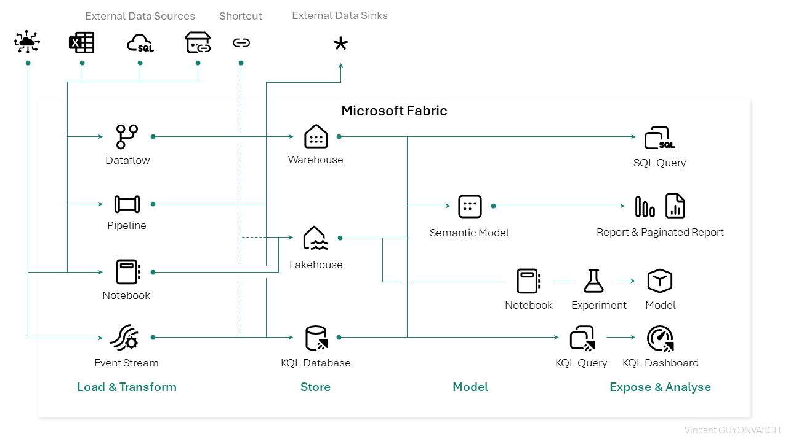
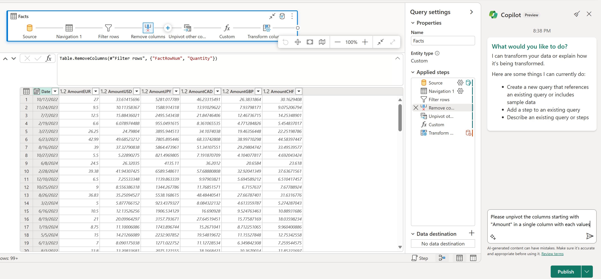
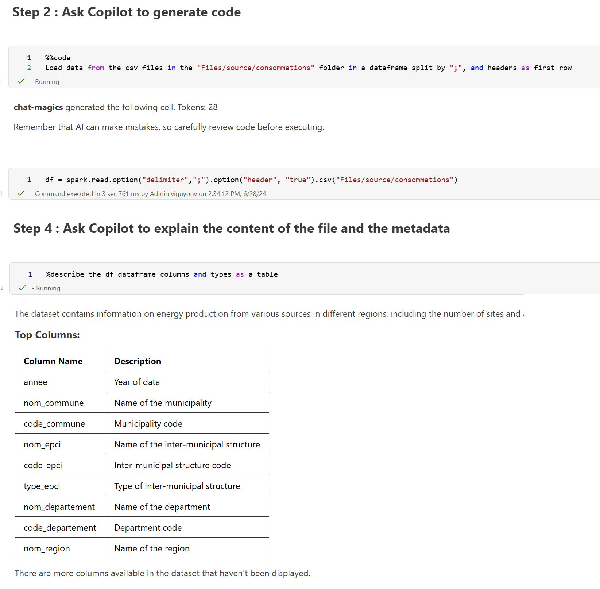
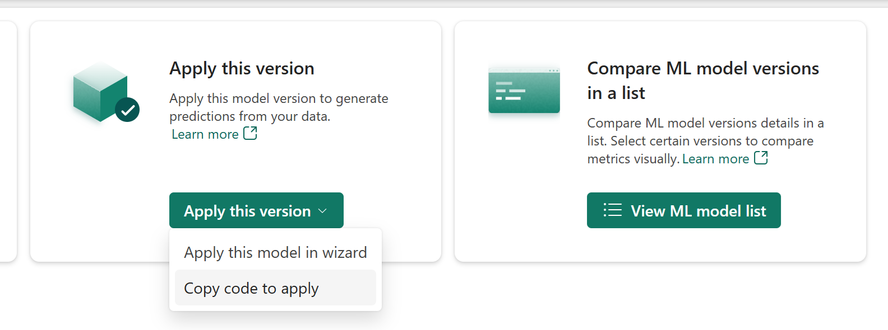
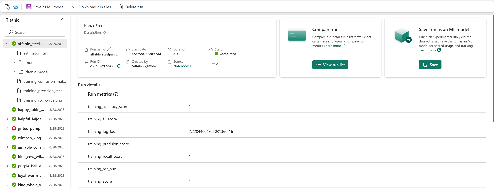

## Introduction

Cet article est le troisième de cette série concernant les choix d'architecture au sein de Microsoft Fabric. Nous avons pour l'instant étudié les différentes opportunités pour donner de la valeur aux informations brutes qui se déversent dans notre plateforme Data. Maintenant, nous devons comprendre comment visualiser et exposer cette valeur aux utilisateurs clés de l'entreprise.

Les choix d'architectures ont majoritairement déjà été faits dans les deux précédentes étapes, et ce dernier article détaille plutôt les opportunités qu'offrent Microsoft Fabric pour analyser et exposer ses données. Les méthodes de stockages auront un impact majeur sur les méthodes d'expositions disponibles.

Voici à nouveau une vue alternative des services Microsoft Fabric : il représente les associations entre les services, et leur compatibilité. Pour ce troisième article, nous étudierons la partie **Expose & Analyse** :

*Vue alternative des compatibilités entre les services Microsoft Fabric. J'ai choisi de garder les noms anglais car je trouve qu'ils désignent les idées d'une meilleure manière que leurs traductions françaises.*

## L'analyse et l'exposition des données

Cette dernière couche est cruciale : c'est elle qui porte l'image du travail accompli jusqu'ici. Les flux et les structures définies précédemment n'auront que peu d'importance si les services d'expositions ne sont pas fiables, intéressants et performants.

Les éléments décrits ci-après présentent les méthodes permettant d'exposer la valeur d'une plateforme de données à double enjeu : répondre à la fois à des **besoins définis** par un **cahier des charges** développés par des **équipes spécialisées**, mais aussi proposer une couche de données **exploitable simplement** (sans langage spécifique) et avec l'outil favoris d'un **utilisateur métier**. Pour y répondre, cette couche finale appelée *Serving Layer* doit être à la fois **performante et universelle**.

Voyons alors ensemble comment Fabric peut proposer cette diversité.

### 1 - L'analyse sémantique des données via un rapport

Premièrement, **qu'est-ce qu'un modèle sémantique ?** C'est le fait d'exposer les données techniques d'une base de données, structurée sous forme de modèle, et enrichit avec des métadonnées. L'idée est d'apporter un sens fonctionnel et des relations aux informations stockées dans une base de données. Jusqu'ici, rien de nouveau : les modèles sémantiques, ou "cubes" existaient déjà dans SQL Server Analysis Services, dans les datasets Power BI, et sont désormais dans Microsoft Fabric.

Mais que peut-on **faire de plus qu'avec Power BI ?** On pourrait s'arrêter au renommage de l'objet *dataset***\*** en *semantic model*, pour faire passer ce changement de nom pour un argument de vente : Les nouveautés apportées par Microsoft Fabric sont nombreuses, tant sur le développement que sur la performance.

Dans Power BI, bien des utilisateurs remontent des limitations concernant le déploiement d'indicateurs sans apprendre le langage DAX, et prennent parfois les datasets pour un support d'extraction ou intermédiaire a d'autre plateformes de données, or il n'est pas performant et présente de nombreuses limites lors de l'affichage de longues listes de lignes et de colonnes.

*(**\***) : Ce nom qui d'ailleurs est plus précis : un "ensemble de données" n'indique en rien le fait qu'il soit enrichi de mesures, de relations, de KPIs etc. Il laisse à penser que c'est une table prête à l'extraction plus qu'un modèle de données enrichi.*

#### Un accès aux données sans rafraîchir son modèle en Direct Lake :

En se basant sur les données du Lakehouse, les modèles sémantiques en Direct Lake exploitent les données enregistrées dans les **Tables** directement, sans nécessiter le rafraîchissement du modèle sémantique : la logique de compression orientée en colonne que l'on connait sur Power BI est transposable aux données qui sont stockées grâce au framework **Delta**, qu'on a présenté dans la partie 2, dans le Lakehouse. Les avantages sont nombreux :

-   Le modèle ne nécessite plus de mise à jour en fin de chaîne, la dernière couche de chargement du Lakehouse est suffisante : les données n'ont plus de décalage entre le batch d'alimentation et l'analyse, ce qui est présent dans les tables du Lakehouse est présent dans les rapports. Dans certains cas, une mise à jour des métadonnées est nécessaire pour assurer les performances du modèle : il y a alors une synchronisation avec les métadonnées des tables du Delta Lake.
-   Il n'y a pas de traduction du DAX en langage source, comme dans un mode Direct Query vers Snowflake, Big Query ou SQL Server.

Soit, le chargement des données via un Notebook entraîne alors un coût supplémentaire car il consomme des ressources et des CU(s), mais ce coût est économisé sur les rafraîchissements de modèles sémantiques, qui ne sont plus nécessaires.

Le prérequis est alors d'exposer ses données au sein d'un Lakehouse : dans le cadre d'un projet existant cela nécessite une réécriture pour y stocker les données dans One Lake, ou de garder les données là où elles sont stockées et de les représenter via des *shortcuts* dans Microsoft Fabric. L'innovation entraîne régulièrement un changement d'architecture, mais y a-t-il des cas ou le Direct Lake ne pourrait-il pas être utilisé ? Quelles sont les **limites** du mode Direct Lake aujourd'hui ?

-   Il n'est pas possible de faire de tables/colonnes calculées pour le moment (ce qui est une bonne pratique, car à préparer dans la partie Table dans 99% des cas).
-   Les relations sur des colonnes au format Datetime ne sont pas supportées.
-   Le mode Direct Lake est garanti lorsque les ressources utilisées sont disponibles, et que les limites sont respectées : autrement les requêtes seront [basculées](https://learn.microsoft.com/fr-fr/power-bi/enterprise/directlake-overview#fallback) en Direct Query vers le Lakehouse, ayant des impacts de performance importants. Ces limites sont axées sur les volumes, le nombre de fichiers parquet et de lignes par tables.

#### Développer au sein du service via l'expérience web

Pour s'affranchir du service Power BI Desktop, Microsoft Fabric vient renforcer l'approche sans client lourd, permettant d'être agnostique du système d'exploitation de développement. Au sein de la feature Lakehouse, on retrouve l'ensemble des données montées dans les tables, comme présenté dans la partie précédente. Toutes ces tables peuvent être représentées au sein d'un modèle, et les éditer depuis le portail web : les mesures et les relations du modèle.

#### Utiliser son modèle sémantique en Spark : Semantic Link

Le **semantic Link** c'est la capacité à utiliser un modèle sémantique dans un autre service qu'un rapport ou un Tableau Croisé Dynamique : le modèle sémantique devient une **source de données pour un notebook**, et ainsi servir des projets Data Science ou d'intégration de données à part entière. L'intérêt ici est de **centraliser les règles fonctionnelles** pour les équipes Analytics et les équipes Data Science, permettant ainsi de gagner du temps en évitant de réinventer la roue, et d'assurer **cohérence et continuité** entre les valeurs affichées de part et d'autre :

-   Lorsque les équipes Analytics définiront les règles fonctionnelles au sein d'un modèle, ces règles fonctionnelles pourront être utilisées directement par les équipes Data Science ;
-   Si l'idée est d'aller dans une logique Notebook pour utiliser les méthodes et librairies Python pour analyser ses données, l'usage du modèle sémantique développé par l'équipe Analytics permet de profiter de la couche sémantique au sein du Notebook lui-même.

### 2 - La consommation des données via requête SQL

Chaque Lakehouse et Data Warehouse s'accompagne d'un point de terminaison SQL qui permet de proposer le meilleur des deux mondes : un stockage à bas coût avec une compression élevée tout en garantissant la consommation et la structuration des données comme dans une base de données. Ce point de terminaison permet alors :

-   L'abstraction des requêtes SQL complexes sous forme de vues aux utilisateurs finaux,
-   La simplification des exports et des usages grâce à **des requêtes Visuelles** ou l'utilisateur final fait ses filtres et jointures dans une interface similaire à celle de Power Query,
-   L'enrichissement des structures de fichiers grâce au langage SQL comme la lecture des JSON, la mise en place de règles de sécurité (OLS, RLS, Dynamic Data Masking)

### 3 - L'intelligence Artificielle et l'accompagnement à l'usage avec Copilot dans Microsoft Fabric

Copilot vient s'introduire dans Microsoft Fabric de bien des manières, en s'adressant encore une fois aux populations de Data Engineer, Scientist et aux Citizen Developers :

-   Copilot pour les **développeurs** de **rapports** : Il apporte des méthodes permettant de créer des visuels, de développer des mesures DAX ou de documenter des mesures,

-   Copilot pour les **utilisateurs** de **rapports** : Ici, il joue le rôle d'assistant permettant d'analyser les données présente dans une page ou d'expliquer la nature d'un modèle sémantique exposé et de répondre à des questions,

-   Copilot pour les **développeurs** de **Dataflows** : Encore une fois il permet aux utilisateurs métiers de faire leurs transformations de données au sein de l'interface Power Query et de monter en compétences sur les étapes de la transformation de données,

-   Copilot pour les **développeurs** de **Notebooks** : Et enfin ici il permet d'assister les Data Engineers à développer, traduire, commenter, analyser le code qu'ils ont sous les yeux.

### 4 - L'industrialisation de modèles de Machine Learning

Les composants de Machine Learning reposent sur des données traitées et mises à dispositions au sein du Lakehouse. Les données sont mises à disposition pour l'entraînement des modèles aux ingénieurs ML, qui vont alors publier un ou plusieurs modèles industrialisés permettant d'être exploités quotidiennement en production.

L'utilisation du Machine Learning au sein de Microsoft Fabric repose sur deux éléments distincts :

-   Les **modèles** : C'est la version finale qui permettra de prédire ou de classer les informations à tester. C'est là que réside l'intelligence du service de Machine Learning, c'est le modèle qui porte la méthode de machine Learning adaptée à notre étude. Après avoir été **entraînés** sur un ensemble de données connues, il est déployé et utilisable via un point de terminaison ou une interface graphique. Au sein de Microsoft Fabric, les modèles peuvent avoir **plusieurs versions**, et ainsi comparer les différents algorithmes et valider celui qui collera le plus à notre échantillon de données.

-   Les ***experiments*** : C'est l'étape qui précède les modèles. Le déploiement d'un modèle de machine learning peut être empirique : pour obtenir le meilleur score de prédiction il est nécessaire de tester plusieurs opportunités, plusieurs algorithmes, écarter les indicateurs compris ou non pour obtenir le meilleur modèle possible. Ces itérations sont représentées par des exécutions au nom généré aléatoirement (*runs*), et ces *runs* sont regroupées dans expériences (*experiments*). Le but étant de pouvoir comparer les *experiments* les uns avec les autres, puis à terme les publier en production sous forme de **modèles**.

### 5- L'analyse de données en temps réel

Comme décrit dans un [article](/2023/08/02/real-time-analytics-microsoft-fabric/) précédent, Microsoft Fabric permet d'envisager des scénarios en temps réel : au sein d'un même service on retrouve de quoi ingérer les données, les structurer dans une zone tampon, les historiser au sein d'une solution dédiée, et les analyser via un rapport classique ou un rapport en temps réel.

### 6 - Alertes automatiques grâce à Data Activator

Data Activator permet d'automatiser des actions et des flux sur la base d'indicateurs, de seuils et de mouvements de données. En bout de chaîne, après avoir automatisé l'intégration de données, l'analyse sémantique et les indicateurs permettant de mesurer et de prendre des décisions, Data Activator permet de surveiller les indicateurs, et dès lors qu'ils dépassent des seuils dynamiques (vis-à-vis d'autres indicateurs) ou statiques (en valeurs, en pourcentages) de déclencher des flux d'activités comme Power Automate, d'envoyer des mails ou d'appeler des APIs.

## Conclusion

Le but de ces articles est de présenter les outils et d'apporter une vision différente en découpant les composants par étapes du cycle de vie des données plutôt que par profils d'utilisateurs (personas).

Microsoft Fabric propose une solution Data de bout en bout, de l'intégration, au stockage et à la restitution des données. L'enjeu est de réussir à proposer un outil permettant de répondre à des besoins et des populations hétérogènes avec performance et simplicité. En centralisant les services Data qui existent parfois déjà dans Azure, Microsoft Fabric permet de faciliter et d'accélérer le déploiement des projets en limitant la complexité des infrastructures. En revanche, il limite les possibilités de réglages fins. Attention tout de même à respecter les bonnes pratiques de sécurité et d'isolation lors de la réalisation de ces architectures.

Ces différentes solutions peuvent être choisie indépendamment les unes des autres, et la myriade d'outils mis à disposition peut être faite au fur et à mesure. L'axe central de cette plateforme de données unifiée reste tout de même le Lakehouse, qui permettra de composer avec un maximum d'outils dans Fabric, et d'adresser avec performances différentes problématiques fonctionnelles.
