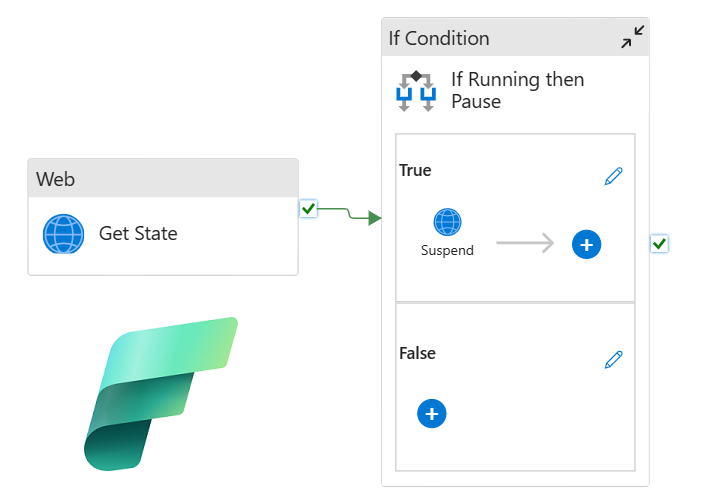
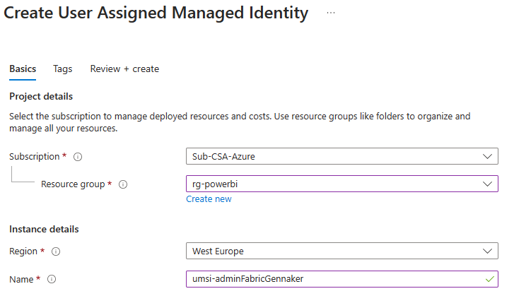
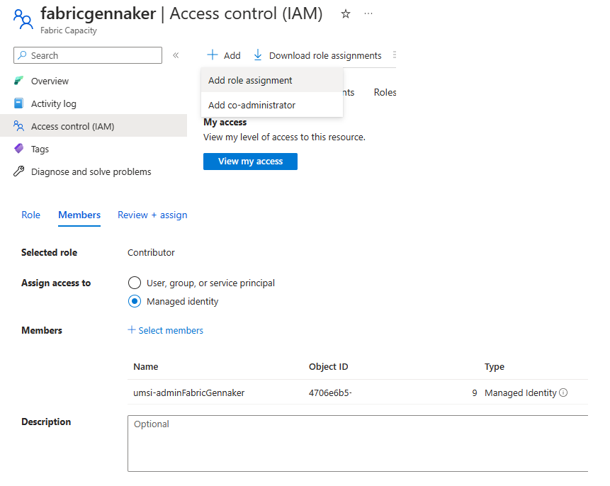
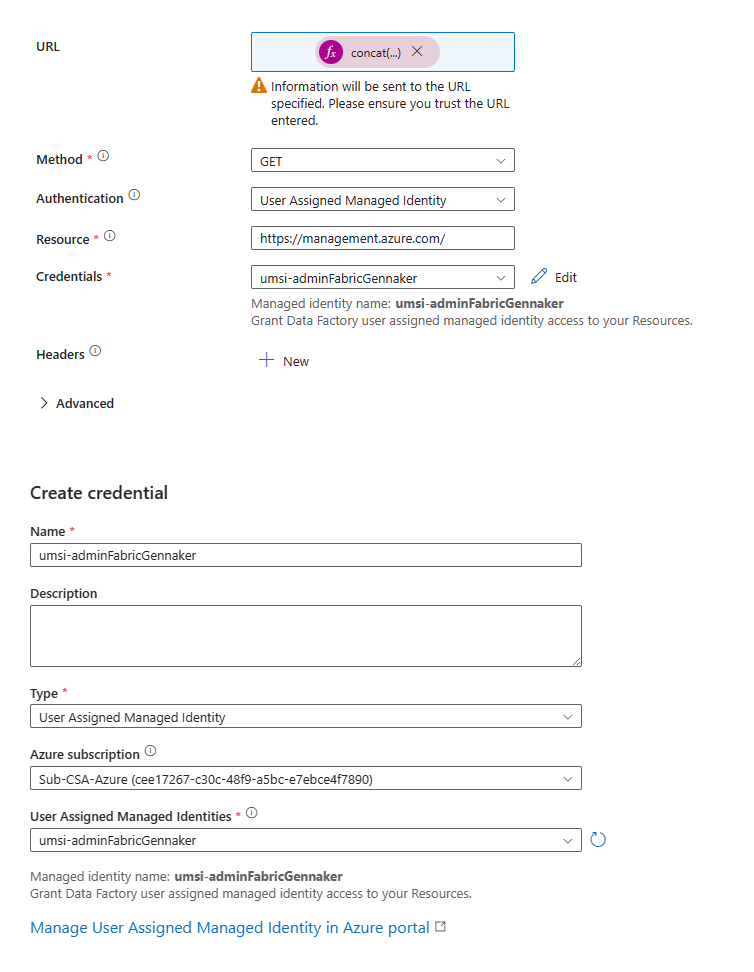
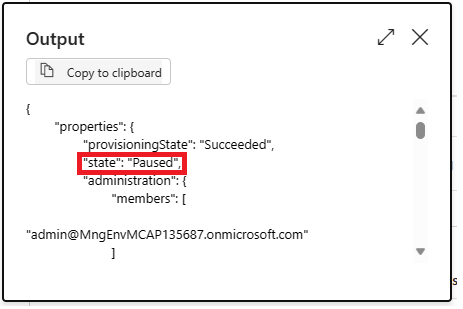
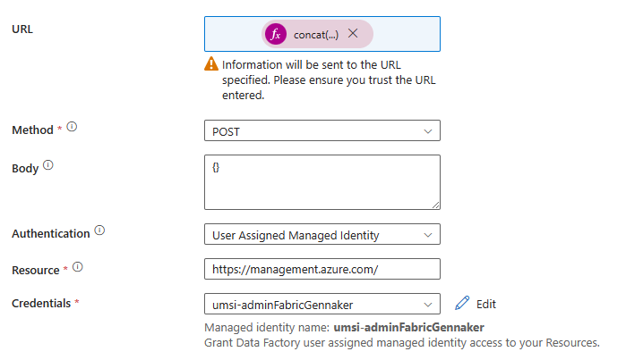
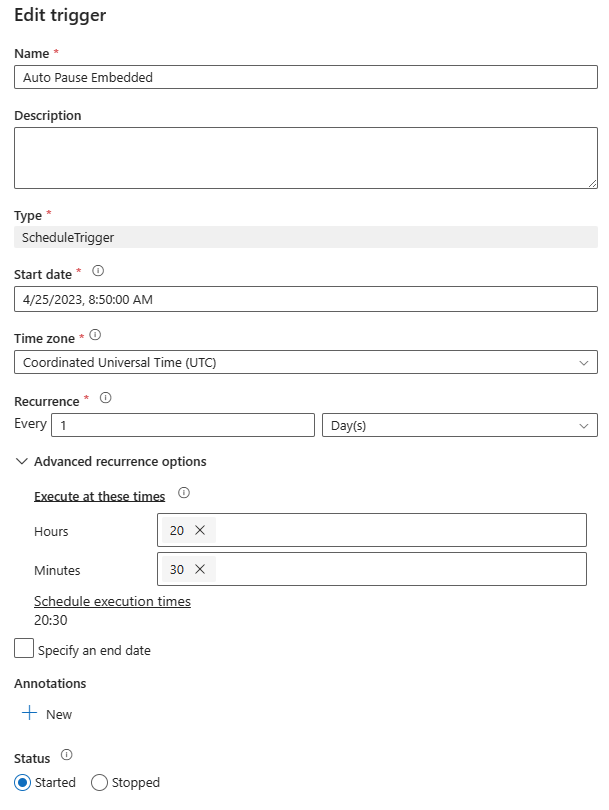

## Introduction

Il m'arrive de faire un ensemble de tests ou de démonstrations sur Fabric, et de devoir mettre en route ma capacité via le portail Azure. Une fois ma journée et mes tests finis, il m'arrive régulièrement d'oublier d'éteindre cette capacité, et de voir la **facture de ma souscription Azure gonfler**. L'idée de cette article est de proposer une solution permettant d'automatiser cette mise en pause, et d'envisager des scénarios ou l'on utiliserai une capacité Fabric seulement à certains moments de la journée, et de profiter des temps morts pour réduire les coûts de notre infrastructure.

Cette automatisation peut être faite avec n'importe quel lanceur d'API automatisable, ici, nous utiliserons **Azure Data Factory**. Evidemment, le reflèxe désormais serait d'utiliser les pipelines au sein de Fabric, mais pour cela, il faut que notre cluster soit allumé, et on se retrouve alors dans un problème "de la poule et de l'oeuf".

## Mise en place

Voilà à quoi va ressembler notre flux : Une première étape qui vise à récupérer l'état de notre capacité. Selon son retour, si la capacité est en marche, alors je la suspends. Autrement, elle est déjà à l'arrêt.



Notre premier bloc est une activité *Web*, composée comme suit : l'URL est décrite plus bas, et les credentials doivent être créés auparavant. Pour y arriver, nous allons utiliser une *Managed Identity*, pour des raisons de gestions de mots de passe simplifiés et d'accès aux ressources restreints.

##### Définition de la MI User Assigned dans Azure :

Sur le portail Azure, chercher **Managed Identities**, et cliquer sur créer :



Une fois la MI créée, **l'ajouter en tant que contributeur** sur la capacité Fabric, depuis la ressource *Fabric* (*IAM*) : attention, le rôle contributeur est dans le second menu des rôles disponibles.



##### Définition de l'activite Web dans Data Factory :



La définition de l'URL est dynamique, et réalisée comme suit :

```javascript
@concat(
    'https://management.azure.com/subscriptions/',
    'xxxxx-xxxx-xxxxx(replaceWithSubscriptionId)',
    '/resourceGroups/',
    'rg-powerbi(replaceWithResourceGroupName)',
    '/providers/Microsoft.Fabric/capacities/',
    'fabricgennaker(replaceWithFabricCapacityName)',
    '?api-version=2022-07-01-preview'
)
```

Par la suite, le bloc *if* dépend de la sortie de l'activité Web permettant de récupérer l'état de la capacité : en effet, l'API nous renvoie un **JSON contenant l'état de la capacité** :



L'activité *if* est définie dynamiquement comme suit :

```javascript
@not(equals(activity('Get state').output.properties.state,'Paused'))
```

Une fois l'état validé comme "en marche", alors une autre activité web similaire sera utilisée pour suspendre la capacité cette fois-ci :



Contenu de l'URL dynamique de l'activité Web :

```javascript
@concat(
    'https://management.azure.com/subscriptions/',
    'xxxxx-xxxx-xxxxx(replaceWithSubscriptionId)',
    '/resourceGroups/',
    'rg-powerbi(replaceWithResourceGroupName)',
    '/providers/Microsoft.Fabric/capacities/',
    'fabricgennaker(replaceWithFabricCapacityName)',
    '/suspend?api-version=2022-07-01-preview'
)
```

Une fois le pipeline défini, on peut imaginer l'usage d'un déclencheur, exécuté tous les soirs, après 20h30 pour arrêter la capacité automatiquement :


