The new Capacity Metrics App used to monitor capacity usage can raise numerous questions: the KPIs displayed and their explanations are complex.  Decrypting it requires an understanding of key concepts about executing a Power BI Report.

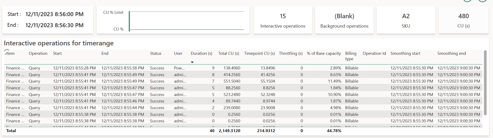

Let's begin by analyzing a Power BI report's behavior on the Desktop App and comparing it to deploying this report to a premium capacity on powerbi.com. Later, we will expand this analysis to an enterprise environment where multiple users use multiple reports at the same time.

### What does calculating report visuals involve?

Here is the report developed for our use case : A report made of one title, 2 filters, 3 cards, 3 graphs and 1 table, that makes 10 visuals in total.

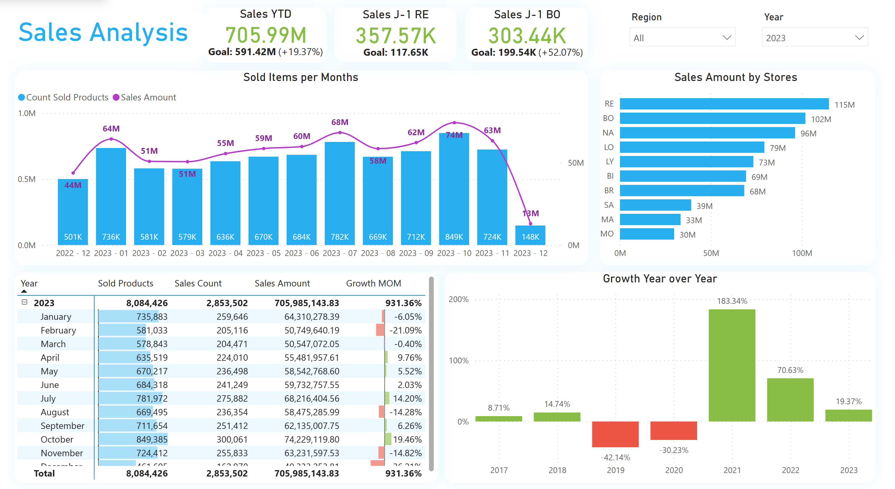

While some measures used in this report could be optimized, for demonstration purpose, large calculation will help us understand the capacity behavior.

Each report is made of one or more visuals. Visuals interacting with data or measures generate one or more DAX instructions evaluated by the Power BI Engine for display.

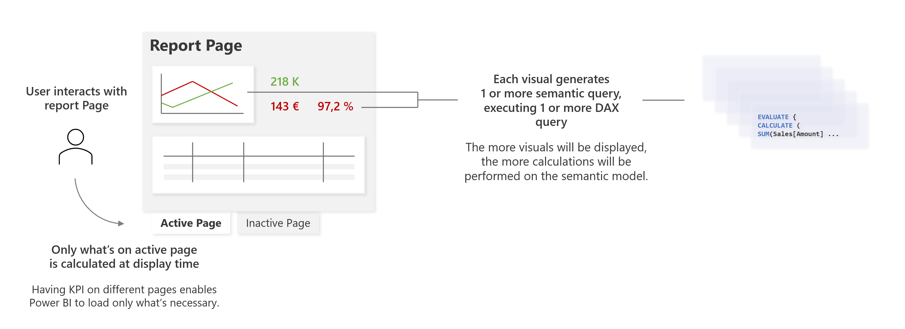

Let's focus on one single visual : Power BI sends DAX instructions to two engines, each with specific roles :

-   The first engine is the **Formula Engine** : it is capable of **translating the DAX queries** to be read by the second engine. This engine is the brain of Power BI, calculating complex queries, but executing it sequentially as it is mono-threaded.
-   The second engine is the **Storage Engine** : it's role is to interact with data (stored locally in the semantic model, or located on the data source in Direct Query). This engine can only execute **simple calculations**, trying to return aggregated data to the Formula Engine. If the query sent is too complex, then Storage Engine calls the Formula Engine back with full data (a callback), with impacting performance. This second engine can parallelize queries as it is multi-threaded.

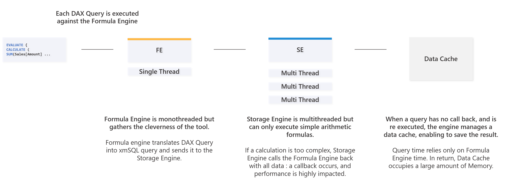

For each visual, the queries evaluation and it's execution time can be intertwined depending on the measures. The query parallelism impacts the rendering time : one user can wait 2.5 seconds to have a feedback, but the Storage Engine can parallelize 8 queries, each taking 1 second.

The critical aspect here is that in a Power BI capacity or a Power BI Desktop File, the engine working time is a sum of the calculations done, and some calculation can be parallelized : it's cost can be 8 seconds to complete, but can be displayed in 2,5 seconds.

## How to determine the calculation time and the duration of one request ?

In order to determine the calculation time of a visual, it is possible to use DAX Studio, and its query traces.

In our case, here is the collected content : we had 1 title, 2 filters, 3 cards, 3 diagrams and 1 table, 10 visuals. On these 10 visuals, only 7 generates DAX queries (title and slicers do not interact with data and measures). We have 7 DAX queries listed here :

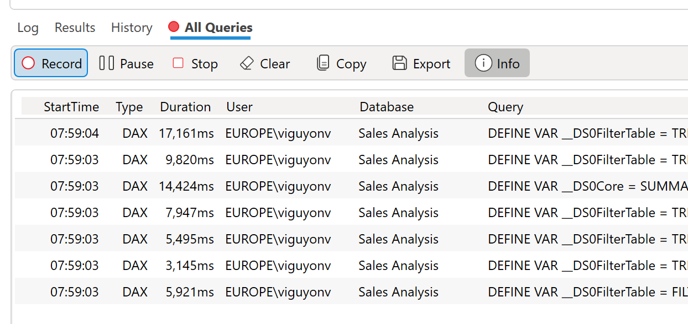

We notice that the execution time varies from 3.1 to 17.1 seconds. Let's take a query randomly from the list, and restart it : the query takes **1 837 milliseconds** (ms) **in total**. In details, we have 38 ms of Formula Engine, and 1 799 ms of Storage Engine. But the storage generates 11 queries, and can be sent parallelly with a total calculation time of 11 063 ms of calculation. This demonstrates the difference between duration time and the actual calculation time (CPU Time) for this visual.

The real cost of a query in term of milliseconds is a sum of the Formula Engine and the Storage Engine time. We can also notice that there are queries in **bold** **text**, that indicates a callback, limiting performance.

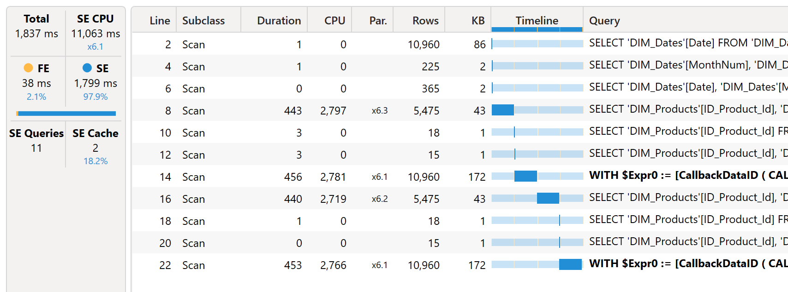

## Is it possible to obtain the calculation time and duration of the queries of a report sent to powerbi.com ?

Once the report and it's semantic model (formerly called dataset) is published to the capacity, it is possible to realize the same analysis of the execution times via [Log Analytics](https://learn.microsoft.com/en-us/power-bi/transform-model/log-analytics/desktop-log-analytics-overview). When [deploying this service](https://learn.microsoft.com/en-us/power-bi/transform-model/log-analytics/desktop-log-analytics-configure) in Azure, it is possible to get the two KPIs presented above for a specific workspace. Displaying the report on a web page triggers 7 queries, their effective duration (**DurationMs**), and their real engine calculation time (**CpuTimeMs**). For instance, one query lasts 8 188 ms, consuming 25 891 ms of CPU Time on my powerbi.com capacity.

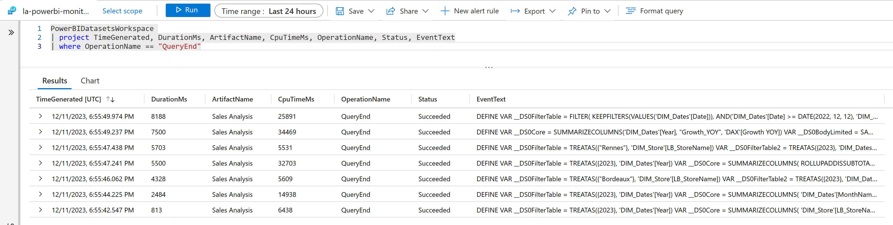

## But what is the with connection with the capacity metrics app ?

Understanding that the time an analyst waits to display a report differs from its runtime on the Power BI engine helps in interpreting the KPIs displayed on the metrics app. Here, we've only focused on the report's display time, not its data refresh. Report **usage** are considered as **interactive** operations, while semantic model **refresh** are considered as **background** operations. This article focuses only on **interactive operations**. Here's what occurred on the capacity receiving these queries :

The table at the bottom displays at the semantic model level two indicators : CU (s) and Duration (s).

-   **CU (s)** translates the real cost of execution time in seconds called **Capacity Units**. It remains consistent from one capacity size to another : in other words, the SKU chosen has no impact of the CU consumed by a given query. What is important is the **quantity of available resources** for all queries, and with this the possibility to **evaluate more queries at the same time**. A bigger SKU will provide more CU at the same time. If we want to be more precise about this unit, the CPU time displayed in Log Analytics is 62.5 times the CU for each queries : ***CPU (ms) = 62.5 \* CU (s)***.
-   **Duration (s)** is the total waited time to display the visual, summing the time spent waiting for the visuals of all reports connected to this semantic model to display.

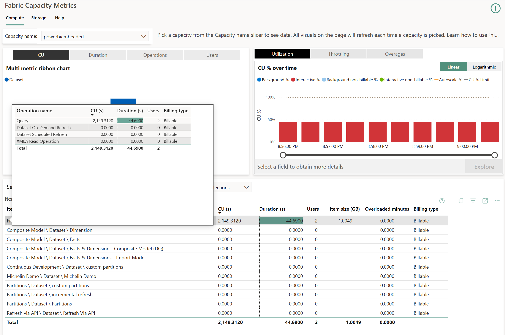

In the top right corner, a diagram displays **Background** (blue bars) and **Interactive** (red bars) queries one on top of the other. In our case, we will find one bar per 30 seconds blocks : the quantity of consumed resources is evaluated per batches of 30 seconds to ease the analysis of the capacity. It is possible to zoom in on each blocks, called **Timepoints** by selecting one and chosing **Explore**.

On these Timepoints, we will find the 7 queries again with their rounded durations. Each line with a duration above zero represents a query generated by a visual observed either on DAX Studio or Log Analytics. **The number of listed lines is related to the number of visuals displayed across reports** **accessed by all users in a capacity**. This highlights the **importance** of using Fabric & Power BI capacities with **optimized semantic models** and clear governance methods.

Each rows corresponds to a query generated by a visual executing DAX. The query starts at the **Start time** and ends at the **End time**, represented by the **Duration (s)** column. This elapsed time represents the actual wait time for that specific visual. Queries consume CPU time translated as CU (s) on the capacity, displayed in the **Total CU (s)** column. This is where is becomes more complex : introducing the concept of **Smoothing** : to prevent usage peaks during report display and smoothen usage over time, when a query completes, it's divided into 10 equal parts and split on the 10 Timepoints (lasting 5 minutes, with each Timepoint lasting 30 seconds) The consumed value is displayed in the **Timepoint CU (s)** column. This explains **why the same query appears in the following 10 Timepoints, even if it executed earlier**. The **Smoothing Start** & **Smoothing End** columns indicate when the query starts to be split.

How is calculated this percentage ? ***% of Base Capacity*** refers to the ratio between the total workload of the capacity (***480 CU (s)*** in our case) and the CU (s) represented by the ***Timepoint CU (s)***. Why ***480 CU (s)*** ? It's the [capacity size](https://learn.microsoft.com/en-us/fabric/enterprise/licenses) multiplied by the number of seconds in a Timepoint. In our case, an A2 SKU (F16 for now on) gives us : ***16 CU \* 30 seconds = 480.***

It is possible to find values in the ***Operation*** column categorized as 'Query' or 'XMLA Operation'. The last one can correspond to composite model usage or access to semantic models using Excel. Both accesses consume a large quantity of resources.

## How can I understand this table based on the queries sent with Power BI Desktop ?

Our reference query tracked in Log Analytics is the second row in our displayed table: this query lasted 8 seconds (rounded 8 188 ms). According to Log Analytics, it consumed 25 891 ms of CPU, whereas in the Metrics app, it consumed 414.256 CU (s) (414.256 \* 62.5 = 25 891) and was split on 10 Timepoints. On a specific Timepoint, this query then consumes 41.4256 CU (s), which is 8.63% of our total capacity of 480 CU.

What would have happened if the SKU was not an A2 (F16) but a P1 (F64) ? The quantity of CU would be the same for this query, but simply the percentage would be divided in 4, because a P1 gives us 1 920 CU(s) per timepoints. When you increase a SKU size, you increase the number of concurrent queries.

## What happens when the capacity usage is above 100 % ?

A capacity is not always used at 100%, varying along the day. In the morning, the usage is higher, decreasing along the day, until the the night when reports are less displayed. This capacity usage time, if not used, is considered "lost" in a physical environment. However, resource allocation is done logically here and not physically : at a specific time, a capacity can consume more resources than what has been paid for. This allows the capacity to compensate with overage. This overage capability is called **Bursting**. Here, for instance, we consumed **137.67%** of the capacity :

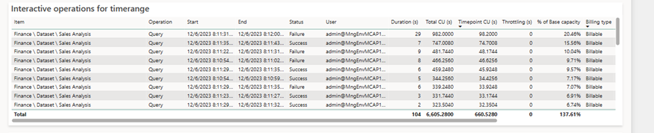

If a capacity is the victim of excessive queries or if a single query overloads it, driving into consuming more resources than available, the CU (s) consumed (***Add%***) are summed and saved in the ***Cumulative%*** column. In our case, the overconsumption is 37.61% of capacity at the given timepoint. As this is not the first Timepoint where capacity is over used, the Cumulative had stacked already 55.26% of overconsumption. This percentage represents resources to "pay back" : As the resources are calculated in seconds, this overage results into time that needs to be repaid when no queries are evaluated.

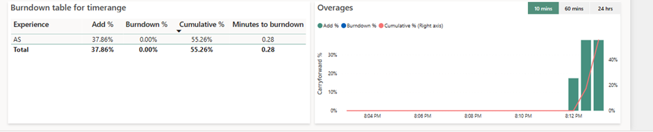

When the engine doesn't receive queries, it can then pay back these resources. The ***Cumulative %*** column will be transfered into the ***Burndown %*** column, and the capacity will reimburse it's debt when no one uses it :

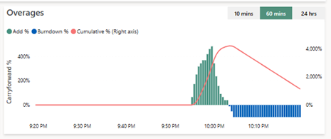

Here we can see that the queries have been too greedy and overflowed the capacity, depicted in the green bars (**Add%**). It made the **Cumulative %** grow until 4 000 % of the capacity (right axis), and when the overage came lower, then capacity could pay back, and per 100% blocks it paid back it's debt (blue bars, **Burndown %**), and the Cumulative % decreases.

## What happens then when the capacity can't pay back it's debt ?

If one capacity cannot pay back because it is over used, then it will set up a mechanism that will prevent from being victim of overuse for too long :

-   When the dept at a given time is less than 10 minutes, nothing happens, as it is the authorized usage in advance without any consequences.

-   When the overage is above 10 minutes, but below 1 hour, then the users queries will be limited, and can be slowed down, as a wait delay will be injected before the query is evaluated. This delay is proportional with the overage.
-   When the overage is between 1 hour and 24 hours, the interactive queries can be rejected,
-   And eventually, if the overage is more that 24h, then the background operations are rejected.

## What can I do if my capacity is overused ?

Two solutions exists :

-   The first one, if time is counted, the optimizations are no longer possibles, and that the wallet is still full, we can either divide the capacity in to two others (a scale out) or upgrade the SKU (scale up) of the capacity to increase the available CU in each timepoints,
-   The last one but the most complex asks to analyse the most consuming semantic models and to optimize it by reducing the number of concurrent queries, the data analyzed or the complexity of the code. In other words, to optimize the Power BI semantic model.
