La nouvelle Application de suivi des métriques d'usage des capacités Power BI peut apporter de nombreuses interrogations : les indicateurs affichés ainsi que leur explication peut laisser perplexe. Pour mieux la décrypter, il est nécessaire de comprendre quelques concepts qui définissent l'exécution d'un rapport Power BI.

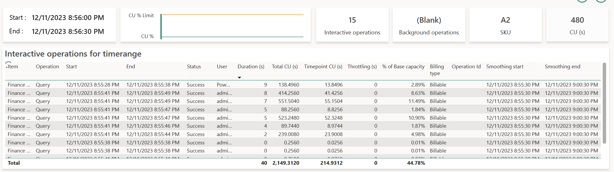

Nous allons d'abord analyser le comportement d'un rapport Power BI via Power BI Desktop, puis suivre son déploiement et son cycle de vie sur powerbi.com pour les comparer. Il faudra ensuite mettre à l'échelle d'une entreprise ces comportements : plusieurs utilisateurs qui utilisent plusieurs rapports en simultané.

### Qu'entraîne le calcul des visuels d'un rapport ?

Voici le rapport développé pour l'occasion : Un rapport composé d'un titre, de deux filtres, de 3 Cards, 3 graphiques et un tableau. Cela fait en tout 10 visuels.

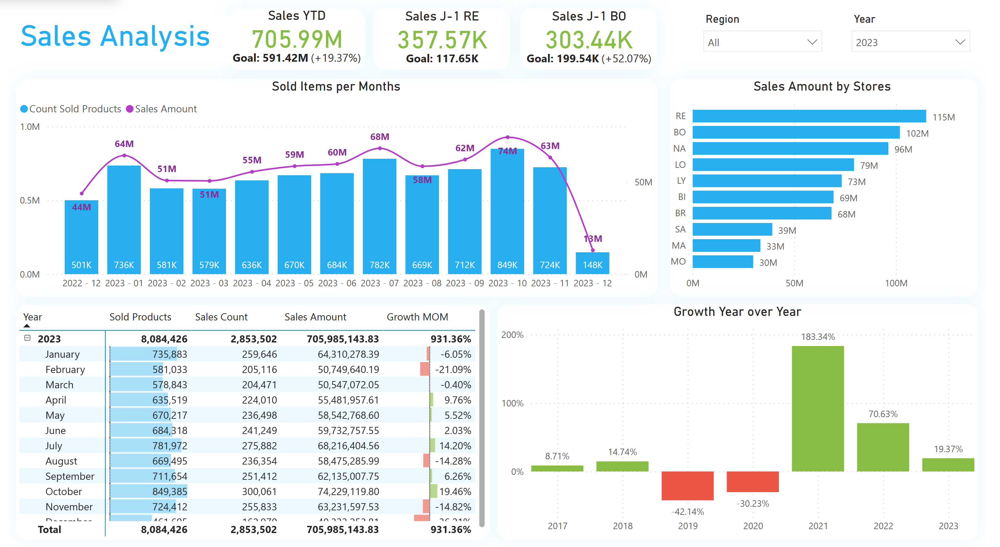

Au sein de ce simple rapport se sont glissées quelques mesures qui mériteraient d'être optimisées, mais pour cette explication, les calculs consommateurs nous permettent de mieux comprendre le fonctionnement de cette capacité.

Un rapport est composé d'un ou plusieurs visuels. Les visuels interagissant avec les données et les mesures d'un rapport génèrent un ou plusieurs blocs de code DAX, qui sera évalué par Power BI avant de renvoyer un résultat et d'être affiché.

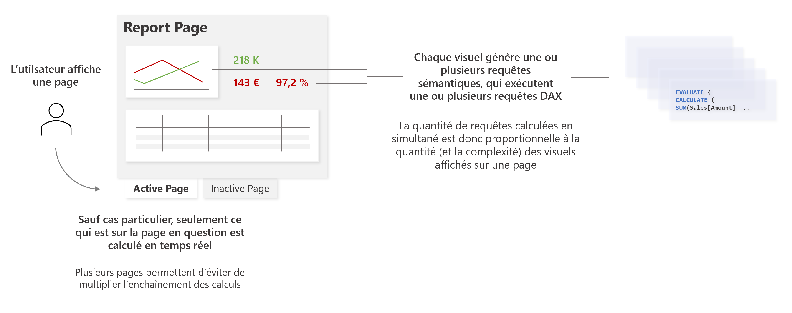

Concentrons-nous sur le fonctionnement d'un seul visuel : Power BI enverra alors ces requêtes DAX à deux moteurs qui ont chacun un rôle bien précis :

-   Un premier moteur, le **Formula Engine**, capable d'**interpréter les requêtes DAX**, de transformer ces requêtes et de les traduire pour les faire interpréter par le second moteur. Ce moteur ne peut exécuter **qu'une instruction après l'autre** (monothread), mais permet à Power BI d'effectuer des **calculs complexes**.
-   Un second moteur, le **Storage Engine**, capable d'interagir avec les données (stockées localement ou bien déportées). Ce moteur ne peut exécuter que des **calculs simples**, et de retourner dans l'idéal des résultats agrégés au Formula Engine. Dans le cas où les résultats sont trop complexes, il retourne les données telles que (un callback), avec un fort impact sur les performances. Ce moteur en revanche peut exécuter **plusieurs instructions en parallèle** (multithread).

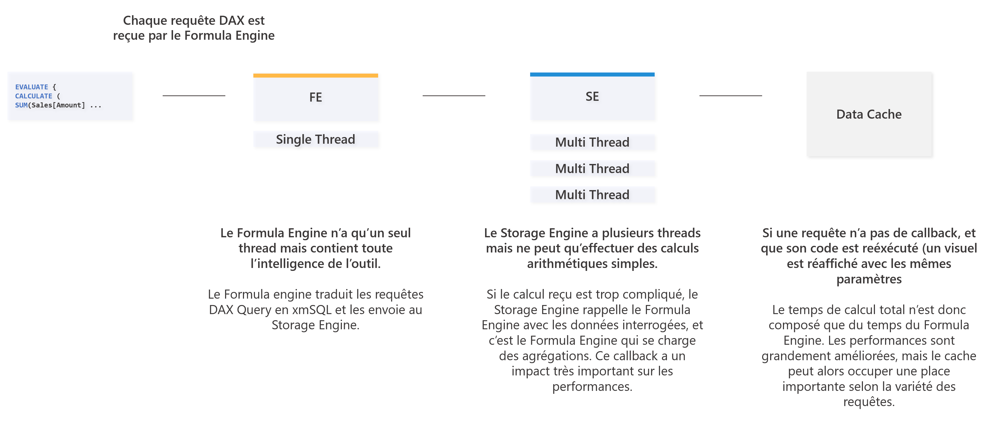

Pour chaque visuel alors, le code généré sera interprété par deux moteurs, dont les temps d'exécutions sont entrelacés selon les mesures, mais qui dépendent donc aussi de la parallélisation des requêtes : **un utilisateur peut attendre 2,5 secondes** seulement pour avoir un retour, cependant, le Storage Engine peut paralléliser par exemple **8 requêtes d'une seconde**.

Une notion importante à comprendre pour comprendre le fonctionnement d'une capacité Power BI, c'est donc que **le temps de travail du moteur est une somme** **du temps de calculs** des visuels **qui peuvent être parallélisés**, et qui peut donc coûter 8 secondes, alors qu'elle n'a duré réellement que 2,5 secondes.

## Comment déterminer le temps de calcul et la durée d'une requête ?

Pour déterminer le temps de calcul d'un visuel, il est possible d'utiliser DAX Studio et ses traces de suivi. Ces traces nous permettent d'extraire les requêtes DAX générées par la page de notre rapport, et d'en déduire les temps des Storage Formula Engine. Dans notre cas, voici les éléments récoltés : Nous avions 1 titre, 2 filtres, 3 indicateurs en en-tête, 3 diagrammes en basecrres, et un tableau, soit 10 visuels. **Sur les 10 visuels, seulement 7** (le titre et les filtres ne le font pas) **génèrent du code DAX**. Nous avons alors **7 blocs de codes DAX** :

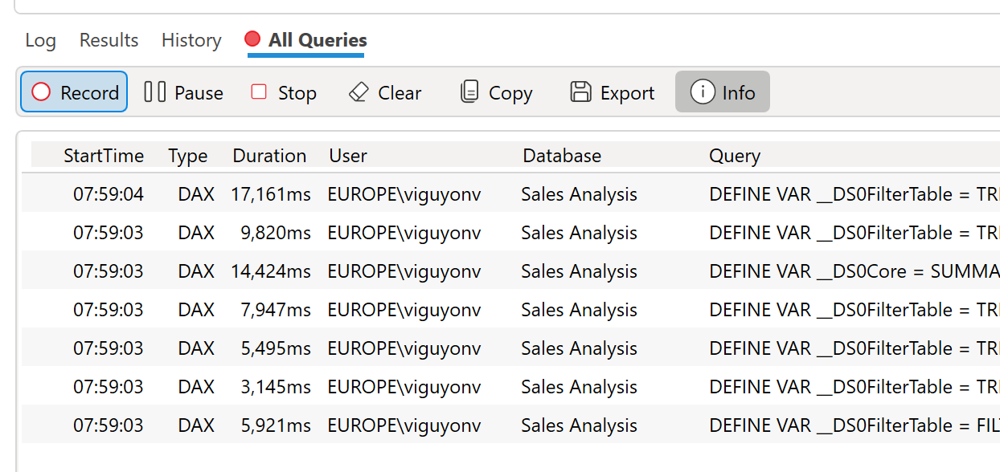

On remarque donc que les temps d'exécutions des requêtes fluctuent entre 3,1 et 17,1 secondes. Prenons une requête au hasard et rejouons-la : ci-dessous, on retrouve donc une requête qui va prendre **1 837 millisecondes** (ms) **au total**. Parmi ces 1 837 ms, nous avons 38 ms de Formula Engine, et 1 799 ms de Storage Engine. Mais ce Storage Engine **génère 11 requêtes**, qui peuvent être parallélisées : on retrouve alors un temps de calcul de **11 063 ms**. C'est donc **la** **différence entre la durée d'exécution** (*Duration*), et l**e coût réel** (en millisecondes) **d'exécution** de ce visuel (*CPU Time*). **Ce coût réel est une somme** du temps de calcul **du Formula Engine** **et du Storage Engine**. On notera aussi au passage les requêtes en gras, indiquant un callback, responsables de performances limitées.

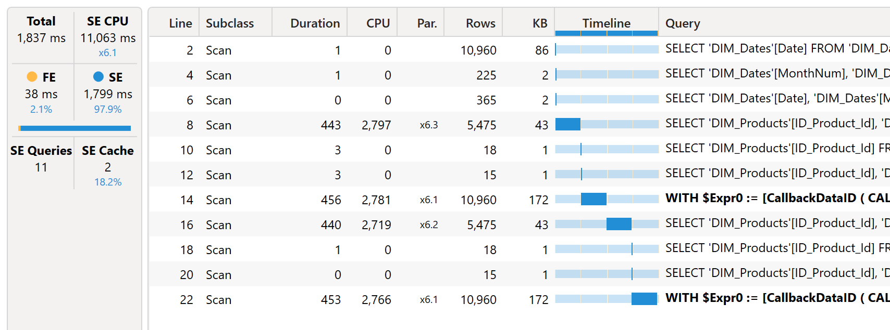

## Comment obtenir ces temps d'exécution une fois le rapport envoyé sur powerbi.com ?

Une fois le rapport et son modèle sémantique (anciennement appelé dataset) publié sur la capacité, il est possible de réaliser le même suivi de ces temps d'exécution via [Log Analytics](https://learn.microsoft.com/en-us/power-bi/transform-model/log-analytics/desktop-log-analytics-overview). En [déployant ce service](https://learn.microsoft.com/en-us/power-bi/transform-model/log-analytics/desktop-log-analytics-configure) au sein d'Azure, localement sur un espace de travail, il est possible d'obtenir alors les deux indicateurs présentées plus haut. Une fois déployé, si j'affiche le rapport sur une page web, je trouve à nouveau 7 requêtes, leurs durées effectives (*Duration*) et leurs coûts réels sur le moteur (*CPU Time*). Une requête nous servira de suivi, celle qui a duré **8 188 ms**. Cette requête a consommé **25 891** **ms de temps CPU** sur ma capacité, sur powerbi.com. .

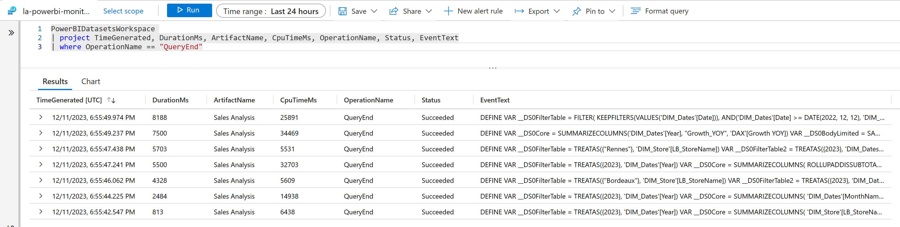

## Mais quel est le lien avec le capacity metrics app ?

Une fois que l'on a compris que le temps attendu par un analyste pour afficher un tableau est différent du coût en temps sur le moteur de Power BI, il est possible de mieux comprendre les indicateurs affichés sur les tableaux. Nous avons uniquement étudié le comportement d'un rapport lors de son usage, et non lors de son actualisation. L'usage d'un rapport appartient aux opérations dites ***interactives***. L'actualisation d'un modèle sémantique correspond à une opération de ***background***. Nous nous concentrerons sur les opérations interactives. Voici ce qu'il se passe sur la capacité qui a subi ces requêtes :

Dans le tableau du bas, on retrouve au niveau du modèle sémantique en question deux indicateurs : **CU (s)**, et **Duration (s)**.

-   Le premier est une transposition du coût réel d'exécution en secondes. Il correspond a un indicateur appelé **Capacity Units**. Ils sont les mêmes d'une taille de capacité à l'autre : autrement dit, **peu importe le SKU choisi** (P1, P2 et maintenant F64, F128), **le CU imputé à la capacité sera identique** si la même requête est exécutée sur deux capacités de taille différentes. Ce qui change, c'est la quantité de ressources disponibles en parallèle, et donc le nombre de requêtes interprétées simultanément : **un SKU plus grand** proposera **plus de "CU" disponibles à un même moment**. Si l'on veut être plus précis sur cette unité, Le temps CPU correspond à 62,5 fois le CU pour une requête : ***CPU** (ms) = **62,5 \* CU** (s)*.
-   Le second, est la durée totale attendue pour afficher ces visuels. C'est la somme des temps écoulés réellement pour afficher les visuels d'un rapport.

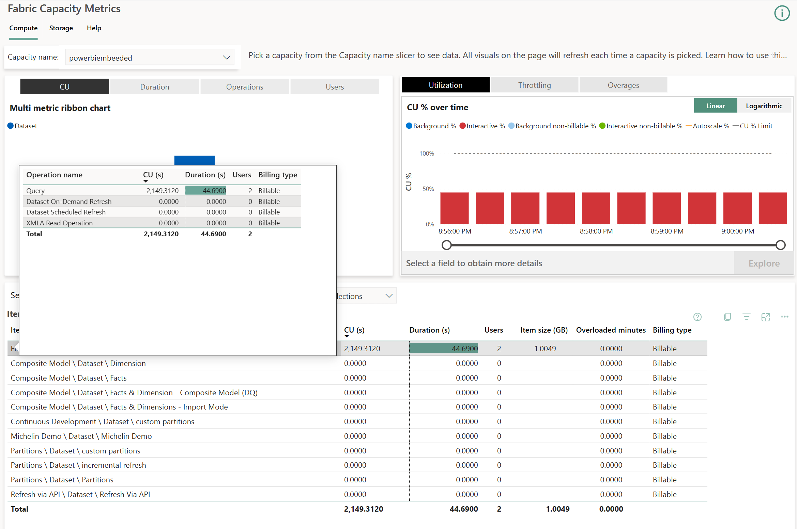

En haut à droite on retrouve un diagramme en barre qui superpose les activités de ***Background*** en bleu, et les activités ***Interactive*** en rouge. Dans notre cas, on retrouve une barre par blocs de 30 secondes : la quantité de ressources consommées est analysée par blocs de 30 secondes pour faciliter leur analyse. Il est possible de zoomer sur un point précis appelé **Timepoint** en cliquant dessus puis en cliquant sur Explore :

Sur ce Timepoint, on retrouve de nouveau les 7 requêtes, et leur durées arrondies. Chaque ligne dont la durée est supérieure à zéro représente donc une requête générée par un visuel que l'on a observé sur DAX Studio ou bien sur Log Analytics. **Le nombre de lignes** listées alors dans ce tableau est donc **proportionnel au nombre de visuels affichés** **sur les rapports consultés par tous les utilisateurs** d'une capacité. On comprend donc l'importance d'utiliser ces capacités Fabric & Power BI avec des modèles sémantiques qui ont été optimisés et validés par un ensemble de méthodes de gouvernances claires.

Chaque ligne correspond alors à la requête générée par un visuel qui exécute du DAX. La requête démarre alors au temps ***Start***, et termine au temps ***End***. Ce temps écoulé est représenté dans la colonne ***Duration* *(s)***. C'est, comme on l'a dit plus haut, le temps qu'à réellement attendu l'utilisateur pour ce visuel en question. Les requêtes consomment du temps CPU sur la capacité, représenté par la colonne ***Total CU (s)***. C'est ici que les choses deviennent **plus compliqués** et qu'entre en jeu la notion de ***Smoothing*** : pour éviter les pics d'usages lors de l'affichage d'un rapport, et pour lisser l'usage sur le temps, lorsque une requête sera réellement terminée, elle sera coupée en 10 parts égales, et **chaque part sera répartie sur les** **10 Timepoints suivants** (soit sur 5 minutes, un timepoint équivaut à 30 secondes). C'est pour cela que l'on retrouve cette requête sur les 10 timepoints suivants, même si son exécution a été faite antérieurement. C'est ce qui est indiqué dans la colonne ***Timepoint CU (s)***. On retrouve en fin de tableau les colonnes ***Smooting Start*** & ***Smoothing End***, période pendant laquelle la requête est divisée et imputée à la capacité.

Comment est calculé le pourcentage ? ***% of Base Capacity*** correspond alors au rapport entre la charge de travail totale de la capacité, dans notre cas ***480 CU (s)***, et le CU (s) représenté par le ***Timepoint CU (s)***. Pourquoi 480 CU ? Car c'est [la taille de la capacité](https://learn.microsoft.com/fr-fr/fabric/enterprise/licenses) multipliée par le nombre de seconde dans un timepoint. Dans notre cas un SKU A2 est aussi appelé un SKU F16 : 16 CU \* 30 secondes = 480.

Il est possible aussi de trouver dans la colonne ***Operation*** des valeurs de type ***Query*** ou de type ***XMLA Operation***. Ces dernières correspondent par exemple à l'usage de **modèles composites**, ou encore d'accès aux modèles sémantiques **via Excel**. Ces deux types d'accès sont particulièrement consommateurs en ressources.

## Comment comprendre ce tableau avec les requêtes analysées précédemment sur Power BI Dekstop ?

Notre requête repère suivie sur Log Analytics est alors la deuxième ligne de notre tableau affiché plus haut : cette requête a duré 8 secondes (arrondi de 8 188 ms). Elle a consommé d'après Log Analytics 25 891 ms de CPU, et d'après l'app Metrics 414,256 CU (414,256 \* 62,5 = 25 891), puis a été coupée sur 10 Timepoints. Ramené sur un Timepoint précis, cette requête consomme alors 41,4256 CU, soit 8,63% de 480 CU, notre capacité totale a cet instant.

Que se serait-il passé si la capacité n'était pas un SKU A2 (F16 désormais sur Fabric) mais un P1 (F64) ? Et bien la quantité de CU serait la même pour cette requête, simplement le pourcentage serait divisé par 4, car un P1 propose alors 1 920 CU. Lorsqu'on augmente la taille d'une capacité, on augmente le nombre de requêtes exécutées en parallèle.

## Que se passe-t-il lorsque l'usage de la capacité dépasse les 100 % ?

Une capacité n'est pas utilisée à 100% constamment, et son utilisation fluctue au court de la journée. Le matin, les utilisations sont importantes, et diminuent jusqu'à la nuit ou les rapports ne sont pas consultés. Ce temps est "perdu" s'il n'est pas utilisé dans un environnement physique. Cependant, il faut d'abord comprendre que **l'allocation de ressources est logique et non physique** : à un instant T, **une capacité a accès à plus de ressources** que ce qui a été payé. **Il est possible alors de sur-consommer des ressources** pour subvenir à un besoin ponctuel. Pour permettre cette surconsommation, une capacité Power BI propose de consommer des ressources "à l'avance". Par exemple, on peut voir ici **137,67%** de consommation. C'est ce qui est appelé le ***Bursting***.

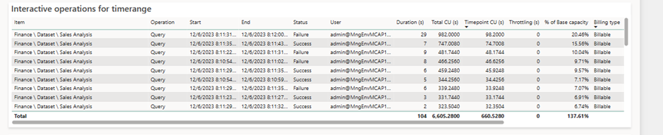

Si une capacité subit un nombre de requête important, ou qu'une requête est surchargée, alors une requête consomme plus de ressources que disponible. Les CU sur-consommés sont additionnés (***Add %***) les uns aux autres et conservés dans la colonne ***Cumulative %***. Dans notre cas, la surconsommation représente 37,61% d'une capacité. Dans la colonne ***Add%***, on retrouve donc 37 % d'ajout. Ce n'est pas le premier Timepoint sur lequel la capacité est dépassée, et cet ajout se superpose aux 55.26% précédemment surconsommés. Ce % de surconsommation représente une quantité de ressources à "rembourser" : étant donné que les ressources disponibles se calculent en secondes d'utilisation, on peut transposer cette consommation en temps d'inactivité à rembourser.

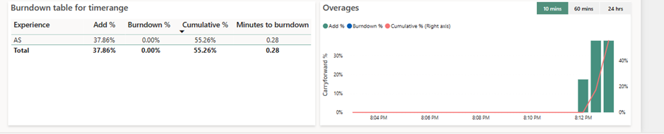

Lorsque le moteur ne reçoit pas de requêtes, il peut alors les rembourser. La colonne ***Cumulative %*** va se déverser dans la colonne ***Burndown %***, et la capacité va rembourser sa dette lorsque personne ne s'en servira :

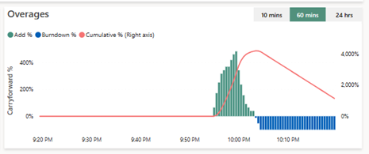

On peut voir ici donc que les requêtes ont été trop gourmandes et ont dépassé la capacité au sein des barres vertes (***Add %***). Elles ont fait grimper le ***Cumulative %*** jusqu'à 4 000% de la capacité (l'axe de lecture est sur la droite), puis lorsque la capacité a été de nouveau capable de rembourser, par blocs de 100%, elle a remboursé sa dette (barres bleues, ***Burndown %***), et le Cumulative % diminue.

## Que se passe-t-il lorsque la capacité ne peut pas rembourser sa dette ?

Si une capacité ne peut pas rembourser sa dette car elle est trop utilisée, elle mettra en place un mécanisme lui permettant de ne pas être victime de sur-consommation pendant trop longtemps :

-   Lorsque la dette à un instant T est de moins de 10 minutes, rien ne se passe, c'est la dette autorisée sans conséquence.
-   Lorsque la dette est dépassée 10 minutes, mais est inférieure à une heure, alors les utilisateurs seront limités et leurs **demandes** peuvent être **ralenties**. Un délai d'attente sera injecté à l'exécution. Ce délai est proportionnel à la surconsommation.
-   Lorsque la dette dépasse 1 heure, les **activités *interactives*** peuvent être **rejetées**.
-   Enfin, si la dette dépasse 24h de consommation, les **activités de *Background*** seront **rejetées**.

## Comment faire si une capacité est sur-utilisée ?

Il existe alors globalement deux solutions :

-   La première, si le temps est compté, que les optimisations ne sont plus possibles, et que le portefeuille est encore plein, alors il est possible de diviser la charge de travail sur deux capacités (*scale out*) ou encore d'augmenter la taille de cette capacité (*scale up*)et donc d'augmenter le nombre de CU disponibles par Timepoints,
-   La seconde est la plus compliquée, et elle demandera d'analyser les modèles sémantiques les plus consommateurs en CU et à les optimiser en réduisant le nombre de requêtes simultanées, en réduisant les données analysées, ou en réduisant la complexité du code.
