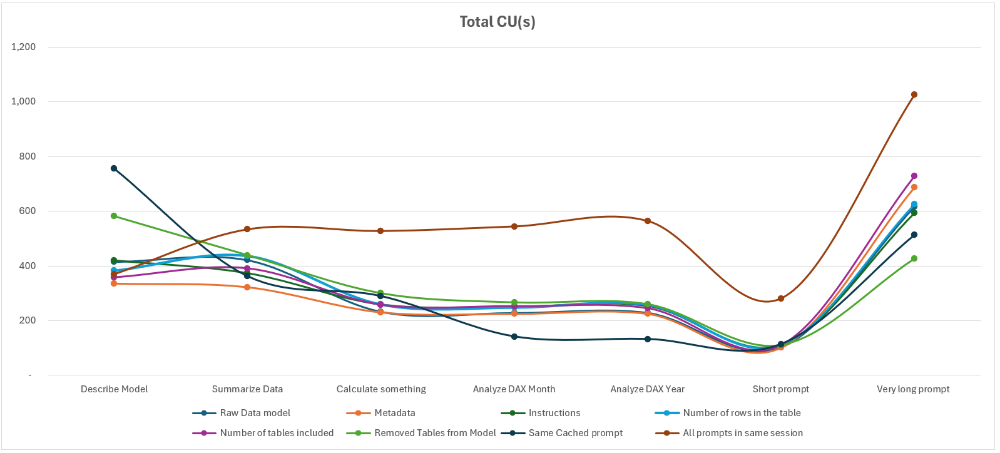
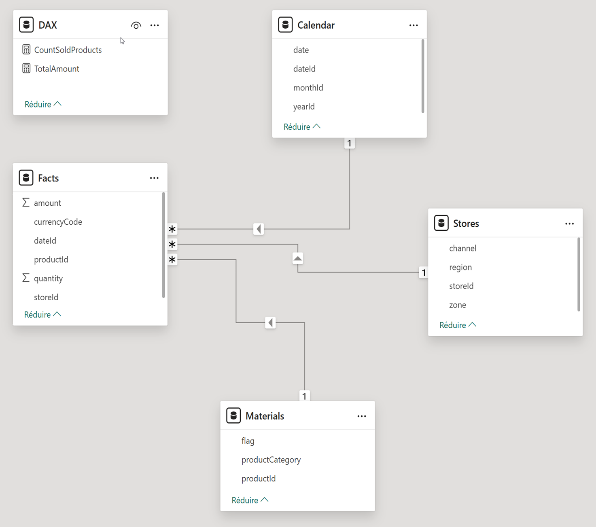
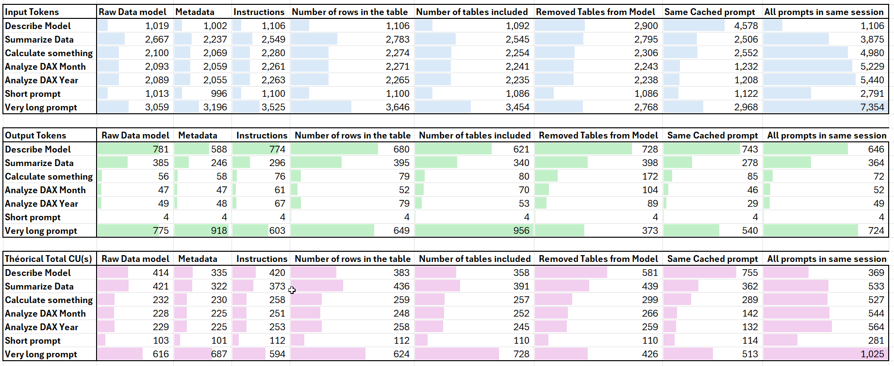
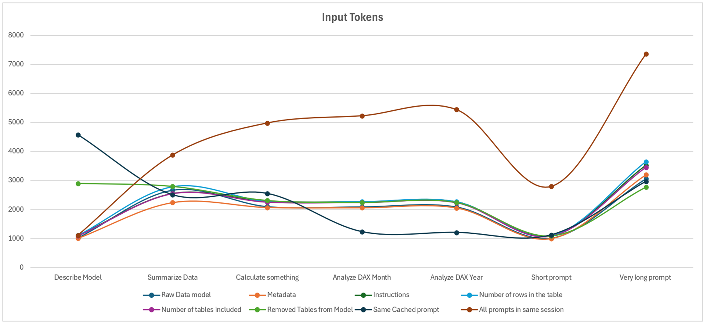
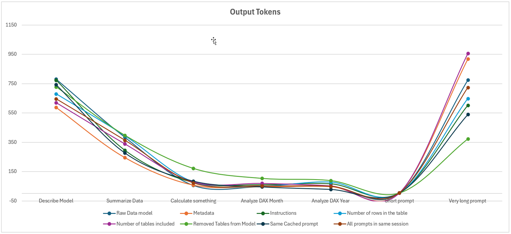
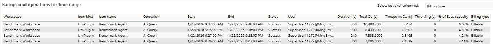
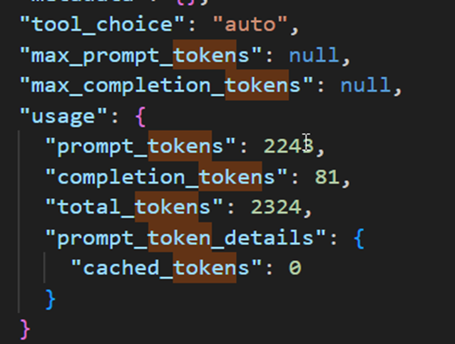
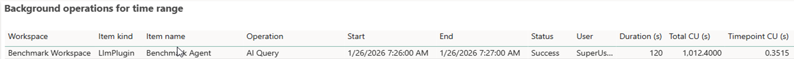

## Introduction

L’objectif de cet article est d’éclaircir **le coût** et **la consommation de ressources** associées à l’usage de **Fabric Data Agent**, au sein de Microsoft Fabric. Lié à un modèle sémantique, nous allons interroger un Data Agent à plusieurs reprises, **faire varier un ensemble d’éléments** et observer l’évolution des ressources consommées suite à ces différentes requêtes.

Pour faciliter l’analyse, nous ne parlerons pas de coût en dollars ou en euro : nous parlerons alors dans une unité commune, celle qui matérialise la consommation de ressources au sein de Fabric, car chaque client de Microsoft Fabric paiera un prix différent pour sa capacité : selon son choix de facturation – avec ou sans engagement (*Reserved Instance/Pay As You Go*) –, selon sa région, et selon le discount négocié entre les deux partis. Une fois le coût en CU(s) obtenu, pour obtenir le prix en €/$ que chaque prompt aurait coûté, chacun pourra alors multiplier par le prix unitaire qu’il paye pour son infrastructure.

L’unité de calcul de la consommation des ressources pour Microsoft Fabric est similaire à un débit : une quantité de ressources consommées pendant une période donnée : Pour nous ici, nous compterons en CU(s). Une capacité Fabric F2 ou F64 donne la même qualité de ressources, simplement elle offre un débit proportionnel : 2 ou 64 CU chaque seconde.

Nous **appliquerons la théorie** documentée pour mesurer les ressources que chaque prompt doit consommer, puis **analyserons via l’App Fabric Capacity Metrics** pour obtenir les coûts imputés réellement à la capacité pour chacun des prompts.

## La théorie

Dans la [documentation](https://learn.microsoft.com/en-us/fabric/fundamentals/data-agent-consumption), on peut lire :

*When you query Data agent using natural language, **Fabric generates tokens that represent the number of words in the query** … 750 words ~= 1000 tokens.*

On peut comprendre ici que la requête envoyée par l'utilisateur est celle qui est utilisée pour compter le nombre de token du prompt d'entrée.

*Input prompt : 100 CU(s) = 1000 Tokens*

*Output completion : 400 CU(s) = 1000 Tokens*

*For example, assume each Data agent request has 2,000 input tokens and 500 output tokens. The price for one Data agent request is calculated as follows :*

*(2,000 × 100 + 500 × 400) / 1,000 = 400.00 CU seconds*.

On comprend alors que la **quantité de CU(s) consommées** est **calculée** selon le nombre de tokens dans la question et la réponse, et qu’il y a un ratio de **1 pour 4** entre ces derniers.

Enfin, information importante, mais que nous n’analyserons pas ici, si l’agent a besoin d’interroger une source pour calculer un indicateur, alors la requête DAX ou SQL sera facturée à part comme une requête classique. En d’autres termes, le cout de réflexion n’inclut pas l’exécution des requêtes, elles seront calculées comme d’origine humaine, mais l’avantage est qu’il n’y a pas de surfacturation liée à ce qu’elle vienne d’un LLM.

## L'analyse

#### Les éléments de l'analyse

Notre analyse est basée sur deux éléments uniquement : un **modèle sémantique** Power BI, et un **Fabric Data Agent**.

Le modèle représente un cas d’usage simple, l’analyse des coûts d’une entreprise de vente de bien consommations, et contient 5 tables au départ : **1 table de Faits**, nos ventes, **3 dimensions** (temps, magasin, produits vendus) et une table technique pour les mesures (Nombre de produits vendus et Montant total).

**Fig. 1 : Le modèle sémantique de cette étude**

L’agent est créé simplement, sans aucun paramétrage au départ, simplement branché au modèle de données. Pour chaque prompt, le service propose des **logs de diagnostic**, regroupant des éléments importants, parmi ceux-là : le nombre de tokens entrant et sortants, le détail du chemin de réflexion et des requêtes qui ont réussi, échoué, ou sont ressayées par l’Agent, le contexte fourni à l’agent, la version du LLM utilisé.

C’est donc grâce aux **tokens du Diagnostic Logs** qu’on saura combien consomme chaque prompt.

#### Les prompts testés

Dans notre étude, **pour chaque variable** qui évoluera, **on rejouera** un ensemble de **7 prompts**, pour tester plusieurs aspects de l’agent. Ces 7 prompts ont pour but de tester l’accès aux métadonnées, l’accès à l’ensemble des données du modèle, de calculer un indicateur qui nécessite une réflexion supplémentaire, l’accès à plus ou moins de données avec un même indicateur, et de tester les prompts simples et complexes.

Grâce aux diagnostic logs, nous savons que l’Agent repose sur le modèle d’Open AI : **GPT 4.1 adapté pour Power BI Copilot**. Pour mesurer la taille des prompts, j’ai donc utilisé un **tokenizer** pour mesurer la longueur des prompts (annotés à côté de chaque prompt ici) :

1.  **Décrire le modèle :** (18 t.) *Describe the datamodel, tables and content, and provide eventual analysis that could be done.*
2.  **Résumer les données :** (10 t.) *Summarize the Data contained in this report.*
3.  **Calculer un indicateur qui n’est pas dans le modèle :** (15 t.) *Calculate the total amount of product solds divided by the count of products.*
4.  **Analyser un mois de données :** (13 t.) *What is the total amount sold in Setember 2023 ?*
5.  **Analyser un an de données :** (11 t.) *What is the total amount sold in 2023 ?*
6.  **Un prompt très simple :** (13 t.) *Are you a Data Agent ? Simply answer yes or no.*
7.  **Un prompt complexe :** (138 t.) *I'm a Data Analysts working for a company named Contoso. I'm in charge of reporting figures to my direction, in concise but insightful maner. I would like you to provide :* *Total Amount Sold per Month for 2025 in a table, with one row per month.Distinct count of product solds per month in a table, with one row per months.* *An analysis about which Stores were performing the best for September 2025, and why if it exist.* I *would like this prompt to be ready to be sent via mail, and written in financial wording, with, at the end, a phrase to ask for more details if needed.*

#### Hypothèses testées

Ces 7 prompts sont joués pour les **8 hypothèses suivantes**, avec une session vide à chaque prompt :

1.  **Raw Data Model :** Branchement de l’agent sur le modèle tel quel, sans descriptions, sans prendre en compte les bonnes pratiques.
2.  **Metadata :** Enrichir le modèle de bonnes pratiques pour décrire l’ensemble des champs, les relations, les mesures au sein du modèle directement dans Power BI,
3.  **Instructions :** Définir les instructions pour respecter les bonnes pratiques de l’Agent, pour décrire son rôle, les tables ...
4.  **Quantity of data :** Nous augmenterons le nombre de lignes dans la table de fait de 100 000 à 1 000 000 de lignes,
5.  **Limit tables :** Décocher les tables disponibles pour l'Agent (Calendar & Materials)
6.  **Remove tables :** Supprimer les tables du modèle (Calendar & Materials)
7.  **Same prompt :** Rejouer le même prompt deux fois sans nettoyer le cache
8.  **Real Use case :** Tous les prompts sont joués dans une seule session sans nettoyer le cache

## Résultats & interprétations

Ci-dessous, on retrouve nos données, représentées dans une matrice et via 3 graphiques permettant d'analyser les **tokens entrants**, **tokens sortants**, et le coût en **CU(s) théorique**.

**Fig 2 : Tableaux récapitulatifs des résultats des tests : Input & Output Tokens & CU(s) théoriques*.*

**Fig 3 : Diagramme en lignes représentant le nombre de Tokens entrants pour chaque hypothèse et chaque prompt.**

Le premier élément notable de cette étude montre que **pour le moindre prompt, la valeur minimale** de tokens est de **1 000 tokens**, peu importe l'hypothèse ou le prompt testé. Même le prompt le plus simple "est-ce un rapport, oui ou non ?" est loggé entre 996 et 2 791 tokens. En détaillant le contenu du Diagnostic Log, on observe (et c'est là que le concept d'Agent prend tout son sens), que différents LLMs interagissent entre eux. Un meta-prompt apparaît, contenant un ensemble d'instructions pour éviter le prompt injection. On observe aussi que **ce prompt est concaténé** aux **instructions fournies** par l'utilisateur final. Nous avons alors fait un dernier test pour atteindre 15 000 caractères soit le maximum des instructions du Fabric Data Agent : les inputs tokens augmentent au fur et à mesure (le prompt le plus simple passe de 1100 tokens à 3300 tokens).

Ensuite, plusieurs cas sont très similaires, et ne varient que pour résumer les données, ou pour le prompt plus avancé. Autrement, les deux qui sortent vraiment du lot sont les deux éléments où le prompt est relancé (économie lors du deuxième prompt), ou lorsque l'utilisateur envoi ses prompts l'un après l'autre.

On remarque donc que ce qui impact le plus sur la quantité de tokens (et donc de CU(s) consommés) est le fait de tout écrire dans une même session. Autrement, peu importe la quantité de données, de métadonnées ou de bonnes pratiques respectées, le nombre de tokens ne varie que très peu.

**Fig 4 : Diagramme en lignes représentant le nombre de Tokens sortants pour chaque hypothèse et chaque prompt.**

Pour les prompts de sortie, on remarque que les éléments qui ont fait varier le plus le nombre de tokens sont les prompts qui demandent une réflexion plus avancée : résumer les données, décrire le modèle, et enfin le prompt complexe, mais on observe une tendance parmi tous les prompts.

**Fig 5 : Diagramme en lignes représentant le nombre de CU(s) pour chaque hypothèse et chaque prompt.**

Enfin, le nombre de CU(s) théoriquement plus élevés sont dus au fait que les prompts soient tous exécutés dans une même session.

## Comparaison aux coûts réellement imputés

Lors des tests, il a fallu comparer les CU(s) théorique avec les CU(s) réellement consommés. A ce moment, incapable de trouver les mêmes chiffres : ils sont largement supérieurs aux valeurs théoriques :

**Fig 6 : Liste des CU(s) consommés pour les plus grosses requêtes envoyées à l'Agent sur une journée.**

N'étant pas capable d'isoler les requêtes, nous avons alors attendu que toutes les requêtes disparaissent, pour en relancer une seule : basé sur le diagnostic log, cette requête devrait consommer **256 CU(s) au total** :

(2243/1000) \* 100 + (81/1000)\* 400 = 256.1

**Fig 7 : Sortie du Diagnostic Log.**

Dans l'interface de l'App Capacity Metrics, **on retrouve 1 012 CU(s)**, soit **4 fois le coût théorique**. En comparant les deux tables, on observe que plus la colonne durée est grande, et plus le CU(s) est élevé. En divisant la durée par 30, nous obtenons quasiment les mêmes chiffres que calculés avec la formule théorique. En revanche, aucune des requêtes envoyées à l'agent n'a pris plus de 30 secondes. Il y aurait donc un lien indirect entre cette colonne durée et le coût imputé, même si la durée réelle n'est pas représentée ici ...

**Fig 8 : CU(s) réellement consommés par le prompt.**

## Conclusion

Ce n'est pas parce que le prompt initial est court que le nombre de tokens envoyés au service sera petit. En revanche, les tokens en sortie sont bien alignés avec ce qui résulte du diagnostic log.

Il n'y a **pas d'augmentation notable** des coûts liés au **volume de données,** à la **description** du modèle, au **nombre de table** que contient un modèle ou qui sont inclues dans l'analyse.

La complexité des prompts augmente les ressources consommées, mais c'est avant tout le fait de **conserver l'historique des prompts** qui **augmente grandement** le coût de Fabric Data Agent.

Les **instructions** fournies à l'Agent font augmenter le coût en tokens et en CU(s) des prompts.

Aussi, il y a un **écart** entre le calcul des **CU(s) théorique** et le coût **réellement imputé à la capacité**.

Lorsque l'on exécute un prompt simple permettant d'obtenir la valeur des ventes pour un mois donné, le coût théorique est de 256 CU(s), le coût réel est de **1 012 CU(s)**. Si l'on calcule **la même chose simplement via un rapport**, le coût en CU(s) est de 1.74 CU(s), soit un **581 fois moins de ressources** pour le même résultat. Au-delà des ressources Fabric consommées, c'est l'énergie employée pour supporte ces capacités qui est démultipliée : il est donc primordial de remettre en question les prompts exécutés, et la nécessité d'utiliser des technologies reposant sur l'IA Générative pour des cas où un rapport, une requête, un service simple existerai déjà.
