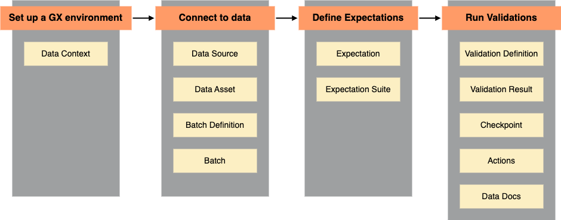
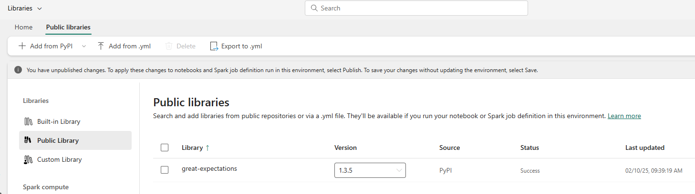
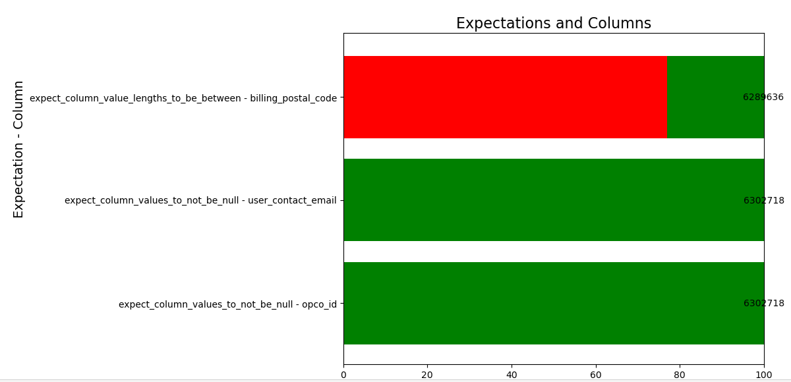

## Introduction

Être capable d'analyser la qualité de ses données de manière précise et de mesurer son évolution dans le temps est un défi important à relever pour assurer la précision d'une plateforme de données : il faut être capable de comparer nos informations avec les attentes que l'on veut porter. Great Expectations (Gx) propose un service appelé **[Gx Core](https://greatexpectations.io/gx-core)**, une librairie Python Open Source, qui joue le rôle d'interface programmable pour définir des patrons répétables, interactifs ou automatiques, qui vont permettre de valider la qualité de nos données.

L'objectif de cet article est de présenter cette librairie au sein de **Microsoft Fabric** : présentant une solution d'exécution de Notebooks, nous allons découvrir comment embarquer ce *framework*, comment l'utiliser sur nos différents containers de données avec un exemple, et comment améliorer la lisibilité de ses résultats.

## Principes

Great Expectations (Gx) est un service qui possède ses propres mots clés, qu'il faut saisir pour comprendre l'organisation du framework. Pour commencer, le container général de cette logique est appelé un **context** : il peut être éphémère dans le cadre d'un usage interactif, ou bien pérennisé dans un fichier de configuration.

Pour comparer nos informations avec ce que l'on en attend il faut que l'on structure ces attentes. Pour cela nous allons définir au sein de notre contexte des **expectations** : elles définissent les règles que l'on veut valider : le fait qu'un code postal français comporte bien 5 caractères, pas plus, pas moins par exemple. Il en existe des [préconçues](https://greatexpectations.io/expectations/), mais il est possible d'en définir soi-même (**custom expectations**). Pour ne pas exécuter nos attentes les unes après les autres, nous allons les regrouper dans des ensembles logiques appelés **suites**.

Ces suites sont alors vérifiées contre un ensemble de données auxquelles nous nous connectons grâce à une **datasource** (méthode de récupération des données). Ces datasources sont regroupées dans un ensemble logique appelé **asset**, qui permet de suivre l'évolution des résultats d'un sujet fonctionnel tout au long de sa vie dans la plateforme (dans une architecture medaillon, on suivra les données de Faits du Bronze/Silver/Gold au sein du même asset). Enfin, un **batch** définit une tranche de données incrémentale ou complète, qui sera évaluée face à nos attentes.

Pour répéter l'exécution de ces attentes, nous utiliserons des **checkpoints** : ils définissent la fréquence d'exécution de nos attentes, spécifient les données que l'ont veut étudier, et sauvegardent nos résultats.

Une fois les données matérialisées, les attentes spécifiées, nous allons exécuter des **validations** : le process de comparaisons de nos deux ensembles. Ces validations font l'objet d'un **results** : la sortie structurée des résultats de la qualité de données. Elles comportent un booléen général et par attente, puis par exemple un ratio permettant de connaître le pourcentage de données répondant à nos attentes.

Pour lire nos résultats il est possible d'utiliser des **data docs** : une documentation prête à l'usage orientée web pour explorer nos résultats de manière interactive. Pour automatiser des actions suite à ces résultats, il est possible d'utiliser des déclencheurs appelés **trigger actions**.

Voici un [schéma récapitulatif](https://docs.greatexpectations.io/docs/core/introduction/gx_overview) de l'organisation de ces principes :



## Démonstration

*Retrouver ce Notebook Jupyter sur* [*Github*](https://github.com/VincentGvr/Data-Engineering/blob/main/Gx.ipynb).

Au sein de Microsoft Fabric nous utiliserons un Notebook. Pour commencer nous aurons besoin des librairies Great Expectations : pour les importer de manière unique au sein d'un notebook, nous irons directement installer notre librairie. Autrement, il est une bonne pratique de définir au sein d'un environnement les librairies utilisées de manière récurrente, instanciées directement lors de l'allocation des ressources utilisées par le Notebook :

Option 1 :

```python
%pip install great_expectations
```

Option 2 :



Une fois installées, importons ces librairies au sein de notre Notebook :

```python
import great_expectations as gx
from great_expectations import expectations as gxe
```

Pour démarrer, nous avons besoin d'instancier une variable de contexte. Elle peut être éphémère comme enregistrée pour être rejouée plus rapidement

```python
context = gx.get_context()

#context = gx.get_context(mode="file", project_root_dir="./new_context_folder")
```

Définissons notre source de données (en Spark, ou en pandas par exemple), puis définissons notre asset :

```python
datasource_name = "my spark datasource"

data_source = context.data_sources.add_spark(name=datasource_name)
#data_source = context.data_sources.add_pandas(name=data_source_name)

data_asset_name = "my dataframe asset for Facts"
data_asset = data_source.add_dataframe_asset(name=data_asset_name)
```

On prépare ensuite notre batch : il permet de regrouper notre source de données et la méthode de chargement des données à tester.

```python
batch_definition_name = "My batch"
batch_definition = data_asset.add_batch_definition_whole_dataframe(batch_definition_name)
```

Une fois le batch défini, on l'ajoute au contexte.

```python
FactsDf = spark.sql("SELECT productId, billing_postal_code, user_contact_email FROM Facts")
batch_parameters = {"dataframe": FactsDf}

batch_definition = (
    context.data_sources.get(datasource_name)
    .get_asset(data_asset_name)
    .get_batch_definition(batch_definition_name)
)
```

Créons alors notre première attente : vérifions que pour chaque ligne de notre table de faits, l'ID produit est non nul. On peut la valider contre le batch, et en afficher les résultats :

```python
productId_notNull = gx.expectations.ExpectColumnValuesToNotBeNull(
    column="productId",
    mostly=1
)

batch = batch_definition.get_batch(batch_parameters=batch_parameters)

validation_results = batch.validate(productId_notNull)
print(validation_results)
```

Voici notre premier retour ! On remarque un booléen pour le statut de notre test, la colonne testée, le nombre de valeurs, et le ratio concerné par le résultat.

```json
{
  "success": true,
  "expectation_config": {
    "type": "expect_column_values_to_not_be_null",
    "kwargs": {
      "batch_id": "spark_datasource-my_dataframe_data_asset",
      "column": "productId"
    },
    "meta": {}
  },
  "result": {
    "element_count": 6302718,
    "unexpected_count": 0,
    "unexpected_percent": 0.0,
    "partial_unexpected_list": [],
    "partial_unexpected_counts": []
  },
  "meta": {},
  "exception_info": {
    "raised_exception": false,
    "exception_traceback": null,
    "exception_message": null
  }
}
```

Pour tester plusieurs expectations, on peut les ajouter à notre suite et les exécuter contre nos données.

```python
suite_name = "Facts_ExpectationsSuite"
suite = gx.ExpectationSuite(name=suite_name)
suite = context.suites.add(suite)

billing_postal_code_notEmpty = gx.expectations.ExpectColumnValueLengthsToBeBetween(
    column="billing_postal_code",
    min_value=5,
    max_value=5
)

user_contact_email_notNull = gx.expectations.ExpectColumnValuesToNotBeNull(
    column="user_contact_email",
    mostly=1
)

suite.add_expectation(user_contact_email_notNull)
suite.add_expectation(productId_notNull)
suite.add_expectation(billing_postal_code_notEmpty)

validation_results = batch.validate(suite)
```

De manière interactive et rapide on peut les représenter sous forme d'un diagramme en barres pour en afficher les résultats :

```python
import json
import pandas as pd
import matplotlib.pyplot as plt

jsonResult = json.loads(str(validation_results))
resultList = []

for result in jsonResult['results']:
    success_status = result['success']
    expectation = result['expectation_config']['type']
    dataset_column = result['expectation_config']['kwargs']['column']
    element_count = result['result']['element_count']
    unexpected_percent = result['result']['unexpected_percent']

    resultList.append({
        'success_status': success_status,
        'expectation': expectation,
        'dataset_column': dataset_column,
        'element_count': element_count,
        'unexpected_percent': unexpected_percent
    })

df = pd.DataFrame(resultList)
```

Une fois le dataframe créé, on peut utiliser matplotlib pour le représenter :

```python
df['success_percent'] = 100 - df['unexpected_percent']
df['expectation_column'] = df['expectation'] + " - " + df['dataset_column']
df['unexpected_count'] = df["element_count"] * (df['success_percent']/100)

fig, ax = plt.subplots(figsize=(12, 8))

for index, row in df.iterrows():
    color = 'green' if row['success_status'] else 'red'

    ax.barh(row['expectation_column'], row['success_percent'], color=color, label='Success' if row['success_status'] else 'Failure')
    ax.barh(row['expectation_column'], row['unexpected_percent'], left=row['success_percent'], color='green', label='Unexpected Percent')
    ax.text(row['success_percent'] + row['unexpected_percent'] / 2, index, f'{int(row["unexpected_count"])}', ha='center', va='center', color='black', fontsize=10)

ax.set_xlabel('Percentage (%)', fontsize=14)
ax.set_ylabel('Expectation - Column', fontsize=14)
ax.set_title('Expectations and Columns', fontsize=16)

#ax.legend(loc='lower center')

plt.tight_layout()
plt.show()
```



On pourrait aussi imaginer pérenniser ces données dans une table au sein de notre Lakehouse pour les réutiliser dans un rapport :

```python
gxDf = spark.createDataFrame(df)
gxDf.write.mode("overwrite").option("overwriteSchema", True").format("delta").saveAsTable("gx_results")
```

## Aller plus loin

Il est possible en quelques lignes d'obtenir des indicateurs sur la qualité des données exposées dans notre dataplatform. Une fois les attentes définies et les principes de base appliqués, pour améliorer la qualité de nos données, il faudra **industrialiser** le déclenchement des remédiations, être capable de **mesurer** l'amélioration ou la dégradation de la **qualité de données dans le temps**, communiquer ces résultats aux **responsables fonctionnels**, et pourquoi pas l'étendre à un rapport Power BI : c'est l'objet de la seconde partie de cette série d'articles.
