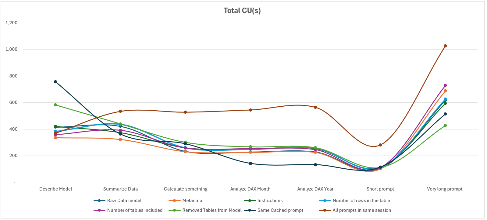
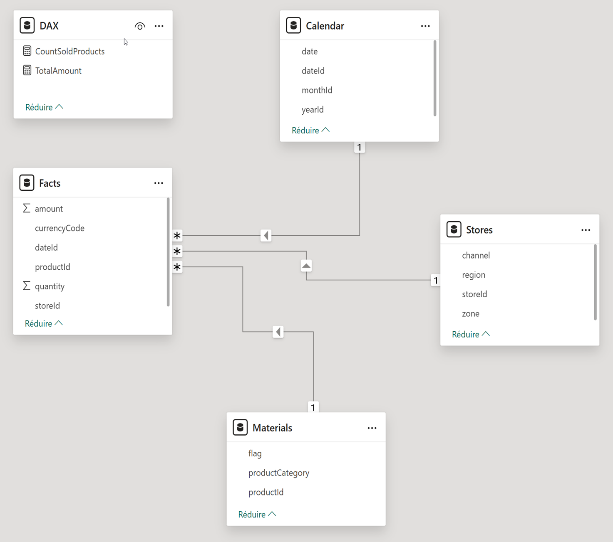
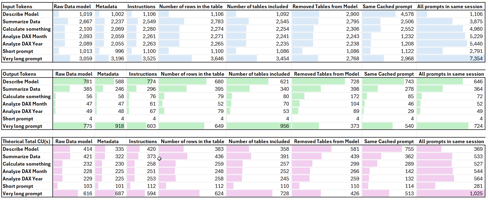
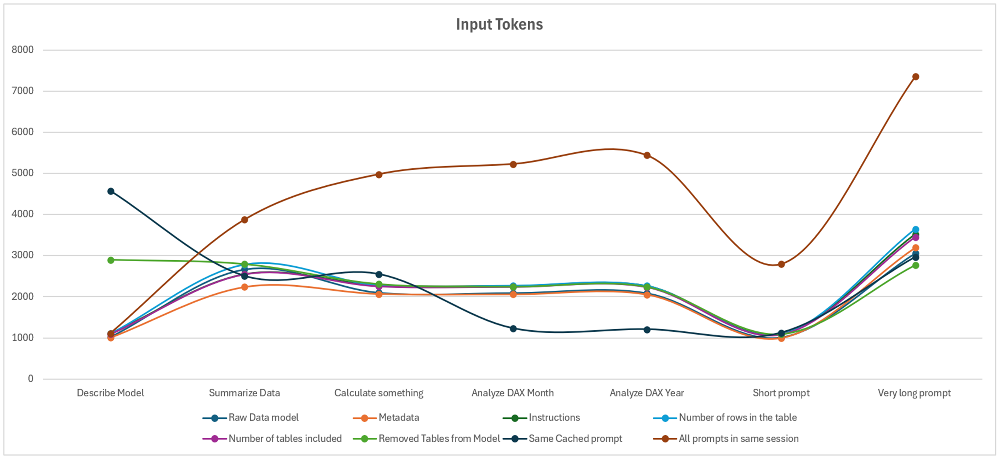
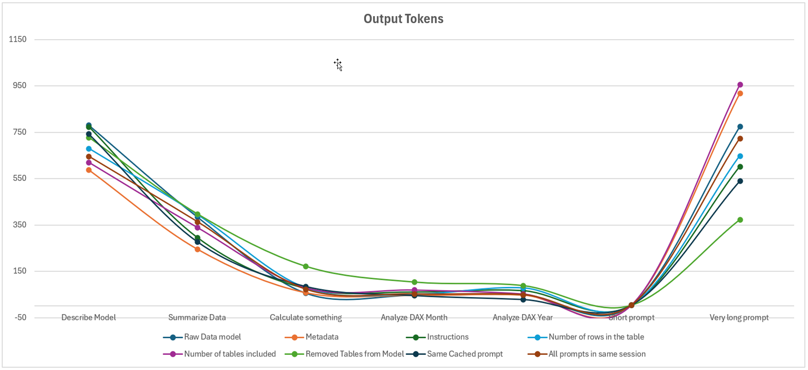
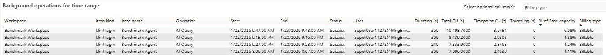
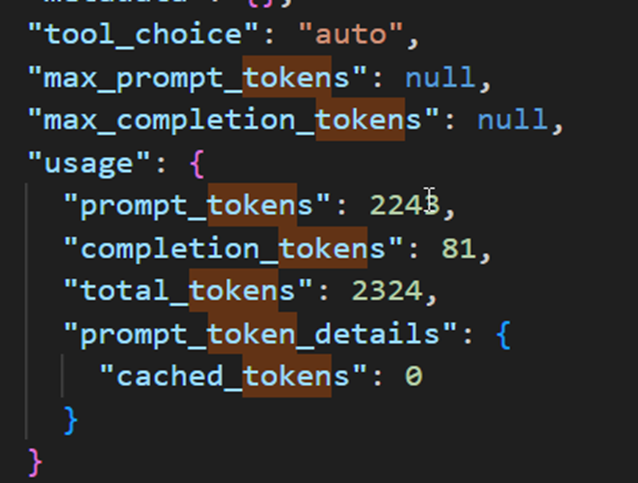
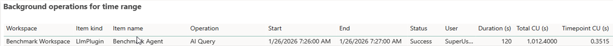

## Introduction

The objective of this article is to clarify the cost and resource consumption associated with the use of Fabric Data Agent within Microsoft Fabric. Linked to a semantic model, we will query a Data Agent several times, vary a set of elements, and observe the evolution of the resources consumed following these different requests.

To make the analysis easier, we will not speak in terms of cost in dollars or euros: we will instead speak in a common unit, the one that materializes resource consumption within Fabric, because each Microsoft Fabric customer will pay a different price for their capacity: depending on their billing choice – with or without commitment (Reserved Instance/Pay As You Go) –, depending on their region, and depending on the discount negotiated between the two parties. Once the cost in CU(s) is obtained, to get the price in €/$ that each prompt would have cost, everyone can then multiply by the unit price they pay for their infrastructure.

The unit for calculating resource consumption for Microsoft Fabric is similar to throughput: a quantity of resources consumed during a given period. For us here, we will count in CU(s). A Fabric F2 or F64 capacity provides the same quality of resources; it simply offers proportional throughput: 2 or 64 CU per second.

We will apply the documented theory to measure the resources that each prompt should consume, then analyze via the App Fabric Capacity Metrics to obtain the costs actually charged to the capacity for each of the prompts.

## Theory

[Documentation](https://learn.microsoft.com/en-us/fabric/fundamentals/data-agent-consumption) states :

*When you query Data agent using natural language, **Fabric generates tokens that represent the number of words in the query** … 750 words ~= 1000 tokens.*

We can read and understand that the query sent by the user will be the one used to count the input prompt tokens :

*Input prompt : 100 CU(s) = 1000 Tokens*

*Output completion : 400 CU(s) = 1000 Tokens*

*For example, assume each Data agent request has 2,000 input tokens and 500 output tokens. The price for one Data agent request is calculated as follows :*

*(2,000 × 100 + 500 × 400) / 1,000 = 400.00 CU seconds*.

We therefore understand that the quantity of CU(s) consumed is calculated according to the number of tokens in the question and the answer, and that there is a 1-to-4 ratio between them.

Finally, an important piece of information, which we will not analyze here: if the agent needs to query a source to calculate an indicator, then the DAX or SQL query will be billed separately as a standard query. In other words, the reasoning cost does not include the execution of queries; they will be calculated as if they originated from a human, but the advantage is that there is no additional charge related to the fact that it comes from an LLM.

## Analysis

#### Analysis Components

Our analysis is based on only two elements: a Power BI semantic model and a Fabric Data Agent.

The model represents a simple use case, the analysis of the costs of a consumer goods sales company, and initially contains 5 tables: 1 fact table, our sales; 3 dimensions (time, store, products sold); and a technical table for the measures (Number of products sold and Total amount).

**Fig. 1 : Semantic Model used in the study**

The agent is created simply, without any configuration at the beginning, simply connected to the data model. For each prompt, the service provides diagnostic logs, gathering important elements, among them: the number of input and output tokens, the details of the reasoning path and the queries that succeeded, failed, or were retried by the Agent, the context provided to the agent, and the version of the LLM used.

It is therefore thanks to the tokens in the Diagnostic Logs that we will know how much each prompt consumes.

#### Tested prompts

In our study, for each variable that changes, we will replay a set of 7 prompts to test several aspects of the agent. These 7 prompts are intended to test access to metadata, access to the entire dataset of the model, the calculation of an indicator that requires additional reasoning, access to more or less data with the same indicator, and to test both simple and complex prompts.

Thanks to the diagnostic logs, we know that the Agent relies on the OpenAI model: GPT-4.1 adapted for Power BI Copilot. To measure the size of the prompts, I therefore used a tokenizer to measure the length of the prompts (noted next to each prompt here):

1.  **Describe data model :** (18 t.) *Describe the datamodel, tables and content, and provide eventual analysis that could be done.*
2.  **Summarize Data :** (10 t.) *Summarize the Data contained in this report.*
3.  **Calculate a new KPI not in the data model :** (15 t.) *Calculate the total amount of product solds divided by the count of products.*
4.  **Analyse one month of data :** (13 t.) *What is the total amount sold in Setember 2023 ?*
5.  **Analyse one year of data :** (11 t.) *What is the total amount sold in 2023 ?*
6.  **Simple prompt :** (13 t.) *Are you a Data Agent ? Simply answer yes or no.*
7.  **Complex prompt :** (138 t.) *I'm a Data Analysts working for a company named Contoso. I'm in charge of reporting figures to my direction, in concise but insightful maner. I would like you to provide :* *Total Amount Sold per Month for 2025 in a table, with one row per month.Distinct count of product solds per month in a table, with one row per months.* *An analysis about which Stores were performing the best for September 2025, and why if it exist.* I*would like this prompt to be ready to be sent via mail, and written in financial wording, with, at the end, a phrase to ask for more details if needed.*

#### Tested Hypothesis

These 7 prompts are executed for the following 8 hypotheses, with an empty session for each prompt:

1.  **Raw Data Model:** Connecting the agent to the model as-is, without descriptions and without applying best practices.
2.  **Metadata:** Enriching the model with best practices to describe all fields, relationships, and measures directly within Power BI.
3.  **Instructions:** Defining instructions to follow the Agent’s best practices, describing its role, the tables, and so on.
4.  **Quantity of data:** Increasing the number of rows in the fact table from 100,000 to 1,000,000 rows.
5.  **Limit tables:** Unchecking the tables available to the Agent (Calendar & Materials).
6.  **Remove tables:** Deleting the tables from the model (Calendar & Materials).
7.  **Same prompt:** Replaying the same prompt twice without clearing the cache.
8.  **Real Use Case:** All prompts are executed within a single session without clearing the cache.

## Outputs & interpretations

Below, we find our data, presented in a matrix and through three charts used to analyze input tokens, output tokens, and the theoretical cost in CU(s).

**Fig 2 : Results of Input & Output Tokens & theorical consumed CU(s)**

**Fig 3 : Line chart representing Input and Output tokens count for each prompt and hypothesis.**

The first notable element of this study shows that even for the smallest prompt, the minimum number of tokens is 1,000 tokens, regardless of the hypothesis or prompt tested. Even the simplest prompt, “is this a report, yes or no?”, is logged between 996 and 2,791 tokens.

By detailing the content of the Diagnostic Log, we observe (and this is where the concept of an Agent fully makes sense) that different LLMs interact with each other. A meta-prompt appears, containing a set of instructions to prevent prompt injection. We also observe that this prompt is concatenated with the instructions provided by the end user.

We then conducted a final test to reach 15,000 characters, which is the maximum instruction size of the Fabric Data Agent: the input tokens increase progressively (the simplest prompt increases from 1,100 tokens to 3,300 tokens).

Next, several cases are very similar and only vary when summarizing data or when using the more advanced prompt. Otherwise, the two scenarios that truly stand out are when the prompt is relaunched (savings on the second prompt), or when the user sends prompts one after another.

We therefore observe that what has the greatest impact on the number of tokens (and thus CU(s) consumed) is writing everything within the same session. Otherwise, regardless of the amount of data, metadata, or best practices applied, the number of tokens varies only slightly.

**Fig 4 : Diagramme en lignes représentant le nombre de Tokens sortants pour chaque hypothèse et chaque prompt.**

For the output prompts, we observe that the elements that caused the greatest variation in the number of tokens are the prompts requiring more advanced reasoning: summarizing the data, describing the model, and finally the complex prompt. However, we notice a general trend across all prompts.

**Fig 5 : Diagramme en lignes représentant le nombre de CU(s) pour chaque hypothèse et chaque prompt.**

Finally, the theoretically higher number of CU(s) is due to the fact that all prompts are executed within the same session.

## Comparing to real CU(s) costs

During the tests, it was necessary to compare the theoretical CU(s) with the CU(s) actually consumed. At this point, we were unable to find matching figures: the actual values are significantly higher than the theoretical ones.

**Fig 6 : Consumed CU(s) for each of the biggest queries sent to the Agent in one Day.**

Being unable to isolate the queries, we then waited for all queries to disappear before running a single one: based on the diagnostic log, this query should consume a total of 256 CU(s).

(2243/1000) \* 100 + (81/1000)\* 400 = 256.1

**Fig 7 : Sortie du Diagnostic Log.**

In the App Capacity Metrics interface, we find 1,012 CU(s), which is four times the theoretical cost. Comparing the two tables, we observe that the larger the duration column, the higher the CU(s). By dividing the duration by 30, we obtain figures almost identical to those calculated with the theoretical formula. However, none of the queries sent to the agent took more than 30 seconds. There therefore appears to be an indirect link between this duration column and the assigned cost, even though the actual duration is not represented here…

**Fig 8 : CU(s) réellement consommés par le prompt.**

## Conclusion

A short initial prompt does not mean that the number of tokens sent to the service will be small. However, the output tokens are well aligned with what results from the diagnostic log.

There is no notable increase in costs related to the volume of data, the model description, or the number of tables contained in a model or included in the analysis.

The complexity of the prompts increases the resources consumed, but it is primarily the retention of prompt history that greatly increases the cost of the Fabric Data Agent.

The instructions provided to the Agent also increase the cost in tokens and CU(s) for the prompts.

Additionally, there is a gap between the calculation of theoretical CU(s) and the cost actually charged to the capacity.

When executing a simple prompt to obtain the sales value for a given month, the theoretical cost is 256 CU(s), while the actual cost is 1,012 CU(s). If the same result is calculated simply via a report, the cost in CU(s) is 1.74 CU(s), which is 581 times fewer resources for the same result. Beyond the Fabric resources consumed, the energy required to support these capacities is multiplied accordingly. It is therefore essential to question the prompts being executed and the necessity of using technologies based on Generative AI for cases where a report, a query, or a simple service already exists.
