## Introduction

La **maturité** des projets Power BI peut amener les utilisateurs à **collaborer** et à mettre en place des **méthodes d'automatisation** des déploiements, via l'utilisation de [pipelines de déploiement](https://docs.microsoft.com/fr-fr/power-bi/create-reports/deployment-pipelines-get-started). Cependant, cette utilisation peut cause un **problème** de **haute disponibilité** : lorsque l'on déploie un objet d'une étape à l'autre, le dataset associé n'est plus utilisable et une **erreur apparaît** sur les **visuels** jusqu'à la mise à jour des datasets. Cette mise à jour, lancée via API ou bien depuis le portail prends donc le temps d'un rafraîchissement complet.

Dans un autre temps, certaines **fonctionnalités avancées** empêchent même de télécharger les rapports Power BI depuis le service : la mise en place du [rafraîchissement incrémentiel](https://docs.microsoft.com/fr-fr/power-bi/connect-data/incremental-refresh-overview) par exemple ne permet plus de repartir de la version publiée sur le service ; Il devient **obligatoire** de sauvegarder la copie en locale, ou d'utiliser l'[ALM toolkit](http://alm-toolkit.com/) : un outil de contrôle de code source qui permet de ne déployer que ce qui a changé, ou bien de comparer deux versions de rapport pour n'en garder que le meilleur.

Le **problème posé** par ces différents éléments, fait que **la mise à jour des rapports devient plus compliquée** : pour mieux la maîtriser, il est possible de mettre en place un **rafraîchissement partiel** des données, via l'utilisation du [point de terminaison XMLA](https://docs.microsoft.com/en-us/power-bi/enterprise/service-premium-connect-tools) : Ce point de terminaison, une fois activé, permet d'envoyer par code une demande de rafraîchissement complète, partielle, spécifique d'un ensemble de tables, de partitions. Elle permet aussi de ne rafraîchir que les métadonnées du dataset, une action habituellement très rapide.

## Prérequis

L'utilisation des XMLA Endpoints repose sur les **fonctionnalités Premium** de Power BI : dans notre cas, l'usage de fonctionnalités de développements avancés ainsi que les usages des pipelines de déploiement implique déjà l'usage de Power BI Premium.

Il est nécessaire d'activer le endpoint **XMLA en lecture/écriture**, plutôt que lecture simple pour être capable de pousser des modifications :

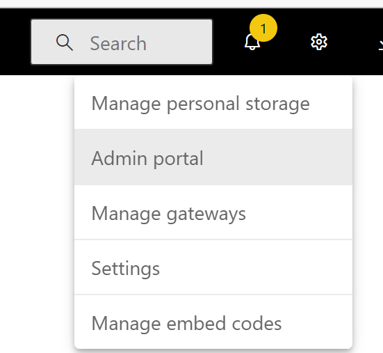

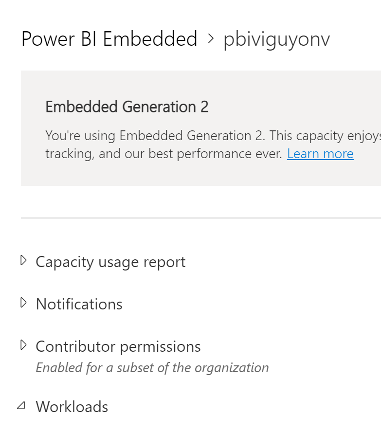

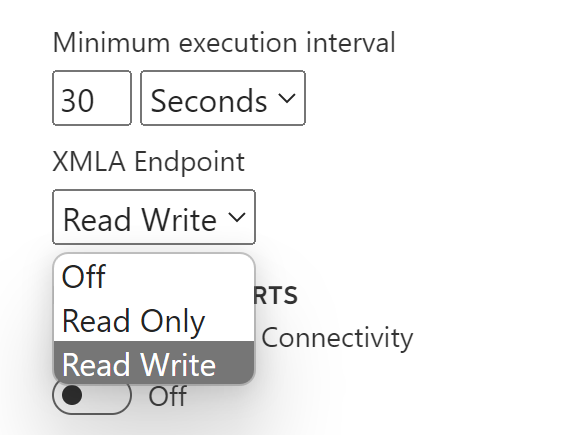

Une fois activé, on retrouve au niveau des workspaces et des datasets les adresses permettant d'utiliser le endpoint XMLA. Pour éviter toute mauvaise surprise, il est bon d'éviter les caractères spéciaux dans les noms des espaces de travail et des datasets.

Au niveau **workspace** :

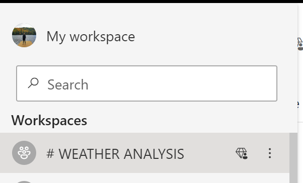


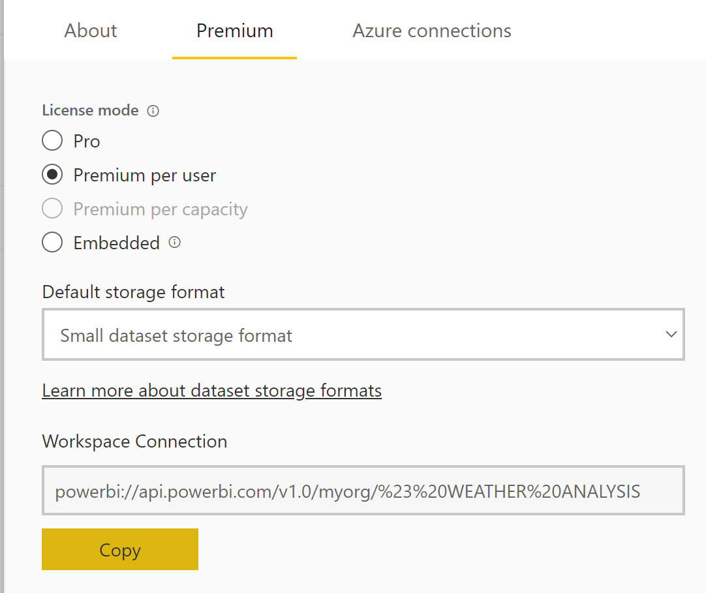

Au niveau **dataset** :

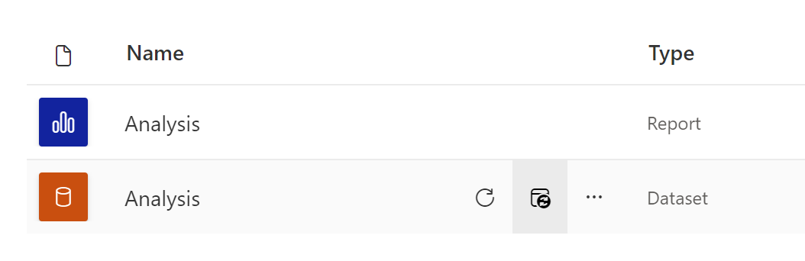

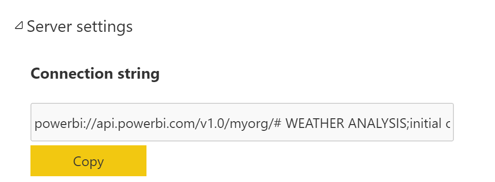

## Déploiement

Une fois mis en place, il est possible d'envoyer a cette adresse un ensemble de commandes pour mettre à jour le dataset. Ici, on voudra, après un déploiement au sein d'un pipeline par exemple, exécuter une mise à jour des métadonnées, plutôt qu'un rafraîchissement full :

Dans notre espace de travail de production, on observe le rapport suivant avant notre modification sur le modèle existant :

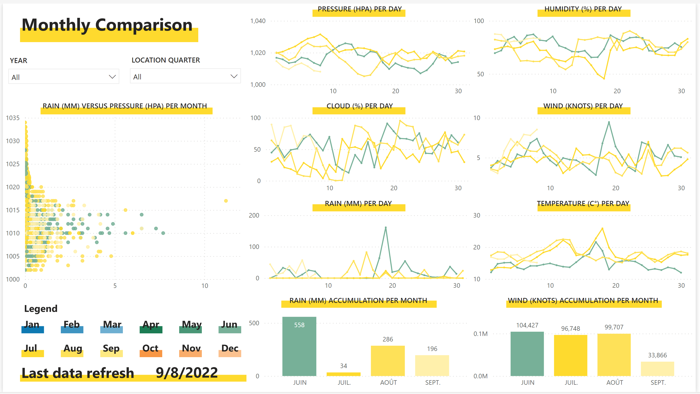

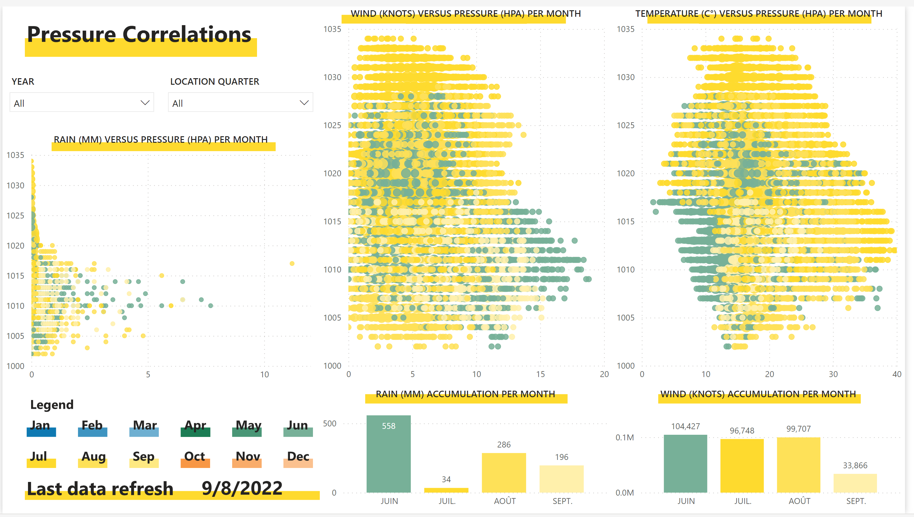

Une fois la modification déployée, je pousse mon déploiement en production, et les visuels concernés par mes mises à jours sont KO :

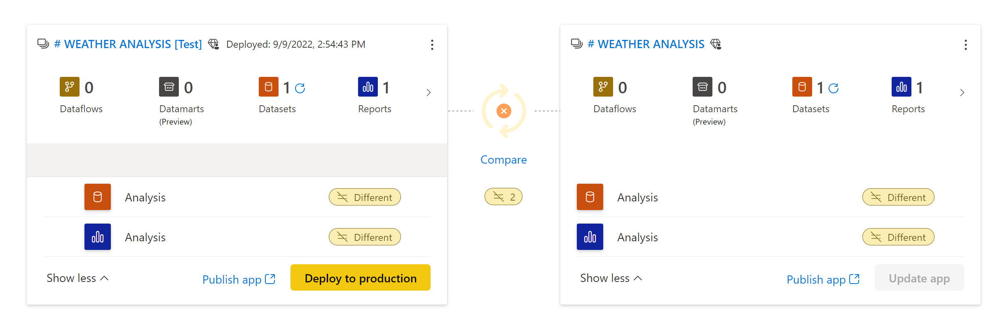

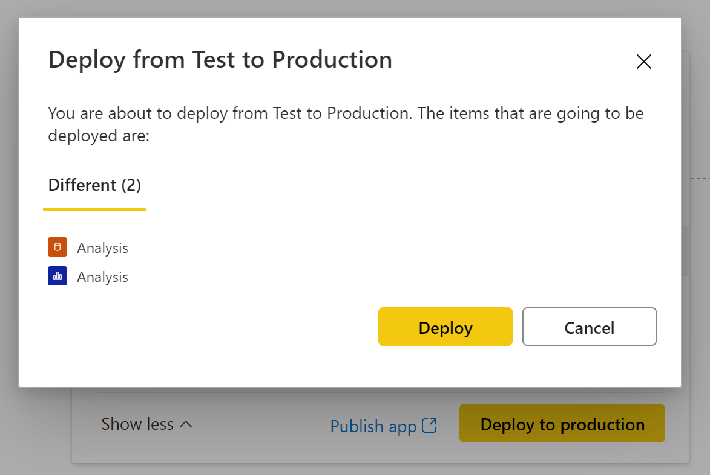

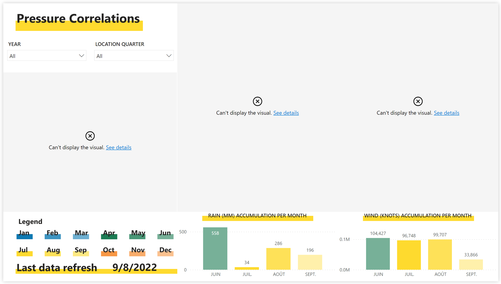

Plutôt que de rafraîchir mon dataset via l'interface, et de devoir attendre que toutes mes données soient rappatriées pour que les relations soient enfin recalculées, il est possible d'envoyer seulement une demande de rafraîchissement du modèle, sans attendre la récupération des données, et ainsi éviter la frustration des utilisateurs finaux. Pour cela :

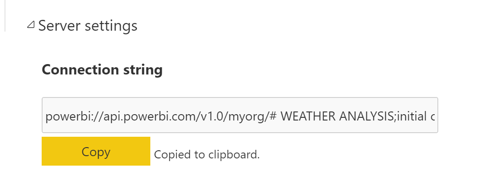

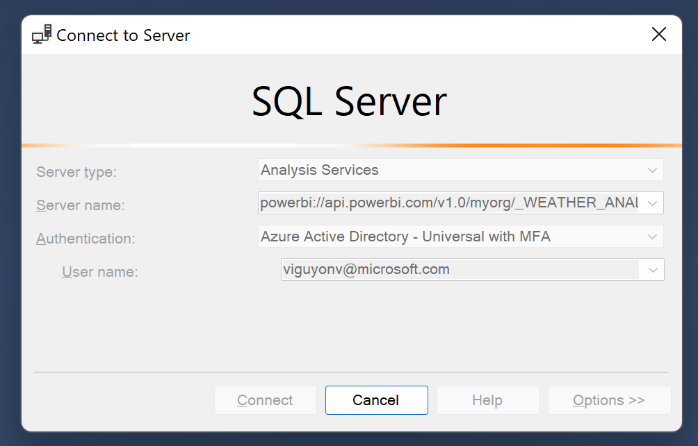

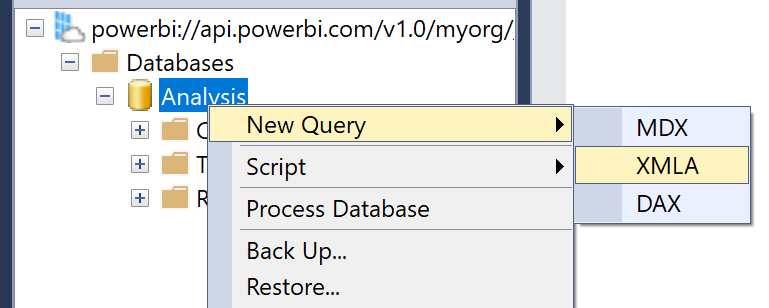

```json
{
  "refresh": {
    "type": "calculate",
    "objects": [
      {
        "database": "Analysis"
      }
    ]
  }
}
```

L'exécution de cette commande aura duré 6 secondes. Une fois exécutée, le dashboard est à nouveau disponible :

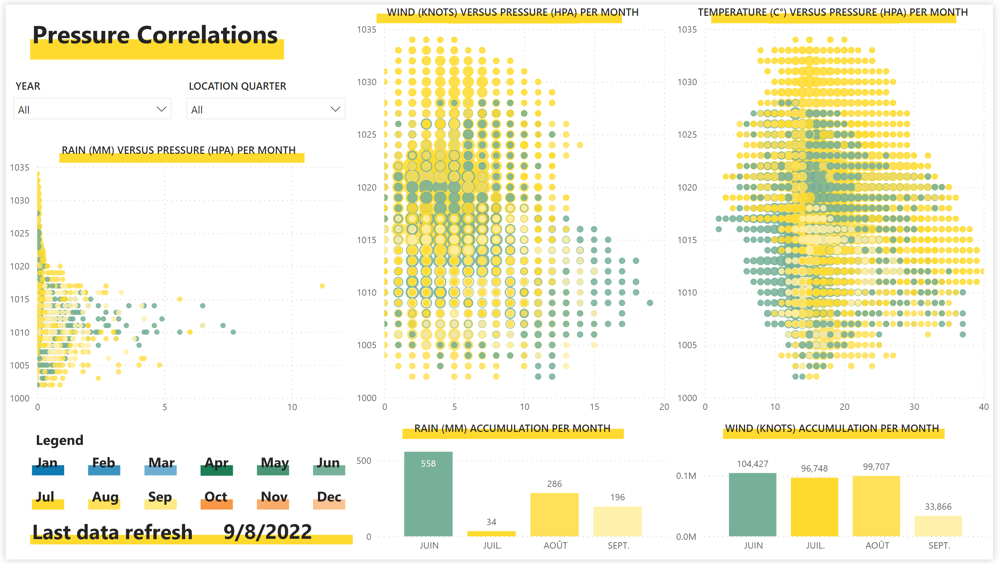
