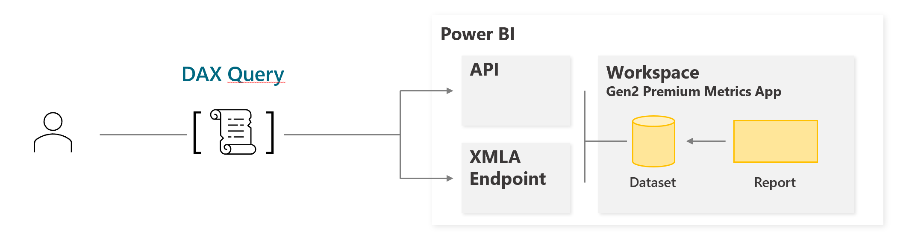

Depuis l'arrivée de la nouvelle génération de capacités Power BI, il est récurrent d'entendre que leur suivi et la compréhension de leur fonctionnement est compliqué. L'application pour le suivi des métriques propose quelques visuels permettant un suivi global, qui peut plaire ou non (je n'aborderai pas ce sujet dans cet article), mais propose aussi un modèle de données avec un ensemble de mesures et d'informations agrégées.

Il est difficile de réussir à réaliser d'autres visuels sans récupérer les données contenues dans ce rapport, du fait de la complexité du modèle développé : toutes les tables ne sont pas connectées, et certaines intéressantes sont cachées. De plus, l'application ne propose que 15 jours d'historique pour la plupart des mesures. Pour me faciliter la tâche, je vais alors récupérer uniquement les informations qui m'intéresse et les enregistrer. **En enregistrant ces données, il sera aussi possible de les historiser.**

Le but de cet article est de proposer plusieurs manières de se connecter directement aux données de l'application Premium Capacity Utilization Metrics, pour en analyser le comportement. Bien sûr, ces méthodes s'appliquent au delà de ce dataset, et peuvent être **appliquées à n'importe quel dataset Power BI**.

## Utililisation du endpoint XMLA

Pour récupérer les données contenues dans un dataset, nous allons utiliser le **langage DAX** contre un dataset déjà déployé sur le service Power BI, et notamment son **point de terminaison (endpoint) XMLA** : ce point de terminaison étend l'utilisation de Power BI au-delà d'un simple Dataset utilisable via Power BI Desktop, en élargissant le champs des possibles, tant bien **en lecture** : requêtage et suivi via SSMS, Tabular Editor, DAX Studio ...), **qu'en écriture**, s'il est activé : refresh par table, par partition, publication de modifications partielles via ALM Toolkit. En bref, il permet de passer d'un rapport Power BI à un modèle Analytique plus avancée.

Pour s'en servir : Il faut récupérer la valeur de ce endpoint. En passant par l'interface, dans l'espace de travail créé par l'app, dans les paramètres du dataset, on retrouve la chaîne de connexion. C'est le **point de terminaison XMLA** :

Documentation : [Connectivité et gestion des jeux de données avec le point de terminaison XMLA dans Power BI](https://docs.microsoft.com/fr-fr/power-bi/enterprise/service-premium-connect-tools)

## Requêtage et sortie de données via DAX Studio

Cette chaîne de connexion peut être utilisée via plusieurs outils, mais dans notre cas nous allons nous y connecter via DAX Studio : [DAX Studio - The ultimate client tool for working with DAX queries](https://daxstudio.org/).

Pour se connecter**\***, il faut copier la valeur du endpoint XMLA copiée dans la partie "Tabular Server". Une fois connecté, la liste des tables apparait sur la gauche :

(**\***) Notes : Il est possible que la connexion déclenche un pop-up de connexion à l'AD. L'utilisateur renseigné ici doit avoir les droits nécessaires sur le dataset.

De plus, il est possible qu'une erreur apparaisse du fait des caractères spéciaux contenus dans le nom du workspace. Il faudra alors changer le nom du workspace pour quelque chose de plus simple (sans la date et l'heure, par exemple).

### Analyser les pics de consommation

Le but est alors d'utiliser ce point de terminaison de manière exploratoire dans un premier temps, pour identifier les requêtes les plus pertinentes pour vos recherches. Il est toutefois conseillé de limiter le périmètre de recherche (soit en temps, soit en nombre d'artifacts) pour obtenir des résultats rapides.

Une fois connecté, il est possible d'utiliser le modèle pour en extraire les données. En modifiant la sortie vers un fichier, par exemple, nous pouvons analyser plus en détail la répartition exacte, par bloc de 30 secondes, de la CPU utilisé en background vs interactive, de la capacité sur une journée en particulier :

Une fois les données enregistrées localement, il est possible de les lire facilement via Power BI comme csv. Via un Import simple, on peut déjà dresser un graph permettant de tracer l'usage de la capacité. Il est ainsi possible de remarquer les **périodes** ou la capacité est **surutilisée**, et même le **déclenchement de l'autoscale** s'il est en place :

Ici on peut vérifier la charge CPU effectuée entre 08:00 et 09:00. Sur cette capacité, l'autoscale est activé, et on remarque que **l'usage CPU réel** (ligne bleu clair) **dépasse la capacité maximale de la capacité** (ligne bleu foncé) : **l'autoscale** de la capacité est alors **déclenché** à **deux reprises** (limite de capacité de calcul augmentée proportionnellement).

Pour aller plus loin, imaginons un autre cas **sans autoscale**. Ici, un pic est identifié entre 08:50 et 09:00. Grâce à la requête ci-dessous, je suis capable d'identifier l'artifact (dataset, dataflow, paginated report ...) en question : nous allons alors étudier ce qui est à l'origine de ces pics en analysant par artifact la consommation de CPU pendant la période donnée :

Une rapide recherche dans la table Artifacts me permet alors d'identifier son nom, et le Workspace dans lequel il est contenu. Une fois le Workspace identifié, il est alors simple de contacter son administrateur pour prendre une **décision** : **mise en quarantaine hors de la capacité, aide du collaborateur à l'optimisation de son rapport** ...) et ainsi améliorer l'usage de la capacité :

### Analyser la consommation CPU par types de requêtes :

Evidemment, la **consommation** de CPU est **proportionnelle** à la **qualité des développements**, à la **quantité de données** étudiées, mais aussi au **nombre de requêtes** effectuées et au **nombre d'utilisateurs**. Il est possible aussi d'identifier pour un artifact donné sa consommation par heure, selon les opérations réalisées : ici, on peut noter l'évolution de la consommation CPU par type d'opération (dataset refresh ou query) et le nombre d'utilisateurs distincts pour une période donnée :

On peut aussi envisager le monitoring d'un **test de montée en charge** : il est facile de voir quel est l'impact direct d'une action sur un dataset, par tranche horaire et par type d'actions.

## Aller plus loin : Automatiser le stockage des données grâce aux appels API ExecuteQueries

Nous avons vu qu'il était possible d'exécuter du DAX directement sur un modèle Power BI, de manière ponctuelle via DAX Studio. Malheureusement, cette méthode requiert la connexion au modèle Il est aussi possible de le faire via API REST, et donc de l'automatiser. Nous utiliserons le langage Powershell pour automatiser l'appel des instructions Power BI, et notamment via l'API suivante : [Datasets - Execute Queries - REST API (Power BI Power BI REST APIs)](https://docs.microsoft.com/en-us/rest/api/power-bi/datasets/execute-queries).

### Via PostMan (en admenttant que l'authentification soit déjà faite) :

### **Via Powershell :**

En intégrant ce code au sein d'une routine (ETL, Ordonnanceur, Automation account ...), il est alors envisageable de stocker les résultats et de les historiser, pour augmenter la période de rétention des données. En voici un exemple de script :
