## Introduction

Power BI permet aux utilisateurs de simplifier le rafraîchissement des datasets par le biais de partitions de données, pour éviter de parcourir un ensemble de données trop important lors de la mise à jour d'un dataset. Ces partitions servent à la fois de réduire leur durée de mise à jour, mais aussi pour réduire la pression subie par la source de données par des requêtes trop gourmandes. Ces différentes partitions peuvent être mises en place par deux moyens :

-   Le développement maison des partitions, et leur gestion par le biais des XMLA endpoint, qui peut s'avérer complexes pour un usage simple de Power BI,
-   La mise en place de **[l'actualisation incrémentielle](https://learn.microsoft.com/en-us/power-bi/connect-data/incremental-refresh-overview)**. Ce rafraîchissement permet alors de ne récupérer que les données les plus récentes, si la source de données le permet, et si le paramétrage est correctement fait.

Pour le savoir, il faut que les **données lues** soient seulement celle qui seront **insérée** dans la partition des **données les plus fraîches**. Autrement, le rafraîchissement sera tout aussi gourmand en ressources sur le serveur, et potentiellement en temps.

Notre objectif sera alors de vérifier que les données envoyées au service Power BI sont celles que l'on attend, et non le dataset entier.

## Prérequis

Dans notre cas, nous utiliserons Synapse Serverless en source, et pour en faire le monitoring, nous utiliserons la [bibliothèque qpi](https://github.com/JocaPC/qpi/blob/master/README.md#installation), développée par Jovan Popovic, et suivrons alors les requêtes exécutées et leur coût en ressource.

Aussi, nous aurons mis en place l'actualisation incrémentielle sur la table de fait qui nous intéresse, grâce aux deux paramètres RangeStart & RangeEnd, puis aurons activé le rafraîchissement comme suit :

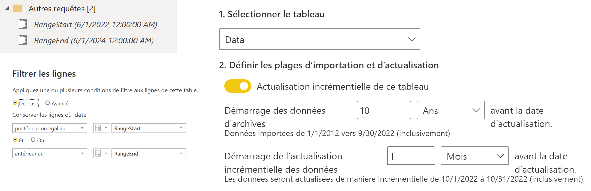

## Query Folding & Incremental Refresh

Prenons par exemple, cette requête SQL avancée dans Power Query :

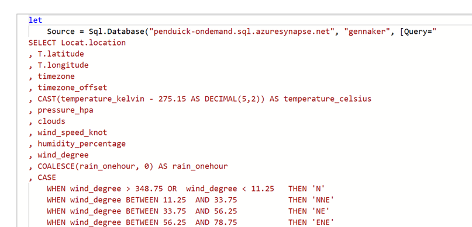

Lorsque l'on vérifie si le Query Folding s'applique, il est grisé. Aussi, l'actualisation incrémentielle nous met en garde, car il n'est pas capable de vérifier que la requête soit *foldable*.

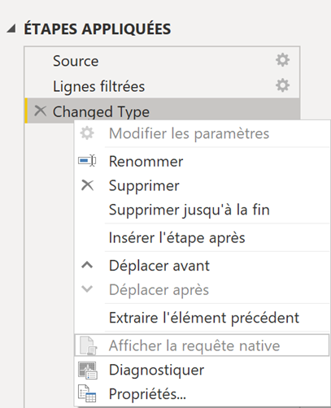

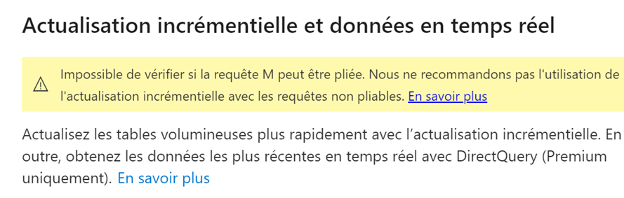

Une fois publié sur le service, et une fois rafraîchi, on peut, via l'exploration du XMLA endpoint, constater que seule la dernière partition a été mise à jour : les dates de rafraîchissements sont décalées :

-   Le premier chargement complet initie les partitions hors de la période de l'actualisation incrémentielle
-   Les chargements suivants complètent le dataset avec les données comprises dans le paramétrage de l'actualisation définie.

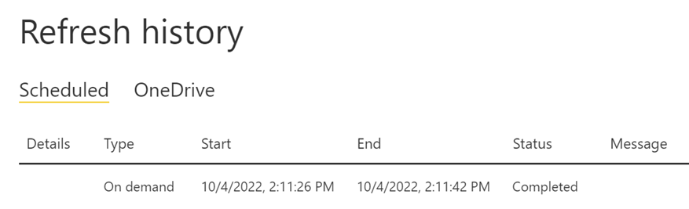

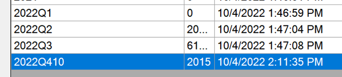

On peut noter ici que les données du dernier mois, comme prévu, sont mise à jour. Mais est-ce que les données ont été filtrées à la source comme prévu, ou est-ce que **toute la table a été scannée** ?

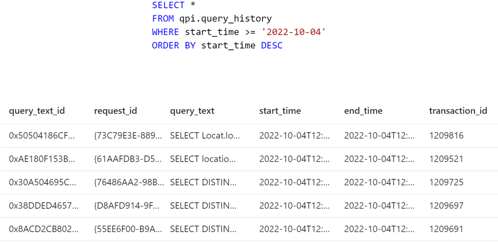

*Le détail des requêtes exécutées par Power BI sur la base de données*

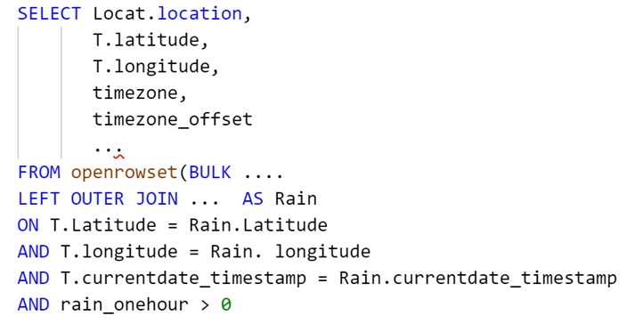

*Le détail de la requête, sans le filtre sur les dates*

On remarque que la requête SQL exécutée **n'a pas filtré les données** : aucun filtre n'a été ajouté en clause *WHERE*. L'ensemble de la table (ici des fichiers via serverless) a été lue par le service Power BI. Notre refresh incrémentiel ne marche qu'à moitié : Seulement les dernières données sont mises à jour, mais les ressources utilisées par le serveur sont les mêmes que lorsque notre dataset est rafraîchis entièrement puisque toute la table est lue.

L'idée est alors de reprendre notre requête, et de la rendre *foldable* : en la **sauvegardant** le code dans **une vue** au niveau de la base, on pourra cette fois ci l'appeler simplement dans le code M :

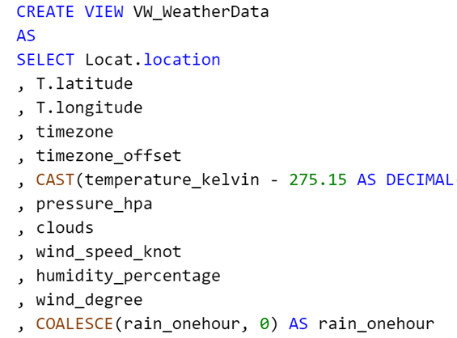

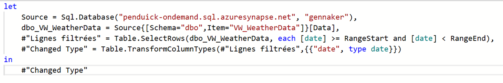

On peut alors noter cette fois-ci que la requête native est disponible, aussi, l'avertissement a disparu :

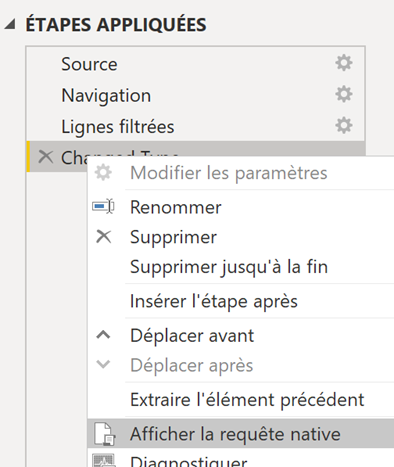

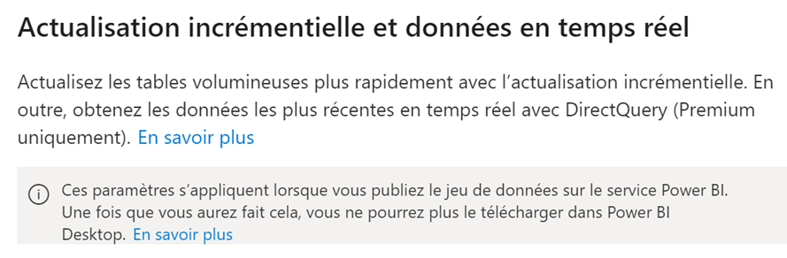

Une fois republié sur le service, notre dataset ne rafraîchis que les données de la dernière partition, comme prévu :

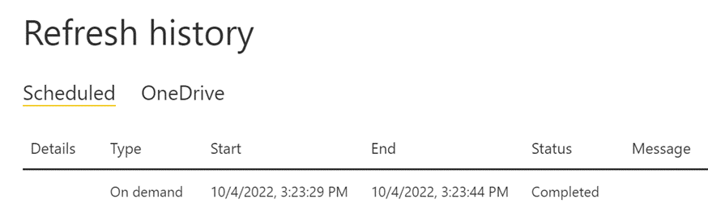

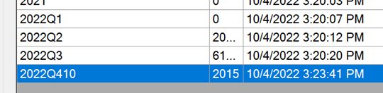

Et lorsque l'on vérifie au niveau du serveur, la clause *WHERE* est bien rajoutée au code de la vue. L'objectif de réduire les ressources utilisées par le service est alors atteint.

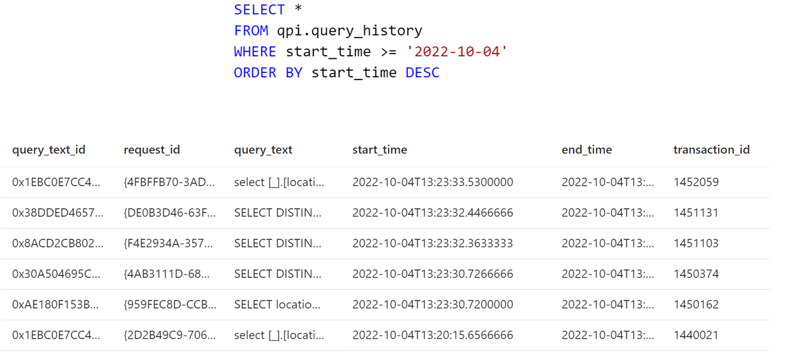

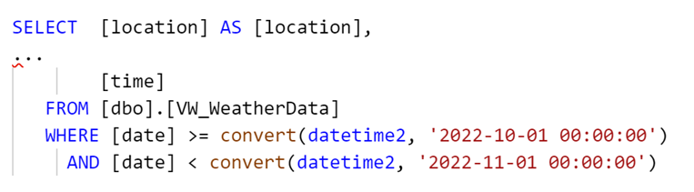

## Conclusion

Il est important de considérer l'avertissement fait par le client lourd lors de la mise en place de l'actualisation incrémentielle pour vérifier que la requête envoyée au service est filtrée. Ce n'est pas vrai dans 100% des cas, et consulter le journal de transaction de la source de données permet alors de s'en assurer.
