## Introduction

Microsoft Fabric propose en accès anticipé un ensemble de fonctionnalités divisées en plusieurs métiers : Data Engineering, Data Science, Real-Time Analytics, Data Warehouse, Power BI ... Autant de profils que l'on veut centraliser au sein d'une plateforme unique, dédiée à l'analytique. Ces différents profils, appelés personas, offrent différentes fonctionnalités. Notre objectif aujourd'hui est de découvrir celui appelé **Real-Time Analytics,** ou encore Analyse de données en temps-réel.

On parle d'a**nalyse en temps** réel lorsque l'on veut **porter un regard** puis prendre décision à partir de données produites dans les derniers instants. Il s'oppose au traitement de données en batch, qui lui vise à charger un ensemble de données traitées par blocs, sur une période passée. Ici, on traite et affiche l'information dans le même temps où on la reçoit.

Aussi, on parlera de temps réel ou de *quasi-temps réel* lorsque les données sont traitées et affichées en quelques secondes, ou bien dans les minutes qui suivent leur extraction.

On retrouve ces analyses autour de cas d'usage comme la réduction des risques dans les chaînes de traitements pour en détecter les anomalies et apporter de la maintenance prédictive, proposer des

Il existe deux types d'analyses de données en temps réel :

-   Analyse en temps réel **syncrhone** : elle se produit de manière régulière et périodique, où chaque étape est déclenchée après la précédente. Elle est utilisée dans le cas où l'on a des délais constants lors de l'analyse de nos évènements. Par exemple, lors de l'analyse de la température d'un système informatique, du contrôle du trafic aérien.
-   Analyse en temps réel **asyncrhone** : Ici, les données sont traitées sans attendre le traitement de la réponse précédente. On pourrait s'inspirer du suivi d'anomalies dans une chaîne de production, ou un évènement surgit lorsqu'une anomalie est détectée, ou bien sur l'analyse en temps réel d'un flux de réseau social. Du fait de l'irrégularité de la génération des évènements et de leurs ressources consommées, cette méthode permettra de les envoyer de manière indépendantes.

## Démonstration dans Microsoft Fabric

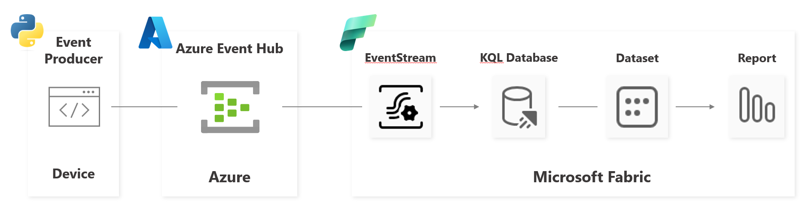

L'objectif est d'afficher au sein d'un rapport Power BI des données envoyées en temps réel par une application ou un service. Pour y arriver, nous allons nous reposer en majeure partie sur les services intégrés à Microsoft Fabric :

-   On utilisera *Azure Event Hubs* pour ingérer en temps réel les données.
-   Depuis cette zone de rétention, nous lirons via **Event Stream** les données : cet élément à pour but de proposer une interface No-code pour définir une source et une destination pour manipuler ces données en streaming. Cette plateforme a pour but d'abstraire et de simplifier l'usage d'Azure Stream Analytics.
-   Une fois ces évènements dirigés, nous les stockerons dans une base de données appelée **KQL Database** orientée et optimisée pour l'analyse des "Time Series", c'est à dire les analyses temporelles. Ici, l'idée est de proposer on demand le service Azure Data Explorer, qui repose sur un langage similaire au SQL, appelé Kusto Query Langage.
-   Enfin, pour lire les données stockées dans cette base, on utilisera le couple classique **Dataset**/**Rapport**.

##### Création de l'Event Hub

Pour permettre à nos différents messages d'être capté dans notre environnement, nous allons avoir besoin de deux éléments permettant de supporter notre besoin :

-   Une ressource Azure Event Hubs (Event Hub Namespace, ou cluster), qui regroupe un ensemble de plusieurs hubs avec une configuration similaire, ici nous voudrons utiliser le pricing tier **standard**.

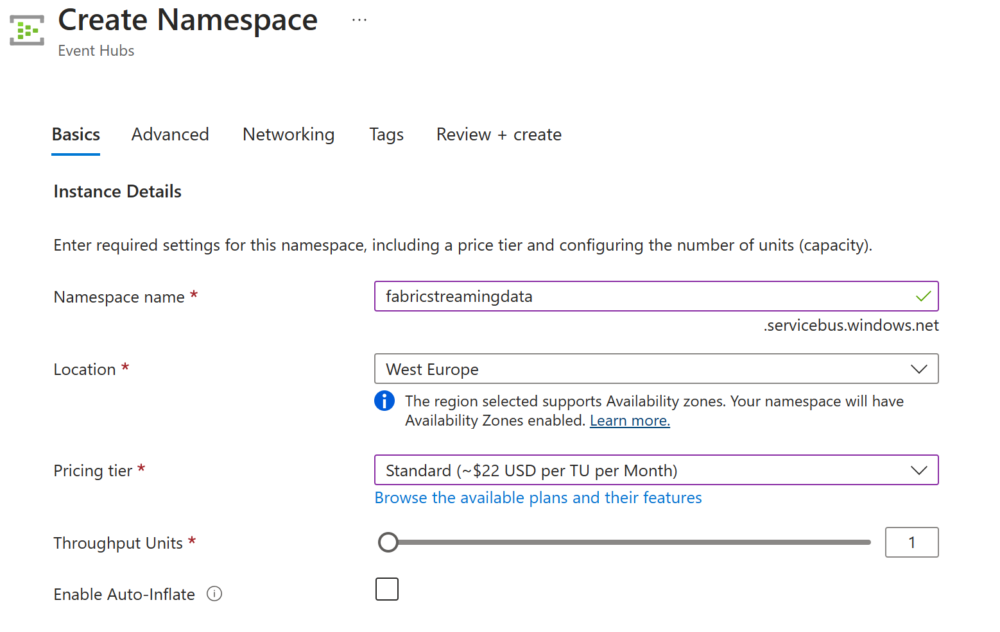

-   Un Event Hub (Event Hub Instance), permettant d'être l'instance de capture des données, avec une période de rétention précise :

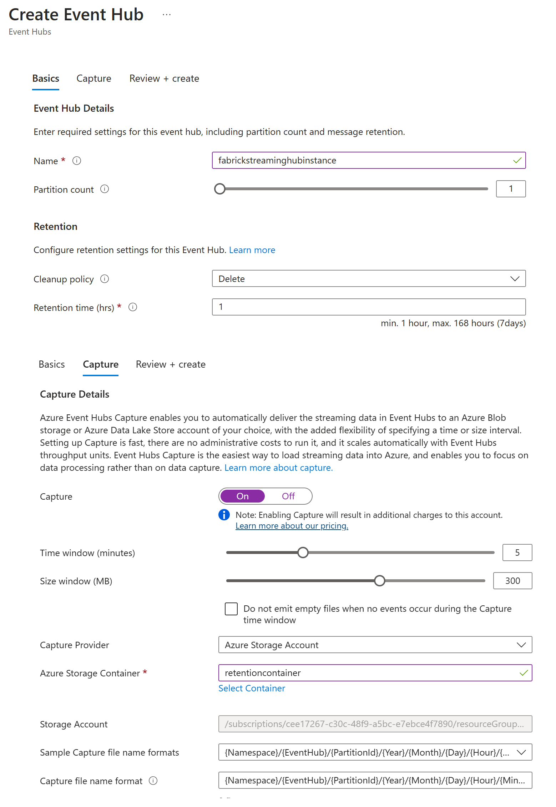

Une fois le hub créé, il est alors possible de l'associer à une activité, et donc d'y envoyer un ensemble d'évènements. Pour y arriver, on voudra noter la connection string & la clé permettant d'atteindre notre Event Hub :

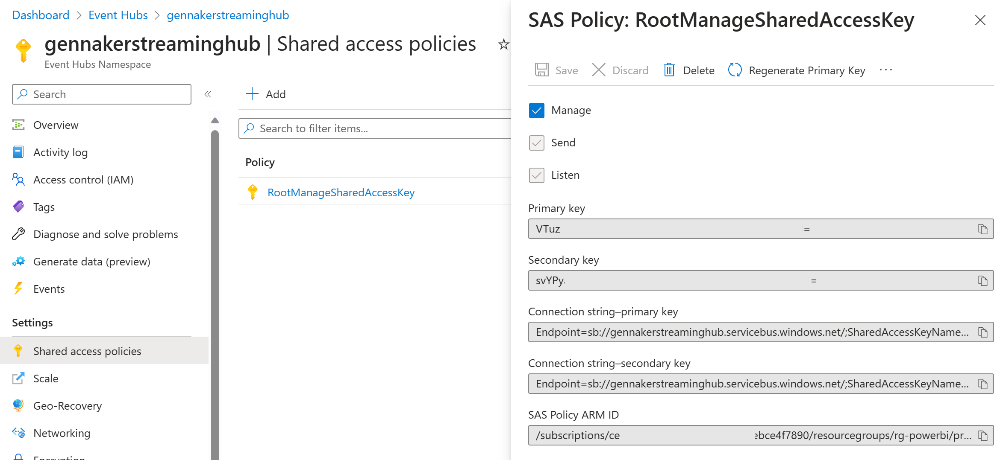

##### Génération des évènements

Sur une machine, j'exécute le code suivant permettant de restituer en **Python**, la quantité de RAM & de CPU (les métriques choisies ici arbitrairement pour notre démonstration) utilisée à l'instant T, et de l'envoyer à notre *Event Hub*.

Les éléments dont je vais avoir besoin sont :

-   La librairie *azure.eventHub* à télécharcher via *pip*,
-   La chaîne de connexion et le nom de l'event hub dédié à l'objet envoyé. Attention, ce n'est pas le nom du *namespace*, mas bien de l'*instance*.

```python
import json
import psutil
from datetime import datetime
from azure.eventhub import EventHubProducerClient, EventData

producer = EventHubProducerClient.from_connection_string(
    conn_str="Endpoint=.....",
    eventhub_name="....."
)

try:
    while True:
        event_data_batch = producer.create_batch()

        streamingData = {'timestamp':  str(datetime.now()) `
                        ,'cpu_usage':  str(psutil.cpu_percent(4)) `
                        ,'ram_used' :  str(psutil.virtual_memory()[2]) }

        s = json.dumps(streamingData)
        event_data_batch.add(EventData(s))
        producer.send_batch(event_data_batch)
        print(s)

except KeyboardInterrupt:
    print("Stop")
    producer.close()
```

##### Création de notre destination (KQL Database) & de l'EventStream

Dans notre espace de travail, on retrouve plusieurs personas : ils simplifient la vue des différents outils mis à disposition au sein de notre capacité, et on retrouve notamment un persona **Real-Time Analytics**. C'est ici qu'on pourra créer notre base de donnée KQL & notre Event Stream :

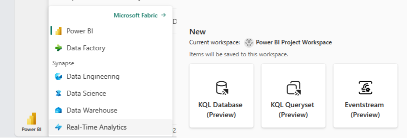

Une fois la KQL Database et l'event stream créés, il faudra paramétrer une source et une destination. Nous choisirons pour destination une base de données Kusto (KQL Database) et pour source l'event hub que nous avons créé.

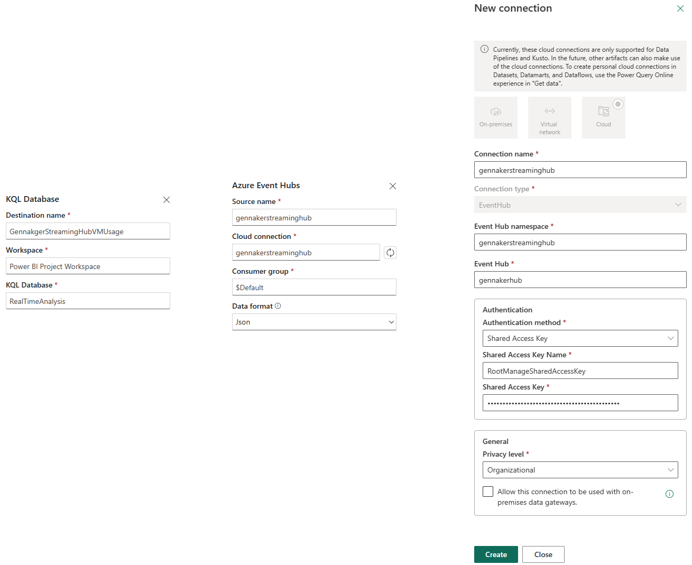

Pour terminer le flux, il faut définir une **table** au sein de notre destination :

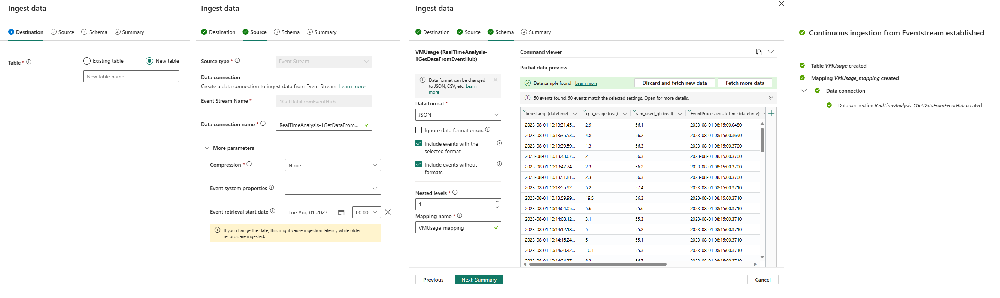

On obtient alors un flux composé d'une source *Event Hub*, d'un *Event Stream* central qui va envoyer nos données à notre base au sein du service *Microsoft Fabric*.

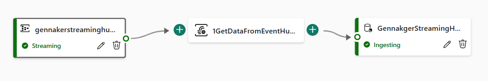

Une fois le flux déployé et mis en place, on peut alors commencer à consulter nos données dans la base :

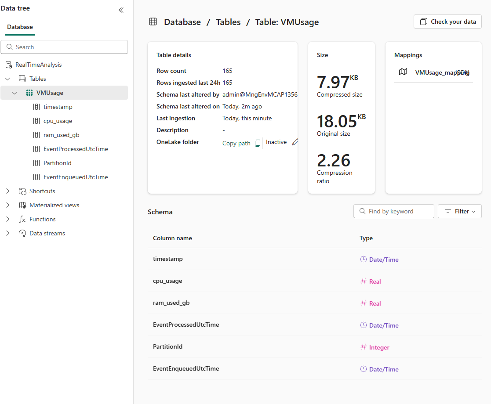

Pour enfin créer un rapport Power BI :

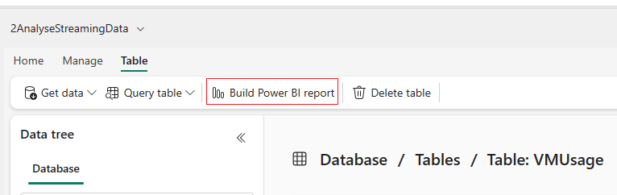

Une fois les indicateurs mis en place, pour obtenir un rafraîchissement en temps réel automatique, il faut paramétrer la page dans l'onglet de Visualisation :

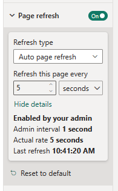

Attention à respecter l'intervale de rafraîchissement minimal défini par l'administrateur de la capacité (par défaut, 5 minutes) :

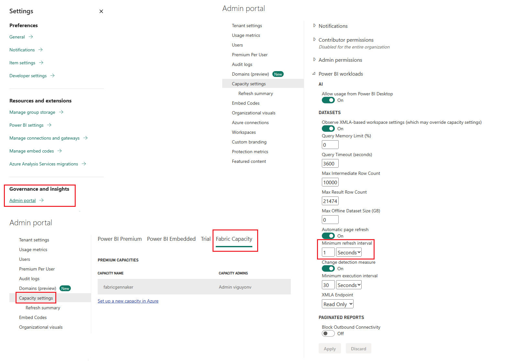

Une fois déployé, on peut remarquer que l'EventStream enverra en continu les données générées par le script Python sur ma machine. On obtient alors un tableau de bord mis à jour automatiquement.

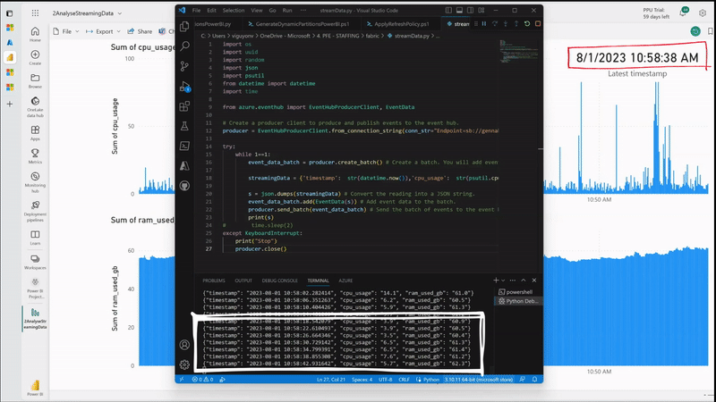

Voilà en quelques étapes la mise en place d'un tableau de bord mis à jour automatiquement, à partir de données envoyées en temps réel depuis un service ou une application.

On trouvera plus de détails et de contenus pour démarrer au sein de ce github, permettant de prendre en main le SDK Python pour event hub :

https://github.com/Azure/azure-sdk-for-python/tree/main/sdk/eventhub/azure-eventhub
