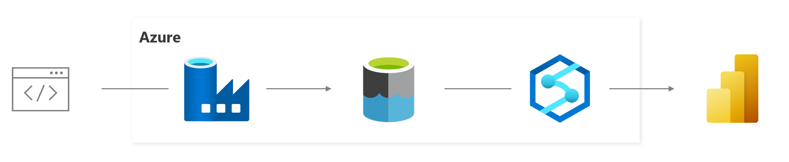
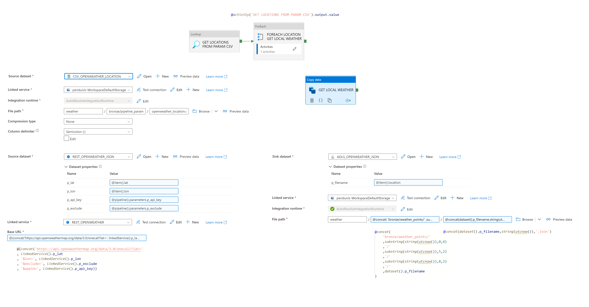
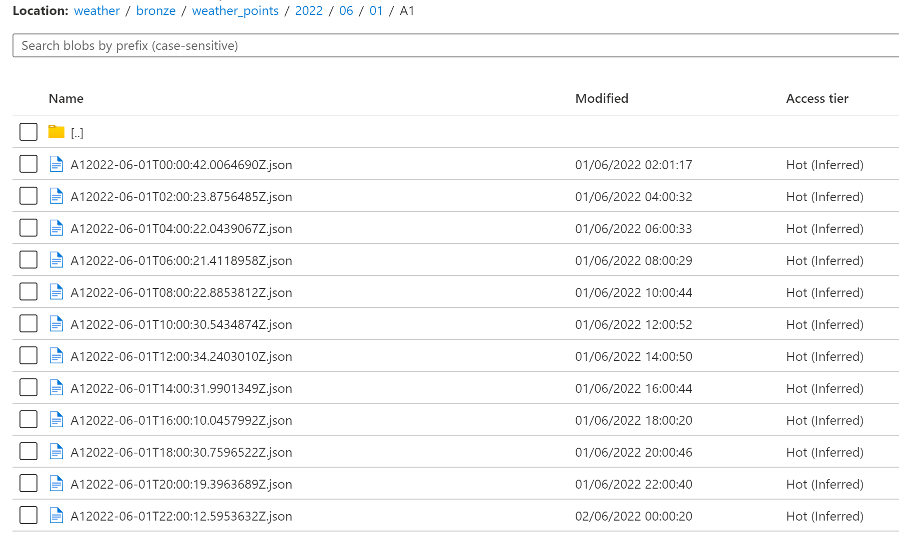
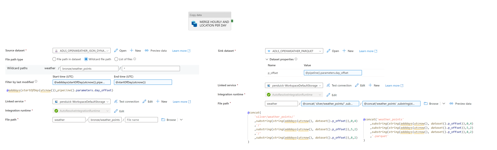
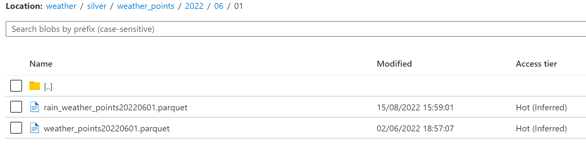
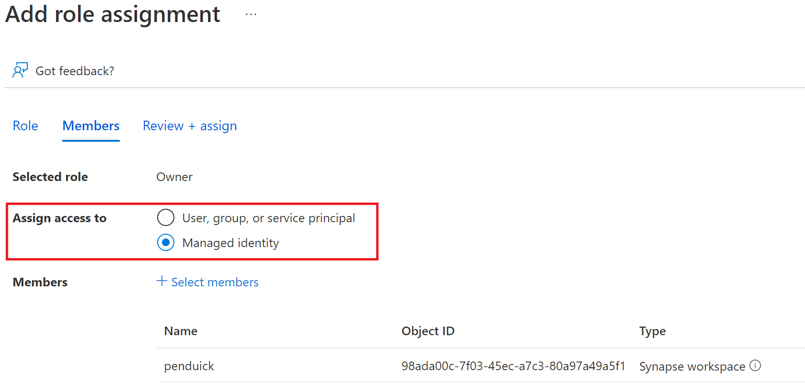
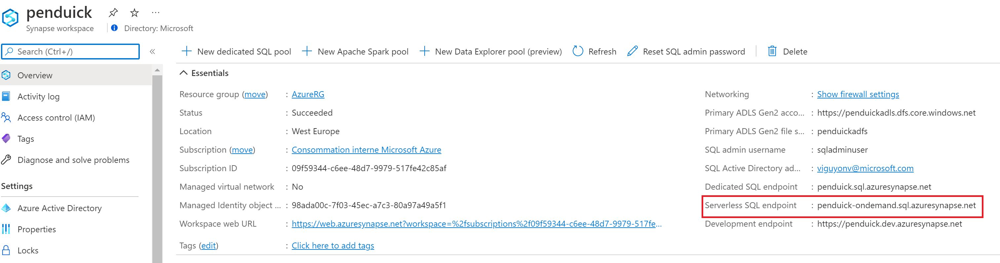
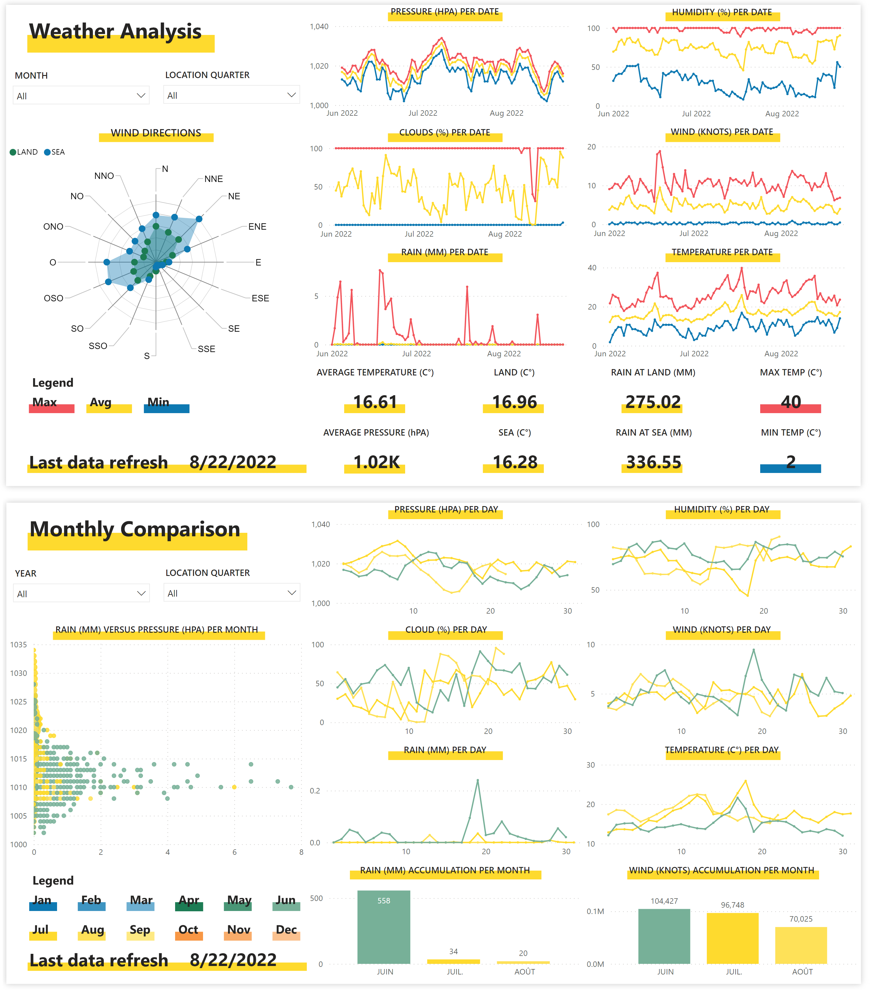

## Présentation générale de l'architecture

Le but de cette architecture est de démontrer la simplicité du déploiement et de la mise en place simple d'un environnement analytique grâce à l'utilisation de **Synapse**. En quelques instants, il sera possible d'obtenir un modèle analytique historisé et d'en analyser les informations de manière performante.



Nous allons utiliser une **API** pour **générer de la données** de manière périodique. Pour cela, nous utiliserons [Open Weather](https://openweathermap.org/) pour analyser en plusieurs points géographique les informations météo au fil du temps. Cette API renvoie uniquement les données d'un point géographique à un instant T : pour unifier ces données, nous chargerons les données via un **pipeline Synapse** au sein d'un **Data Lake** dans **ADLS Gen2**. Stocké de manière brute dans une **première couche de données**, nous utiliserons ensuite **Synapse Serverless** dans un pipeline pour interroger ces données, et les structurer dans **un second niveau de données**, optimisé pour le stockage et la performance. Enfin, une requête SQL Serveless sur Synapse sera envoyé à **Power BI** pour consolider le modèle analytique.

## Connexion de l'API au sein d'un pipeline dans Synapse

Dans notre studio Synapse, nous utiliserons une activité de copy au sein d'un pipeline, pour manipuler notre API. Pour la rendre un petit peu plus automatique et enrichir nos données, nous allons utiliser un fichier technique listant l'ensemble des points géographiques étudiés. Cette liste, sera ensuite utilisée dans une boucle : à chaque tour, l'API sera interrogée, et un fichier sera généré dans le Lake :



Nous planifierons ce flux toutes les deux heures, à l'aide d'un trigger. On obtiendra alors l'arborescence suivante dans le Lake :



## Consolidation et structuration des données au sein du Data Lake

Au sein des pipelines Synapse, il est possible de consolider les fichiers JSON générés préalablement, pour en lire les données et les consolider dans la partie supérieure du Data Lake. Pour cela on utilisera une activité de Copy dans un pipeline pour lire les données le plus récentes, et les consolider au sein d'un même fichier au format Parquet. Ces fichiers sont consolidés par jour. Voici le flux :



Une fois le flux défini, voici l'arborescence obtenue dans le lake :



L'objectif maintenant est de lire ces fichiers parquet simplement via SQL.

## Lecture des données via SQL Serverless

Pour lire les données dans Synapse via SQL Serverless, on pourra alors utiliser le langage SQL. Pour lire les fichiers .parquet à l'aide de SQL, quelques prérequis sont nécessaires :

L'autorisation pour Synapse de lire sure le Lake :



La création d'éléments au sein de l'environnement Serverless :

```sql
--Création d'une base de données
CREATE DATABASE weatherdata

--Création d'une master key, avec clé d encryption
CREATE MASTER KEY ENCRYPTION BY PASSWORD = 'Ma$terKeyEncrypti0n'

--Création d'une méthode d'authentification, basée sur les managed identities
CREATE DATABASE SCOPED CREDENTIAL PenduickADLSMSI
WITH IDENTITY = 'Managed Identity'

--Création d'une datasource externe, basée sur la méthode d'authentification créée plus haut, et qui pointe vers
CREATE EXTERNAL DATA SOURCE PenduickADLSMSIDS
WITH (
    LOCATION   = 'https://penduick.dfs.core.windows.net/weather'
   ,CREDENTIAL = PenduickADLSMSI
)
```

Une fois ces prérequis déployés, il est possible d'utiliser SQL par dessus n'importe quel fichier via l'opérateur [OPENROWSET](https://docs.microsoft.com/en-us/sql/t-sql/functions/openrowset-transact-sql?view=sql-server-ver16) :

```sql
SELECT TOP 10 *
FROM openrowset(
    BULK ('/silver/weather_points/*/*/*/weather_points*.parquet'),
    DATA_SOURCE = 'PenduickADLSMSIDS',
    FORMAT = 'PARQUET'
) AS T
```

A l'aide des différentes options de la fonction, il est alors possible de venir lire l'ensemble des fichiers d'une arborescence, au sein d'une même table, et héritant ainsi des colonnes des différents fichiers.

## Structuration des données au sein du Data Lake via

Pour se connecter en dehors du workspace Synapse, On devra utiliser le endpoint Synapse et un connecteur SQL classique. C'est ce endpoint que l'on va utiliser dans le connecteur Power BI :



## Intégration au sein de Power BI

Dans Power Query on pourra donc utiliser notre requête SQL générée plus haut et charger nos données dans notre rapport :

```sql
SELECT Locat.location
, T.latitude
, T.longitude
, timezone
, timezone_offset
, CAST(temperature_kelvin - 275.15 AS DECIMAL(5,2)) AS temperature_celsius
, pressure_hpa
, clouds
, wind_speed_knot
, humidity_percentage
, wind_degree
, COALESCE(rain_onehour, 0) AS rain_onehour
, wind_gust_knot
, DATEADD(HOUR, DATEDIFF(HOUR, 0, DATEADD(s, T.currentdate_timestamp, '1970-01-01')),0) AS [date]
, RIGHT(DATEADD(HOUR, DATEDIFF(HOUR, 0, DATEADD(s, T.currentdate_timestamp, '1970-01-01')),0),8) AS [time]
FROM openrowset(
    BULK ('/silver/weather_points/*/*/*/weather_points*.parquet'),
    DATA_SOURCE = 'PenduickADLSMSIDS',
    FORMAT = 'PARQUET'
) AS T
LEFT OUTER JOIN (
    SELECT location, lat, lon, SUBSTRING(location, 1, 1) AS X , SUBSTRING(location, 2, 1)  AS Y, location_type
    FROM openrowset(
        BULK ('bronze/pipeline_parameters/openweather_location/openweather_location.csv'),
        DATA_SOURCE = 'PenduickADLSMSIDS',
        FORMAT = 'CSV',
        FIELDTERMINATOR = ';',
        FIRSTROW = 2
    ) WITH (location NVARCHAR(2),lat FLOAT,lon FLOAT, location_type NVARCHAR(4)) AS Loc
) AS Locat
ON ROUND(T.Latitude, 4) = ROUND(Locat.lat, 4) AND ROUND(T.longitude, 4) = ROUND(Locat.lon,4)
LEFT OUTER JOIN (
    SELECT Latitude, Longitude, currentdate_timestamp, rain_onehour
    FROM openrowset(
        BULK ('/silver/weather_points/*/*/*/rain_weather_points*.parquet'),
    DATA_SOURCE = 'PenduickADLSMSIDS',
        FORMAT = 'PARQUET'
    ) AS D
) AS Rain
ON T.Latitude = Rain.Latitude
AND T.longitude = Rain. longitude
AND T.currentdate_timestamp = Rain.currentdate_timestamp
AND rain_onehour > 0
```

Une fois chargé, nous pouvons commencer à mettre en place notre modèle, et définir nos visuels. Maintenant que le rapport est terminé, nous allons le publier dans le service Power BI :



## Coût total de la solution

La solution ici repose donc sur 5 éléments détaillés ci-dessous. L'ensemble des ressource ne représente pas plus de 100$ par mois, et cela est imputé grandement par les flux de données, et par le nombre de licences Power BI. Autrement, le prix lié au stockage et la lecture via Synapse Serverless est proche du zéro :

-   l'**API** source, bien que gratuite, nous ne la compterons pas dans le coût total de la solution car cette source sera toujours différente selon les projets.

-   le **Data Lake**, qui repose sur ADLS Gen2 : Le coût imputé par un Data Lake repose sur trois axes (dans notre cas, le stockage de ces informations et leur lecture engendre un coût total de $0,02 par jour, soit $0,60 par mois) :
    -   la **taille** totale, une unité de 100 Go coûte environ $2.00
    -   l'**écriture**, par bloc de 10 000 fichiers coûte $0.0500
    -   la **lecture**, par bloc de 10 000 fichiers coûte $0.0040

-   l'environnement **Synapse SQL Serverless** : le coût relatif à SQL Serverless correspond à la quantité de données lue sur la période donnée. **2 To représentent $5,00**. Dans notre cas, la quantité lue par le rapport Power BI représente 12 Mo par jours.

-   les **pipelines** au sein de **Synapse** : le coût des pipelines est lui aussi représenté par plusieurs axes (dans notre cas, environ 30$ par mois) :

    -   le **nombre d'activités** par bloc de 1000 activités coûte $1,00 (dans notre cas, chaque jours, nous aurons environ 800 activités par jour du fait du foreach)

    -   la **puissance** utilisée (Data Integration Unit) coûte par unité et par heure $0.25
    -   le runtime Azure (l'environnement de calcul) coûte par heure $0.005

-   le service **Power BI** : la solution repose uniquement sur des éléments liés à une licence pro. Les tarifs seront donc équivalents au nombre de licences pro nécessaires pour consulter le rapport, soit moins de [10 € par utilisateurs et par mois](https://powerbi.microsoft.com/en-us/pricing/).

**Quid d'un projet à l'échelle ?** Dans un autre exemple, toujours par interrogation API, on historisera cette fois ci toutes les minutes un ensemble de JSON. La volumétrie générée par mois est **60 millions** de lignes. Le coût total représenté par la solution est d'environ $400 par mois, et ici aussi le coût est imputé largement si ce n'est dans son ensemble par les pipelines, qui sont exécutés toutes les minutes.

**Quels sont les risques de cette solution ?** Attention : ici les fichiers sont lus en serverless, et le rapport Power BI ne consomme des données qu'une fois par refresh. Le serveur n'est pas allumé constamment pour répondre à des besoins analytiques ad hoc. Le rapport n'est donc pas lié aux données directement en Direct Query : les coûts de lectures sont donc maîtrisés, du fait du nombre de refresh connus et limités côté Power BI. **Un risque existe** si l'accès au serveur SQL Synapse On Demand est ouvert à tous, et/ou que les rapports générés par dessus sont en Direct Query : nous aurions alors un nombre inconnu de requêtes envoyées par un nombre inconnu d'utilisateurs ; les coûts seraient alors proportionnels à cette demande, et seraient difficilement prévisibles.
